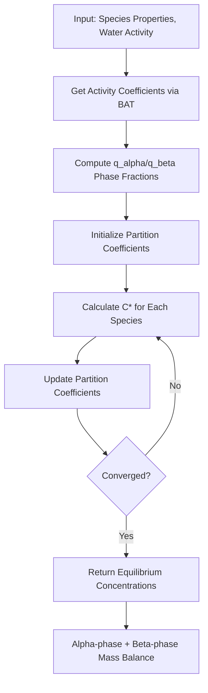

# Equilibria Theory

A bulk partitioning calculation finds how much material occupies the vapor and each liquid at a given temperature. Its water balance depends on whether the surroundings impose humidity or supply a finite water inventory. In kinetic aerosol simulations the current particle masses determine activities, and vapor transport advances those masses in time. The standalone result can provide a long-time reference when temperature, curvature, species inventories and reservoir conditions agree. [Particle-phase activity](activity-theory.md)

## Introduction

When organic vapors encounter aerosol particles, they can condense onto the particle phase. The extent of this partitioning depends on:

- **Saturation vapor pressure**: How volatile the compound is
- **Activity in the particle phase**: Non-ideal mixing effects
- **Available condensed mass**: More organic mass means more partitioning

Understanding these equilibria is essential for predicting secondary organic aerosol (SOA) formation and properties.

## Liquid-Vapor Partitioning Fundamentals

At thermodynamic equilibrium, the partial pressure of each species in the gas phase equals its equilibrium vapor pressure above a flat liquid surface:

$$p_i = a_i \cdot p_i^{\circ}$$

where:

- $p_i$ is the partial pressure of species $i$ in the gas phase
- $a_i$ is the activity of species $i$ in the condensed phase
- $p_i^{\circ}$ is the pure component saturation vapor pressure

This relationship links gas-phase concentrations to particle-phase composition through the activity, which accounts for non-ideal mixing.

## Saturation Concentration (C*)

The **saturation concentration** ($C^*$) is a convenient measure of volatility that directly relates to partitioning behavior. It represents the equilibrium vapor concentration when the condensed phase is present.

### Dry vs. Wet C*

The **dry saturation concentration** ($C^*_{dry}$) assumes an ideal, single-component system:

$$C^*_{dry} = \frac{p^{\circ} \cdot M}{R \cdot T}$$

where $M$ is the molecular weight, $R$ is the gas constant, and $T$ is temperature.

For a single flat liquid phase and ideal vapor, the equilibrium gas mass concentration is $C_{g,j}=a_j C^*_{j,\mathrm{dry}}$. Evaluating the activity requires the liquid composition. In a partitioning solve that composition itself depends on the amount condensed.

### Volatility Basis Set

The **Volatility Basis Set (VBS)** framework bins organic compounds by their $C^*$ values, typically using logarithmic bins (e.g., 0.01, 0.1, 1, 10, 100 $\mu$g/m$^3$). This simplifies the treatment of complex organic mixtures by grouping compounds with similar volatility.

| $C^*$ Range ($\mu$g/m$^3$) | Classification |
|---------------------------|----------------|
| < 0.01 | Extremely Low Volatility (ELVOC) |
| 0.01 - 1 | Low Volatility (LVOC) |
| 1 - 100 | Semi-Volatile (SVOC) |
| 100 - 10000 | Intermediate Volatility (IVOC) |
| > 10000 | Volatile (VOC) |

## Partition Coefficient

The **partition coefficient** ($\varepsilon_j$) describes the fraction of species $j$ in the condensed phase at equilibrium:

$$\varepsilon_j = \frac{1}{1 + C^*_j / C_{\mathrm{liq}}}$$

Key behaviors:

- When $C^* \ll C_{liq}$: $\varepsilon \approx 1$ (mostly condensed)
- When $C^* \gg C_{liq}$: $\varepsilon \approx 0$ (mostly gas phase)
- When $C^* = C_{liq}$: $\varepsilon = 0.5$ (equally distributed)

This relationship shows that partitioning depends on both the compound's volatility and the total available condensed mass.

## Phase Separation (LLPS)

Under certain conditions, organic-water mixtures can undergo **Liquid-Liquid Phase Separation (LLPS)**, forming distinct alpha ($\alpha$) and beta ($\beta$) phases:

- **Alpha phase**: Water-rich liquid
- **Beta phase**: Organic-rich liquid

### When Does Phase Separation Occur?

Phase separation occurs when the Gibbs free energy of a two-phase system is lower than a single homogeneous phase. The coexistence interval depends on organic properties and composition. At the two coexisting compositions each component has the same chemical potential in both liquids. Figure 9 of the BAT paper illustrates the contrast at fixed organic molar mass as O:C varies. [Gorkowski et al. (2019)](https://doi.org/10.5194/acp-19-13383-2019)

### Phase Fraction (q)

The **phase fraction** $q_{\alpha}$ describes the distribution between phases:

$$q_{\alpha} + q_{\beta} = 1$$

The BAT partitioning strategy uses a smooth sigmoid function to model the transition between single-phase and two-phase regimes, preventing numerical discontinuities during equilibrium solving.

## From AIOMFAC activities to coexisting liquids

Consider a particle containing water, 2-propanol and dissolved ammonium sulfate. Adding water changes the relative amounts of the two liquids and can dissolve the organic-rich phase entirely. To predict this transition, evaluate the Gibbs energy of alternative allocations of the same inventory at the same temperature and pressure. The internal calculation assumes bulk, homogeneous liquids with no interfacial free-energy penalty between them. It describes the state after internal equilibration and gives no nucleation time or liquid morphology. [Zuend et al. (2010)](https://doi.org/10.5194/acp-10-7795-2010)

### Chemical potentials and salt transfer

For a neutral species on the pure-liquid reference scale, $\mu_i=\mu_i^\circ(T,p)+RT\ln(x_i\gamma_i)$. For a dissolved ion on the molality scale the activity is $a_k=\gamma_k^{(m)}m_k/m^\circ$, with $m^\circ=1~\mathrm{mol\,kg^{-1}}$. AIOMFAC defines the mixed-solvent molality per kilogram of electrolyte-free solvent and uses the infinite-dilution-in-water reference for the reported ionic coefficients. The activity convention and standard chemical potential must travel together in a Gibbs-energy calculation. [Zuend et al. (2008)](https://doi.org/10.5194/acp-8-4559-2008) · [Zuend et al. (2011)](https://doi.org/10.5194/acp-11-9155-2011)

Each macroscopic liquid is electroneutral. Transferring one formula unit of ammonium sulfate transfers two ammonium ions and one sulfate ion. The corresponding dimensionless potential difference between liquids, in the absence of reactive speciation, is

$$
\frac{\Delta\mu_{\rm AS}}{RT}=
 \ln\left[
 \frac{(a_{\rm NH_4^+}^{\alpha})^2 a_{\rm SO_4^{2-}}^{\alpha}}
      {(a_{\rm NH_4^+}^{\beta})^2 a_{\rm SO_4^{2-}}^{\beta}}
 \right].
$$

The electrical potential contributions cancel in this charge-balanced combination. Coexistence requires it to vanish along with the neutral water and alcohol potential differences. For reacting mixtures, aqueous speciation must satisfy mass action within each candidate liquid. Analytical inventories and elemental and charge balances constrain those reactions. Standard-state terms for species created or consumed by reactions must be consistent with the equilibrium constants. [Zuend et al. (2008)](https://doi.org/10.5194/acp-8-4559-2008) · [Zuend and Seinfeld (2013)](https://www.sciencedirect.com/science/article/pii/S0378381212004827)

For a particle seeded with NaCl and K$_2$SO$_4$, the inventory fixes sodium, potassium, chloride and sulfate individually. The chloride-to-sodium ratio in either liquid can differ from its initial value because potassium and sulfate can also carry charge between the liquids. The independent-ion calculation varies the allocation $f_i$ of each conserved ion under

$$
n_i^\alpha=f_i n_i^{\rm feed},\qquad
n_i^\beta=(1-f_i)n_i^{\rm feed},\qquad
\sum_i z_i n_i^{\alpha}=\sum_i z_i n_i^{\beta}=0 .
$$

At equilibrium, $\mu_i^\alpha-\mu_i^\beta=z_i\lambda$ for the transferable ions, where $\lambda$ is the multiplier for charge balance. Consequently every charge-neutral combination has equal potentials in both liquids. Individual ionic chemical potentials can differ. When active bisulfate dissociation contributes a proton and a sulfate unit, transfer conserves those analytical constituents, and the mass-action calculation recovers the physical HSO$_4^-$, H$^+$ and SO$_4^{2-}$ in each liquid. To recover a phase's physical ion amounts, multiply its reported species moles per kg of liquid by that liquid's mass in kg. Source-attributed salt amounts track which input contributed the mass. Adding them to the physical species inventories would count that mass twice. [Zuend and Seinfeld (2013)](https://www.sciencedirect.com/science/article/pii/S0378381212004827)

A thermodynamic stability search also requires activity derivatives consistent with a single Gibbs energy. At 298.15 K a numerical check of the pinned carbonate model in 98% water and 2% potassium bicarbonate by mass found a discrepancy of about $3.4\times10^{-4}RT$ between the analytical bicarbonate transfer potential and the derivative of the Euler sum $G=\sum_j n_j\mu_j$ along the salt inventory. An additive standard-state constant cannot remove this composition-dependent discrepancy. Select the pinned model for homogeneous aqueous speciation and its mass-action residuals. To run a phase-stability calculation with reactive carbonate, select the separate `carbonate_model="gibbs_consistent"` extension.

### A Gibbs-consistent carbonate extension

Treat dissolved molecular CO₂ as a molal solute in the electrolyte-free solvent. Let $M_s$ be the mass in kg of neutral solvent excluding CO₂, $n_c$ the moles of dissolved molecular CO₂, and $n_i$ the ionic amounts. The extension evaluates the solvent–electrolyte AIOMFAC free energy without CO₂ and adds

$$
\frac{G_c}{RT} =
n_c\left[\ln\frac{n_c}{M_s m^\circ}-1\right]
+\frac{2 n_c}{M_s}\sum_i\lambda_{ci} n_i .
$$

The $\lambda_{ci}$ are the model’s CO₂–ion interaction parameters on its molality scale. Differentiating with respect to $n_c$ gives $\ln a_c=\ln[m_c/m^\circ]+2\sum_i\lambda_{ci}m_i$. An ion receives the reciprocal term $2m_c\lambda_{ci}$. Each solvent chemical potential also changes through the derivative of $M_s$. All three derivatives enter speciation and liquid stability. Standard-state reaction terms reproduce water ionization, CO₂ hydration/first ionization, and bicarbonate dissociation on the chosen scale. Equilibrating both liquids conserves total carbon and charge and accounts for water bound or released in those reactions. The implementation checks derivatives of the minimized Gibbs energy and symmetry of mixed derivatives. The aqueous activity of CO₂ requires a compatible gas dissolution constant to determine its partial pressure.

At 298.15 K the extension overpredicts the measured uptake of CO₂ at 1 atm by 1.1–6.2% across five brines with 0.2–3 mol NaCl per kg water, using the pure-water point as the pressure reference. In a separate 0.1 mol/kg NaCl cell its predicted apparent pK₁ is 6.1290 and the measured value is 6.1191. These experiments constrain aqueous solubility and ionization. The carbonate liquid–liquid example has numerical phase and conservation checks. Direct measurements of its coexisting organic-rich and water-rich phases are still needed. [Harned and Davis (1943)](https://doi.org/10.1021/ja01250a059) · [Harned and Bonner (1945)](https://doi.org/10.1021/ja01222a037)

### Stability, tie lines and phase amounts

Let $b_j$ denote moles of an independently transferable, charge-balanced component, let $y_j=b_j/\sum_k b_k$, and write $g(\mathbf y)$ for Gibbs energy per mole on that same basis after internal speciation. The tangent-plane distance of a trial composition $\mathbf y$ from a liquid at $\mathbf z$ is

$$
D(\mathbf y;\mathbf z)=
 \frac{g(\mathbf y)-\sum_j y_j\mu_j(\mathbf z)}{RT}.
$$

A negative value means a small amount of the trial liquid lowers total Gibbs energy. A search from several compositions tests for competing minima. Given an unstable feed, minimize $G^\alpha+G^\beta$ over nonnegative allocations subject to $b_j^\alpha+b_j^\beta=b_j^{\rm feed}$. A candidate split must satisfy the transfer-potential conditions and a further stability search. Coincident phase compositions also satisfy equality of chemical potentials, so a check of those equalities alone can falsely identify two identical liquids as a split. Several starting points improve coverage without proving a global minimum in an arbitrary multicomponent mixture. An additional unstable direction after a two-phase solve leaves the state unresolved within a two-liquid model. [Zuend et al. (2010)](https://doi.org/10.5194/acp-10-7795-2010) · [Zuend and Seinfeld (2013)](https://www.sciencedirect.com/science/article/pii/S0378381212004827)

For comparison with measured compositions, use the **mass** lever rule. With $f_\alpha=m^\alpha/(m^\alpha+m^\beta)$, the feed mass fraction is $w_j^\mathrm{feed}=f_\alpha w_j^\alpha+(1-f_\alpha)w_j^\beta$. Each tie line connects two coexisting phase compositions at fixed $T,p$. Feeds on that segment share the endpoints while their relative phase amounts vary. When one phase vanishes, its endpoint marks the binodal. A liquid can remain metastable beyond that boundary before a new phase appears experimentally. [Zuend et al. (2010)](https://doi.org/10.5194/acp-10-7795-2010)

Feng et al. measured water/2-propanol/ammonium sulfate coexistence at 303.15 K. On their first archived tie line the water-rich liquid contains 0.0677 alcohol and 0.2373 salt by mass, while the other liquid contains 0.5283 alcohol and 0.0202 salt. These are endpoints of one tie line. They do not specify the overall feed, phase amounts, or ambient RH. An example can choose equal phase masses, normalize the two measured endpoint vectors for feed construction, and use their midpoint as a specified feed. Compare the model's predicted endpoints to the original tabulated values. A model–measurement difference in mass fraction and a chemical-potential residual in units of $RT$ answer different questions. [Feng et al. (2012)](https://doi.org/10.1016/j.fluid.2011.12.023) · [Archived ThermoML measurements](https://trc.nist.gov/ThermoML/10.1016/j.fluid.2011.12.023.xml)

### A mixed-solvent qualification check

The two-liquid calculation requires the component potentials used in the stability test to equal the derivatives of a common Gibbs energy. A pilot at 303.15 K used mass fractions 0.550 water, 0.342 2-propanol, 0.009 1,4-butanediol and 0.099 ammonium sulfate. Its component basis comprises three neutral molecules and one salt formula unit with activity product $a_{\mathrm{NH_4^+}}^2 a_{\mathrm{SO_4^{2-}}}$. Write $u_j=\ln a_j$ on that basis. The check independently perturbs each component mole amount by $\pm10^{-5}n_j$ and differentiates $G/(RT)=\sum_j n_j u_j$ at fixed temperature and other component amounts.

For this recipe the derivatives minus the pinned activity potentials are $-8.78\times10^{-5}$ for 2-propanol and $+5.00\times10^{-3}$ for 1,4-butanediol. These discrepancies persist over relative perturbations from $10^{-6}$ to $10^{-4}$. The two alcohols share a middle-range main group whose constituent subgroups have different molar masses. For this feed, reconstructing their molar masses with the mixture-averaged group masses gives 60.059 and 92.101 g/mol, respectively, while their declared subgroup sums give 60.094 and 90.120 g/mol. This mixture is unqualified for Gibbs-based phase predictions and is excluded from the humidity-ramp example. The ramp uses 2-propanol with sodium and potassium chloride in water and repeats the derivative check on representative compositions. The pinned homogeneous activity model remains available for both recipes.

Reproduce the three perturbation sizes from a checkout with `python studies/aiomfac-mixing-state/equilibrium.py --screen-mixture`. The same script checks each archived droplet’s cloud point against the kinetic phase history. [Worked humidity ramp](../../studies/examples/thermodynamics/equilibria/aiomfac_mixing_state_ramp.py)

### Coupling the phase split to gas and water reservoirs

For an exchanging neutral above a flat liquid surface, the ideal-gas mass concentration is $C_{g,i}=M_i p_i^\circ(T)a_i/(RT)$. Use $M_i$ in kg/mol, $p_i^\circ$ in Pa and $T$ in K to obtain kg/m³. Coexisting liquids give the same activity for a neutral present in both. For a closed component, solve its gas concentration and liquid inventories together subject to $C_i^\mathrm{total}=C_{g,i}+C_{\alpha,i}+C_{\beta,i}$. This equality uses consistent analytical inventories if the component can react. [Zuend et al. (2010)](https://doi.org/10.5194/acp-10-7795-2010)

| Water boundary | Condition for a flat liquid surface | Quantity determined |
| --- | --- | --- |
| Prescribed humidity | $a_w=\mathrm{RH}/100$ for RH in percent | Water drawn from or returned to the surroundings |
| Closed total water | Water inventory is fixed across the vapor and liquid phases | Equilibrium vapor pressure and RH |

An equilibrium calculation imposes vapor–liquid balance at once. A kinetic droplet calculation uses the current liquid activities to set surface vapor pressures at each step and evolves the gas–particle flux. Under instantaneous internal liquid equilibration, only that internal split adjusts at once. Pure-component vapor pressures, finite-radius Kelvin corrections, and gas transport still determine the external exchange. Comparing a flat-surface calculation to a closed droplet trajectory therefore requires matching the water reservoir and accounting for curvature. [Particle-phase activity and curvature](activity-theory.md)

Follow the [AIOMFAC humidity sweep](../../studies/examples/thermodynamics/equilibria/aiomfac_humidity_sweep.py) to locate a split as water availability changes, then the [evaporating droplet](../../studies/examples/thermodynamics/equilibria/aiomfac_evaporating_droplet.py) to compare an evolving particle with its bulk equilibrium. For water/2-propanol/ammonium sulfate at 303.15 K, the experimental comparison predicts two liquids at six of eight observed tie-line midpoints. The root-mean-square endpoint discrepancy across those six cases is 0.103 mass fraction, despite agreement of transfer potentials well below $10^{-8}RT$. [Data, method and results](https://github.com/uncscode/particula/tree/main/studies/feng2012)

In a population, conserved salt and alcohol inventories vary across droplets. A shared ambient humidity can therefore correspond to different internal phase states. Sampling during finite-rate water exchange brackets the onset for each droplet. [1,000-particle kinetic humidity ramp](../../studies/examples/thermodynamics/equilibria/aiomfac_mixing_state_ramp.py)

## BAT equilibrium solving process

Particula solves for equilibrium using an iterative optimization approach:



### Objective Function

The equilibrium solver minimizes the difference between guessed and calculated partition coefficients:

$$\text{Error} = \sum_j (\varepsilon_j^{guess} - \varepsilon_j^{calc})^2 + (C_{liq}^{guess} - C_{liq}^{calc})^2$$

Inspect the returned optimizer success flag and residual for each solve.
Optimizer termination does not imply a universal $10^{-16}$ residual or a
validated thermodynamic accuracy bound.

### Mass Balance

At equilibrium, mass must be conserved:

$$C_j^{total} = C_j^{gas} + C_j^{\alpha} + C_j^{\beta}$$

Here each species balance counts organic mass only. Associated water supplied
by the prescribed humidity reservoir is reported separately; adding it to the
organic species inventory would create a false mass imbalance.

## Standalone BAT calculations

For a single water–organic pair, call `fixed_water_activity` with the imposed water activity, the **water/organic** molar mass ratio, the organic O:C ratio, and the organic density in kg/m³. The water-rich branch, optional organic-rich branch and alpha allocation fraction are available as named fields and by tuple unpacking. Within a branch, the six quantities are water and organic activities, water and organic mass fractions, then water and organic activity coefficients. Sweep results follow the requested activity order. The allocation fraction is the BAT parameterization used by the partitioning calculation.

```python
import numpy as np
from particula.activity.water_activity import fixed_water_activity

binary = fixed_water_activity(
    water_activity=np.array([0.8, 0.6]),
    molar_mass_ratio=18.01528 / 200.0,
    oxygen2carbon=0.5,
    density=1243.493333,
)
water_mass_fraction = binary.alpha[2]
```

For a volatility-basis-set calculation at fixed water activity, use the existing partitioning strategy. Supply dry saturation concentrations and total organic inventories in µg/m³, molar masses in g/mol and organic densities in kg/m³. The solver returns species partition coefficients, water in each phase and the optimization residual. Multiply each organic inventory by its partition coefficient to obtain condensed **organic** mass. These calculations diagnose prescribed equilibrium states independently of a simulation timestep.

```python
from particula.equilibria import LiquidVaporPartitioningStrategy

inventory = np.array([1.0, 2.0, 3.0])
species = dict(
    molar_mass=np.array([200.0, 180.0, 220.0]),
    oxygen2carbon=np.array([0.4, 0.5, 0.6]),
    density=np.array([1400.0, 1300.0, 1500.0]),
)
dry_saturation = np.array([0.1, 1.0, 10.0])
result = LiquidVaporPartitioningStrategy(water_activity=0.7).solve(
    c_star_j_dry=dry_saturation,
    concentration_organic_matter=inventory,
    **species,
)
condensed_organic = inventory * result.partition_coefficients
print(condensed_organic, result.water_content, result.error)
```

The concrete `particula.equilibria.partitioning.liquid_vapor_partitioning` function also returns the underlying optimizer result for diagnostics. [Worked equilibrium examples](../../studies/examples/thermodynamics/equilibria/index.md)

For a species-by-species mass balance and optimizer status, request the individual organic and aqueous arrays from the functional solver at the same conditions.

```python
from particula.equilibria.partitioning import (
    get_properties_for_liquid_vapor_partitioning,
    liquid_vapor_partitioning,
)

gamma, water_fraction, phase_fraction = get_properties_for_liquid_vapor_partitioning(
    water_activity_desired=0.7, **species
)
alpha, beta, system, optimizer = liquid_vapor_partitioning(
    c_star_j_dry=dry_saturation,
    concentration_organic_matter=inventory,
    molar_mass=species["molar_mass"],
    gamma_organic_ab=gamma,
    mass_fraction_water_ab=water_fraction,
    q_ab=phase_fraction,
)
print(optimizer.success, alpha[0] + beta[0])
```

## Key Equations Summary

| Equation | Description |
|----------|-------------|
| $p_i = a_i \cdot p_i^{\circ}$ | Vapor-liquid equilibrium |
| $a_i = \gamma_i \cdot x_i$ | Activity from coefficient and mole fraction |
| $\varepsilon_j = \frac{1}{1 + C^*_j / C_{liq}}$ | Partition coefficient |

## References

Gorkowski, K., Preston, T. C., & Zuend, A. (2019). Relative-humidity-dependent organic aerosol thermodynamics via an efficient reduced-complexity model. *Atmospheric Chemistry and Physics*, 19, 13383-13407. [https://doi.org/10.5194/acp-19-13383-2019](https://doi.org/10.5194/acp-19-13383-2019)

---

**Previous**: [Activity Theory](activity-theory.md) - Learn about the BAT model for activity coefficients.


## Dissolved ions, dry solids and neutral or charged gas

For the dissolution of an anhydrous salt with stoichiometric coefficients
$\nu_i$, let $Q=\prod_i (\gamma_i m_i/m^\circ)^{\nu_i}$. A wet equilibrium
with an available crystal satisfies $n_s\ge0$, $\ln(Q/K_{sp})\le0$, and
$n_s\ln(Q/K_{sp})=0$. Each mole of dissolved NaCl removes one mole of halite
and adds one mole each of aqueous sodium and chloride. On drying, the excess
of either ion after crystal formation stays in the residual inventory.
The single-salt deliquescence RH over a flat surface equals the water activity
of saturated brine. Below this RH dry crystal can coexist with undersaturated
water vapor. Right at the transition, prescribed RH alone generally leaves
the amount of brine undetermined. A closed water inventory fixes that amount.
[Fountoukis and Nenes (2007), Table 2](https://doi.org/10.5194/acp-7-4639-2007)

When several solids are present, coexistence with the first liquid sets a mutual deliquescence humidity. At 298.15 K the water–halite–sylvite calculation gives 72.81% RH, compared with a measured 72.3 ± 0.5%. A semivolatile alcohol can also enter the incipient liquid. The bulk solver tests a candidate liquid against the chemical potentials of all available vapors and solids before selecting a dry or wet solution. In the kinetic water-only calculation on an exactly dry halite or sylvite seed, the water surface pressure comes from its saturated brine and the usual Kelvin correction. The outward flux of a material at zero particle mass is bounded at zero. [NaCl–KCl aerosol deliquescence measurements](https://www.sciencedirect.com/science/article/pii/S1352231013007644)

For a neutral gas dissolving according to $G(g)\rightleftharpoons\sum_i\nu_i i$,
$p_G/p^\circ=\prod_i a_i^{\nu_i}/K$. For HCl the two factors are the
molal activities of H⁺ and Cl⁻. This lets chloride enter a neutral gas while
keeping the hydrogen and chlorine inventories explicit. NH₃ uses the ratio of
ammonium to proton activity. Compound-specific standard states and equilibrium
constants set the pressure scale.
[Wexler and Clegg (2002)](https://doi.org/10.1029/2001JD000451) ·
[Fountoukis and Nenes (2007)](https://doi.org/10.5194/acp-7-4639-2007)

For a gas ion of valence $z_G$, the gas activity at equilibrium also contains
$\exp(z_GF\phi_l/RT)$, with gas electrical potential set to zero. Bulk
electroneutrality constrains the dissolved inventory. The optional ideal
adsorption layer holds uncompensated particle charge and is electrically
coupled to the gas by $Q_s=C\phi_s$, with $Q_s$ and $C$ expressed per air
volume. Each adsorbed ion occupies one site, so its occupied-to-empty
site ratio is $K_{ads,i}a_i\exp[z_iF(\phi_l-\phi_s)/(RT)]$. Conservation
of each supplied constituent and these equations determine the gas pressure,
surface charge, and potential difference. Constants for single ions must use
a consistent electrochemical reference. A numerical test with prescribed
constants checks charge transfer; it supplies no experimental gas-ion
emission rate. [Single-ion transfer and electrochemical reference conventions](https://pmc.ncbi.nlm.nih.gov/articles/PMC4501315/)

These equations describe bulk equilibration at fixed temperature. The
interfacial model assumes ideal site mixing and a specified capacitance.
Kinetic ion emission, gas-phase recombination and crystal nucleation require
additional rate laws. [Using physical reservoir inventories](../../guide/processes/activity.md)
