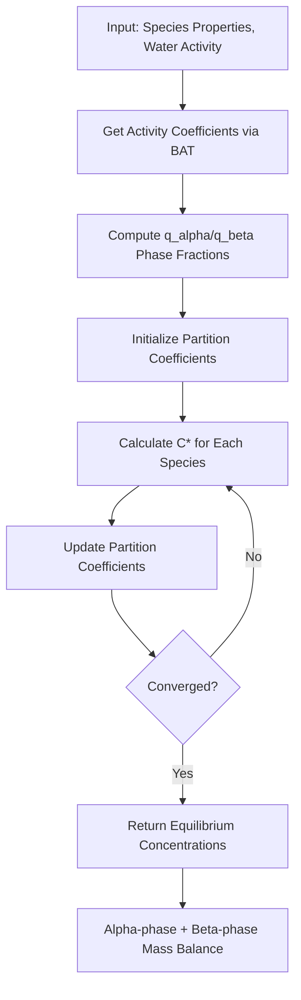

# Equilibria Theory

The standalone partitioning calculation solves for bulk liquid and gas amounts at prescribed water activity. In kinetic aerosol simulations the current particle masses determine activities, and vapor transport advances those masses in time. The standalone result can provide a long-time reference when temperature, curvature, species inventories and reservoir conditions agree. [Particle-phase activity](activity-theory.md)

## Introduction

When organic vapors encounter aerosol particles, they can condense onto the particle phase. The extent of this partitioning depends on:

- **Saturation vapor pressure**: How volatile the compound is
- **Activity in the particle phase**: Non-ideal mixing effects
- **Available condensed mass**: More organic mass means more partitioning

Understanding these equilibria is essential for predicting secondary organic aerosol (SOA) formation and properties.

## Liquid-Vapor Partitioning Fundamentals

At thermodynamic equilibrium, the partial pressure of each species in the gas phase equals its equilibrium vapor pressure above a flat liquid surface:

$$p_i = a_i \cdot p_i^{\circ}$$

where:

- $p_i$ is the partial pressure of species $i$ in the gas phase
- $a_i$ is the activity of species $i$ in the condensed phase
- $p_i^{\circ}$ is the pure component saturation vapor pressure

This relationship links gas-phase concentrations to particle-phase composition through the activity, which accounts for non-ideal mixing.

## Saturation Concentration (C*)

The **saturation concentration** ($C^*$) is a convenient measure of volatility that directly relates to partitioning behavior. It represents the equilibrium vapor concentration when the condensed phase is present.

### Dry vs. Wet C*

The **dry saturation concentration** ($C^*_{dry}$) assumes an ideal, single-component system:

$$C^*_{dry} = \frac{p^{\circ} \cdot M}{R \cdot T}$$

where $M$ is the molecular weight, $R$ is the gas constant, and $T$ is temperature.

For a single flat liquid phase and ideal vapor, the equilibrium gas mass concentration is $C_{g,j}=a_j C^*_{j,\mathrm{dry}}$. Evaluating the activity requires the liquid composition. In a partitioning solve that composition itself depends on the amount condensed.

### Volatility Basis Set

The **Volatility Basis Set (VBS)** framework bins organic compounds by their $C^*$ values, typically using logarithmic bins (e.g., 0.01, 0.1, 1, 10, 100 $\mu$g/m$^3$). This simplifies the treatment of complex organic mixtures by grouping compounds with similar volatility.

| $C^*$ Range ($\mu$g/m$^3$) | Classification |
|---------------------------|----------------|
| < 0.01 | Extremely Low Volatility (ELVOC) |
| 0.01 - 1 | Low Volatility (LVOC) |
| 1 - 100 | Semi-Volatile (SVOC) |
| 100 - 10000 | Intermediate Volatility (IVOC) |
| > 10000 | Volatile (VOC) |

## Partition Coefficient

The **partition coefficient** ($\varepsilon_j$) describes the fraction of species $j$ in the condensed phase at equilibrium:

$$\varepsilon_j = \frac{1}{1 + C^*_j / C_{\mathrm{liq}}}$$

Key behaviors:

- When $C^* \ll C_{liq}$: $\varepsilon \approx 1$ (mostly condensed)
- When $C^* \gg C_{liq}$: $\varepsilon \approx 0$ (mostly gas phase)
- When $C^* = C_{liq}$: $\varepsilon = 0.5$ (equally distributed)

This relationship shows that partitioning depends on both the compound's volatility and the total available condensed mass.

## Phase Separation (LLPS)

Under certain conditions, organic-water mixtures can undergo **Liquid-Liquid Phase Separation (LLPS)**, forming distinct alpha ($\alpha$) and beta ($\beta$) phases:

- **Alpha phase**: Water-rich liquid
- **Beta phase**: Organic-rich liquid

### When Does Phase Separation Occur?

Phase separation occurs when the Gibbs free energy of a two-phase system is lower than a single homogeneous phase. The coexistence interval depends on organic properties and composition. At the two coexisting compositions each component has the same chemical potential in both liquids. Figure 9 of the BAT paper illustrates the contrast at fixed organic molar mass as O:C varies. [Gorkowski et al. (2019)](https://doi.org/10.5194/acp-19-13383-2019)

### Phase Fraction (q)

The **phase fraction** $q_{\alpha}$ describes the distribution between phases:

$$q_{\alpha} + q_{\beta} = 1$$

Particula uses a smooth sigmoid function to model the transition between single-phase and two-phase regimes, preventing numerical discontinuities during equilibrium solving.

## Equilibrium Solving Process

Particula solves for equilibrium using an iterative optimization approach:



### Objective Function

The equilibrium solver minimizes the difference between guessed and calculated partition coefficients:

$$\text{Error} = \sum_j (\varepsilon_j^{guess} - \varepsilon_j^{calc})^2 + (C_{liq}^{guess} - C_{liq}^{calc})^2$$

Inspect the returned optimizer success flag and residual for each solve.
Optimizer termination does not imply a universal $10^{-16}$ residual or a
validated thermodynamic accuracy bound.

### Mass Balance

At equilibrium, mass must be conserved:

$$C_j^{total} = C_j^{gas} + C_j^{\alpha} + C_j^{\beta}$$

Here each species balance counts organic mass only. Associated water supplied
by the prescribed humidity reservoir is reported separately; adding it to the
organic species inventory would create a false mass imbalance.

## Standalone equilibrium calculations

For a single water–organic pair, call `fixed_water_activity` with the imposed water activity, the **water/organic** molar mass ratio, the organic O:C ratio, and the organic density in kg/m³. The water-rich branch, optional organic-rich branch and alpha allocation fraction are available as named fields and by tuple unpacking. Within a branch, the six quantities are water and organic activities, water and organic mass fractions, then water and organic activity coefficients. Sweep results follow the requested activity order. The allocation fraction is the BAT parameterization used by the partitioning calculation.

```python
import numpy as np
from particula.activity.water_activity import fixed_water_activity

binary = fixed_water_activity(
    water_activity=np.array([0.8, 0.6]),
    molar_mass_ratio=18.01528 / 200.0,
    oxygen2carbon=0.5,
    density=1243.493333,
)
water_mass_fraction = binary.alpha[2]
```

For a volatility-basis-set calculation at fixed water activity, use the existing partitioning strategy. Supply dry saturation concentrations and total organic inventories in µg/m³, molar masses in g/mol and organic densities in kg/m³. The solver returns species partition coefficients, water in each phase and the optimization residual. Multiply each organic inventory by its partition coefficient to obtain condensed **organic** mass. These calculations diagnose prescribed equilibrium states independently of a simulation timestep.

```python
from particula.equilibria import LiquidVaporPartitioningStrategy

inventory = np.array([1.0, 2.0, 3.0])
species = dict(
    molar_mass=np.array([200.0, 180.0, 220.0]),
    oxygen2carbon=np.array([0.4, 0.5, 0.6]),
    density=np.array([1400.0, 1300.0, 1500.0]),
)
dry_saturation = np.array([0.1, 1.0, 10.0])
result = LiquidVaporPartitioningStrategy(water_activity=0.7).solve(
    c_star_j_dry=dry_saturation,
    concentration_organic_matter=inventory,
    **species,
)
condensed_organic = inventory * result.partition_coefficients
print(condensed_organic, result.water_content, result.error)
```

The concrete `particula.equilibria.partitioning.liquid_vapor_partitioning` function also returns the underlying optimizer result for diagnostics. [Worked equilibrium examples](../../studies/examples/thermodynamics/equilibria/index.md)

For a species-by-species mass balance and optimizer status, request the individual organic and aqueous arrays from the functional solver at the same conditions.

```python
from particula.equilibria.partitioning import (
    get_properties_for_liquid_vapor_partitioning,
    liquid_vapor_partitioning,
)

gamma, water_fraction, phase_fraction = get_properties_for_liquid_vapor_partitioning(
    water_activity_desired=0.7, **species
)
alpha, beta, system, optimizer = liquid_vapor_partitioning(
    c_star_j_dry=dry_saturation,
    concentration_organic_matter=inventory,
    molar_mass=species["molar_mass"],
    gamma_organic_ab=gamma,
    mass_fraction_water_ab=water_fraction,
    q_ab=phase_fraction,
)
print(optimizer.success, alpha[0] + beta[0])
```

## Key Equations Summary

| Equation | Description |
|----------|-------------|
| $p_i = a_i \cdot p_i^{\circ}$ | Vapor-liquid equilibrium |
| $a_i = \gamma_i \cdot x_i$ | Activity from coefficient and mole fraction |
| $\varepsilon_j = \frac{1}{1 + C^*_j / C_{liq}}$ | Partition coefficient |

## References

Gorkowski, K., Preston, T. C., & Zuend, A. (2019). Relative-humidity-dependent organic aerosol thermodynamics via an efficient reduced-complexity model. *Atmospheric Chemistry and Physics*, 19, 13383-13407. [https://doi.org/10.5194/acp-19-13383-2019](https://doi.org/10.5194/acp-19-13383-2019)

---

**Previous**: [Activity Theory](activity-theory.md) - Learn about the BAT model for activity coefficients.
