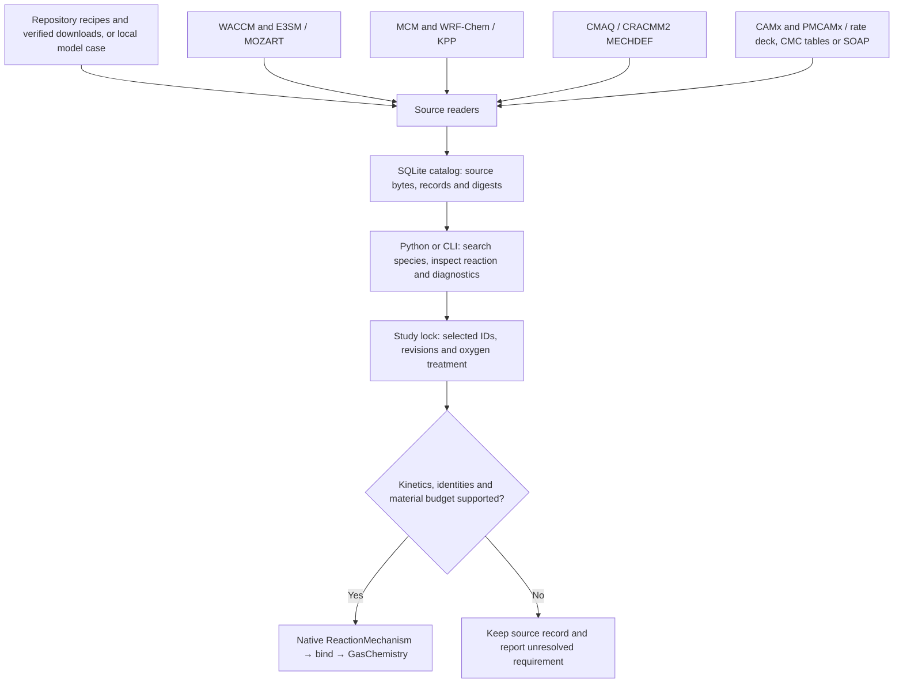

# A native chemical channel catalog for Particula

**Implementation and qualification, 2026-11-28.** A chamber researcher should be able
to choose an emitted precursor or a published pathway, inspect its reactions
and assumptions, and save the exact chemistry used in a study. Import each
source snapshot once. Run only the selected chemistry. Keep enough information
to explain why two sources predict different rates for the same channel.

Particula already binds versioned native mechanisms to gas and particle
inventories. Its existing NCAR converter accepts a closed, single-gas-phase
Arrhenius subset of NCAR Mechanism Configuration 1.3.0. The source catalog converts selected atmospheric
model channels into the same version-1 native mechanism.
[Stage 6 delivery](stage-06-chemistry-model.md) · [Gas chemistry](../docs/guide/processes/gas-chemistry.md) · [Resolved chemistry](../docs/guide/processes/resolved-chemistry.md)

## Source fixtures and scientific scope

| Source | Retrieval and evidence | What the first reader must preserve |
| --- | --- | --- |
| WACCM6 MOZART-TSMLT1 | CAM commit `405a3f21446439d8f952660f0300332d9b860279`, source tag `MZ197_TSMLT1_20180423`. The file contains 433 kinetic and 150 photolysis entries spanning the troposphere through the lower thermosphere. [Mechanism download](https://raw.githubusercontent.com/ESCOMP/CAM/405a3f21446439d8f952660f0300332d9b860279/src/chemistry/pp_waccm_tsmlt_mam4/chem_mech.in) · [Custom rates](https://github.com/ESCOMP/CAM/blob/405a3f21446439d8f952660f0300332d9b860279/src/chemistry/mozart/mo_usrrxt.F90) | Source tags, species roles, stoichiometry and rate expressions. Among the kinetic entries, 357 have one or two inline parameters, 23 have five, and 53 have no inline rate parameters. Record dependencies on air density, light, external routines and untracked reservoirs. Parameter counts alone do not establish executability. |
| Master Chemical Mechanism v3.3.1 | York's KPP export for α-pinene with inorganic chemistry and generic rates contains 313 species, 881 reaction entries and 68 members of its RO₂ sum. The archive supplies a full mechanism and species table. [Precursor export](https://mcm.york.ac.uk/MCM/export/download?selected%5B%5D=APINENE&inorganic=on&generic=on&format=kpp) · [Species export](https://mcm.york.ac.uk/MCM/export/download?selected%5B%5D=APINENE&inorganic=on&generic=on&format=species_tsv) · [Versioned archive](https://www.mcm.york.ac.uk/MCM/about/archive) | Read the KPP equations, species table, RO₂ membership and referenced rate definitions together. Record the selected precursor(s), export flags and checksum of the actual companion constants file. Preserve branch weights, implicit products and photolysis dependencies. [York export instructions](https://www.mcm.york.ac.uk/MCM/export) |

To reconstruct the research fixtures, download the linked WACCM text and York
exports as raw bytes and compare SHA-256 values before parsing. The WACCM text
hash was `c15d52909d246da8cd72c996709d848163c89ed75d4c684ba05aef5cff643664`.
The α-pinene KPP export was `22f5a644a57cf412eb82e257ae44e402b2c7204c18ff551343d0ee179b30bd01`
and its species export was `0925410e40d7a75b07aaefbf6d461e3169a12a455c7c2578b6ebc07f39191780`.
A later York export can change under the same MCM version. Record changed bytes
as a new snapshot and review the differences.

## Records, ownership and revision rules



| Object | Identity and update rule |
| --- | --- |
| Source snapshot | The ID is `source:mechanism@sha256`. Its manifest pins release, aerosol configuration, filenames, input digests, importer version and origins for published recipes. |
| Reaction | Append the source label to the snapshot ID. A separate content digest identifies each normalized revision. Identical MCM reactions can match across differently numbered exports. For unsupported expressions the digest also pins the expression and companion digests, including the RO₂ membership for pool-dependent rates. |
| Species | Source-local names preserve lumped surrogates, prescribed reservoirs and model bins. The compiler maps named molecular identities and source-declared MCM compositions, validates stoichiometry and checks elemental balance. |
| Catalog release | The source recipes and importer ship with Particula. Changing a mapping or reader requires an importer version change. A new upstream input creates a new snapshot. |
| Study selection | A checksummed JSON lock contains normalized records, exact source manifests and the explicit oxygen assumption. Keep the exported native mechanism alongside the lock to preserve the executable result across future compiler changes. |

**Use NO + O₃ to test identity.** At 298 K WACCM gives
1.955 × 10⁻¹⁴ cm³ molecule⁻¹ s⁻¹ and explicitly produces NO₂ and O₂.
MCM gives 1.726 × 10⁻¹⁴ in the same units and lists NO₂ alone.
Both records should appear in one search. Combining their rates would double
count the pathway. Preserve source-specific bookkeeping and require a documented
oxygen treatment before exporting a closed mechanism. York's export row numbers
also change with the selection. Use the row as a source locator, and match the
underlying reaction through a stable source key or a reviewed mapping when
ambiguous. [WACCM channel](https://github.com/ESCOMP/CAM/blob/405a3f21446439d8f952660f0300332d9b860279/src/chemistry/pp_waccm_tsmlt_mam4/chem_mech.in#L785) · [MCM α-pinene export](https://mcm.york.ac.uk/MCM/export/download?selected%5B%5D=APINENE&inorganic=on&generic=on&format=kpp)

## What lives where

- **Particula repository and package.** Keep the schema, importers, small source
  and release manifests, reviewed mappings and compact test fixtures. Preserve
  retrieval and citation instructions. Check source-specific redistribution
  terms when choosing fixtures to publish. [MCM citation guidance](https://www.mcm.york.ac.uk/MCM/about/cite) · [CESM terms](https://www.cesm.ucar.edu/models/cesm2/copyright)
- **Converted reactions.** The [native catalog](../chemistry_catalog/snapshots.json)
  records 19,655 input entries across ten recipes. It contains 2,311 individually
  validated native channels, including seven ozone titration channels requiring
  explicit closed-box oxygen. The per-recipe JSON Lines files store native
  mechanisms, source locations, revisions and assumptions. The manifest links
  the upstream sources and records the pinned file hashes and conversion counts.
  Refresh these files intentionally with
  `python -m scripts.build_chemistry_catalog --refresh --output dist/catalog`
  and review the changed reactions and counts.
- **GitHub Release.** The base library release job packages the committed native
  records offline with `python -m scripts.build_chemistry_catalog --output dist/catalog`.
  It attaches the ZIP and SHA-256 file to the matching library tag. Default fetch
  indexes those native records. Named source imports retain the upstream inputs
  for a full source inventory and subsequent conversions.
- **Local cache.** SQLite holds the original source bytes, immutable records
  and species index in a single file. Import commits them together. Repeating
  a recipe uses cached source bytes, and searching requires neither upstream
  access nor parsing. Keep original custom-case inputs with their provenance
  so the catalog can be rebuilt.
- **Study repository.** Save the selection lock and the small exported native
  mechanism alongside the study. A compatible Particula install can load that
  mechanism offline. Keep forcing references, initial conditions, solver
  settings and bindings with the study for trajectory replay. Rebuilding a
  historical export also requires the pinned inputs and importer, so retain
  the exported mechanism as the durable executable artifact.

## Selection, Python API and CLI

The [catalog package](../particula/dynamics/chemistry/catalog/__init__.py)
exposes `ChemistryCatalog.fetch`, `import_file`, `search`, `show`, `selection`
and `export`. The CLI wraps this API. ZIP and TAR recipes verify archive and
member digests. Readers inspect explicitly supported data and never execute
Fortran routines. Search by source, snapshot, reactant or product and pass a
returned ID to the next command. The snapshot ID itself selects every source
record. A user can lock a precursor subset even when native export requires
additional physics. [Gas chemistry guide](../docs/guide/processes/gas-chemistry.md)

```bash
particula chem fetch
particula chem search --source waccm --species O3 --role reactant --json
# Set REACTION_ID to the NO_O3 result.
particula chem show "$REACTION_ID" --json
particula chem export "$REACTION_ID" --target lock --output chamber.lock.json
particula chem export --lock chamber.lock.json --output mechanism.json
```

For CodeGraph, follow the Python symbol in a supported reaction's
`implementation` field through `ReactionMechanism.bind` and
`GasChemistry.execute`. The source reaction ID identifies the scientific
record independently of the Python symbol.

For discovery, the selected catalog records can supply candidate reactions and
published rates to the existing [network search](../particula/dynamics/chemistry/discovery.py).
Preserve the distinction between a published coefficient and a study-fitted
parameter. A run that prunes branches or treats an oxidant as prescribed should
record that choice and compare its target observables against a fuller reference.

## Delivery order and acceptance

### Implemented source coverage

All source families have a pinned recipe in
[sources.json](../particula/dynamics/chemistry/catalog/sources.json).
A channel passes native preflight when the catalog can represent its molecular
identities, kinetic law, units and elemental balance. The last column counts
individually exportable channels with default reservoir treatment. Each row
counts its own source, including reactions shared across mechanisms.

| Recipe | Model configuration | Imported records | Pass native preflight |
| --- | --- | ---: | ---: |
| `waccm` | Whole-atmosphere TSMLT1–MAM4 | 583 | 39 |
| `e3sm` | EAM v3.0.0 chemUCI–Linoz v3–MAM5–VBS | 104 | 3 |
| `mcm` / `mcm-full` | York v3.3.1 α-pinene subset / full archive | 881 / 16,698 | 94 / 2,152 |
| `wrf-chem` | v4.6.1 MOZART with four-bin MOSAIC | 292 | 3 |
| `cmaq` | EPA CMAQ 5.5 CRACMM2 | 531 | 3 |
| `camx` | EPA CAMx 7.20 CB6r5_CF2E with 234 CMC gain/loss and flux entries from a pinned source mirror | 234 | 5 |
| `pmcamx` | PMCAMx-SR v1.0 CB05, with 156 CMC gas equations and 34 additional rate rows lacking stoichiometry in that pair | 190 | 5 |
| `pmcamx-soap` / `pmcamx-soap-alt` | SR v1.0 / v1.0a, each with 23 NOₓ-dependent precursor yields and 48 volatility-bin aging transfers | 71 / 71 | 0 / 0 |

The source comparison runs all seven gas options through one CPU solver.
Starting with 1 µmol m⁻³ each of NO and O₃, the 298 K NO remaining after
60 s is 0.586070 µmol m⁻³ for WACCM, E3SM, WRF-Chem, CMAQ and PMCAMx,
0.594653 for CAMx and 0.615928 for MCM. Across all four gas species
and all three temperatures, the largest absolute concentration error was
2.47 × 10⁻⁹ µmol m⁻³ against the analytical solution. The separate SOAP comparison checks
the CG20→CG19 gain of 1.075 in the base archive and 1.000 in the alternative.
Prescribed OH, host rate inputs, yields and partitioning require additional
modeling before running SOAP as a particle chemistry process.
[Reproduce the qualification](../scripts/assess_chemical_catalog.py) ·
[PMCAMx-SR source archives](https://doi.org/10.5281/zenodo.4071362)

### Unit evidence for CAMx and PMCAMx imports

Both model readers select one unit system for the entire gas rate deck.
For CAMx 7.20, `readchm.f` counts rows of absolute type 2 or 3. A first
parameter above 1 counts toward ppm, and a value at or below 1 counts toward
molecular units. The archived PMCAMx-SR reader applies the same comparison
to positive types 2 and 3. Both select ppm only when it has more votes, choose
molecular on a nonempty tie, and report failure when there are no votes.
This reconstructs the host's interpretation. The physical provenance of an
unlabelled local or reduced deck can still be ambiguous.
[CAMx 7.20 reader](https://github.com/wcd940816/camx7.2modified/blob/dc4351b4dd5499cc53fc230317875ab831772473/src.v7.20/CAMx/readchm.f#L1306-L1346) ·
[PMCAMx-SR archive, `PMCAMx-SR-CB05/readchm.f`, lines 1047–1096](https://doi.org/10.5281/zenodo.4071362)

| Exact input pinned in the catalog | Molecular / ppm votes | Independent check for NO + O₃ at 298 K |
| --- | ---: | --- |
| EPA CAMx 7.20 CB6r5_CF2E | 96 / 3 | Row 3 gives 1.887 × 10⁻¹⁴ cm³ molecule⁻¹ s⁻¹ from the IUPAC expression reported by Silvern et al. |
| PMCAMx-SR v1.0 CB05 | 73 / 2 | The header explicitly declares molecular units. Row 3 gives 1.955 × 10⁻¹⁴ cm³ molecule⁻¹ s⁻¹ from the JPL expression reported in the same study. |

For reaction order *n*, the molecular system uses
(cm³ molecule⁻¹)ⁿ⁻¹ s⁻¹ and the mixing-ratio system uses ppm¹⁻ⁿ min⁻¹.
For type 3, the source activation parameter and reference temperature are in
kelvin. The host builds an internal table in ppm¹⁻ⁿ h⁻¹. Its conversion uses
order and temperature/pressure scaling, with a reference state of 298 K and
1013 mb. The catalog retains the original input parameters. Its native
compiler accepts verified molecular inputs and reports an explicit conversion
requirement for declared ppm inputs. The literature comparison checks one
channel independently of the deck-level evidence.
[CAMx 7.20 guide, §3.1, Table 3-3b](https://www.camx.com/Files/CAMxUsersGuide_v7.20.pdf) ·
[CAMx rate-table implementation](https://github.com/wcd940816/camx7.2modified/blob/dc4351b4dd5499cc53fc230317875ab831772473/src.v7.20/CAMx/exptbl.f#L53-L115) ·
[Silvern et al. (2018)](https://doi.org/10.1029/2018GL077728)

The PMCAMx-SR aerosol module has its own unit contract. In both archived
`SOAP/soachem.f` files, the precursor prefactor is cm³ molecule⁻¹ s⁻¹ and
the exponential parameter is in kelvin. The module uses pressure (mb) and
temperature (K) to convert the precursor rate to ppm⁻¹ h⁻¹ before multiplying
by oxidant mixing ratio (ppm) and integrating in hours. It labels the raw
low/high-NOₓ yields ppm/ppm and applies density scaling during production.
The aging rate argument has units ppm⁻¹ h⁻¹ at the call site, as follows
from its product with OH in ppm and elapsed time in hours. Records from the
two verified files expose these distinctions.
[PMCAMx-SR base and alternative sources](https://doi.org/10.5281/zenodo.4071362) ·
[Model and VBS study](https://gmd.copernicus.org/articles/14/2041/2021/)

### Next comparisons for transport-model chemistry

- Compare E3SM's net SO₂ + OH sulfuric-acid production with WACCM's separate
  SO₃ formation and hydration under matched pressure, humidity, temperature
  and oxidant exposure. Both paths require their host rate routines.
  [E3SM mechanism](https://github.com/E3SM-Project/E3SM/blob/v3.0.0/components/eam/src/chemistry/pp_chemuci_linozv3_mam5_vbs/chem_mech.in#L265-L284) · [WACCM sulfur chemistry](https://github.com/ESCOMP/CAM/blob/405a3f21446439d8f952660f0300332d9b860279/src/chemistry/pp_waccm_tsmlt_mam4/chem_mech.in#L1131-L1132)
- Compare PMCAMx-SR aging schemes under matched OH exposure, dilution and
  partitioning. The catalog identifies the differing transfer coefficients.
  Testing organic aerosol mass requires the host's volatility-bin properties
  and gas-particle partitioning. [PMCAMx-SR study](https://gmd.copernicus.org/articles/14/2041/2021/)
- Keep CAMx organic/inorganic aerosol treatments, WRF-Chem gas-to-MOSAIC
  mappings and CMAQ's lumped species identities attached to their respective
  configurations before comparing coupled aerosol trajectories.
  [CAMx model inputs](https://www.camx.com/download/camx-test-case/) · [WRF-Chem MOZART–MOSAIC](https://github.com/wrf-model/WRF/tree/v4.6.1/chem/KPP/mechanisms/mozart_mosaic_4bin) · [EPA CRACMM](https://usepa.github.io/CRACMM/)

### Acceptance and subsequent scientific work

| Increment | Deliverable and check that closes it |
| --- | --- |
| 1. Catalog records and cache | Implement snapshot, species, reaction revision and release records with a rebuildable index. Test cold import, warm offline search, interrupted and concurrent import, digest mismatch and deterministic rebuild. Correct one rate and demonstrate that an older lock still resolves its original revision. |
| 2. WACCM and MCM readers | Inventory every reaction in each pinned fixture, including unsupported entries with locations and reasons. Recover the two NO + O₃ expressions independently, preserve the MCM branching fractions and rebuild its 68-member RO₂ definition. Compare a reaction common to a full MCM export and its precursor subset despite different row numbers. |
| 3. Selection, CLI and export | Deliver Python and CLI search/show/export together. Exercise the four-command workflow above, test JSON results against the Python API, detect overlapping selections and report missing inputs. Export an executable WACCM NO + O₃ mechanism, reopen it offline, and verify an unsupported export preserves an existing output. Document the workflow in the gas chemistry guide. |
| 4. Small reference simulations | Verify source and native rate coefficients independently across temperature, including the transformation from cm³ molecule⁻¹ s⁻¹ to m³ mol⁻¹ s⁻¹. At 298 K and 1 µmol m⁻³ initially of both NO and O₃, the isolated WACCM channel has 0.586070 µmol m⁻³ NO after 60 s. Check the analytical trajectory, each species and the closed mass budget. Then reproduce York's methane/CO box against AtChem with matched light, humidity, air density and initial conditions. Compare OH, HO₂, NOₓ and selected products after timestep and tolerance refinement. [York reference case](https://mcm.york.ac.uk/MCM/atchemonline/sec2) |
| 5. Aerosol applications | For WACCM sulfur oxidation, reproduce the CAM SO₂ oxidation and SO₃ hydration rates over the selected pressure, temperature and humidity range, account for background oxygen, and compare H₂SO₄ production before coupling condensation. For MCM α-pinene, compare any reduction against the precursor export across the intended oxidant and NOₓ conditions. Evaluate precursor loss, radicals and condensable-product formation. Specify volatility and particle-phase properties separately. [CAM sulfur rates](https://github.com/ESCOMP/CAM/blob/405a3f21446439d8f952660f0300332d9b860279/src/chemistry/mozart/mo_usrrxt.F90) · [MCM α-pinene](https://mcm.york.ac.uk/MCM/species/APINENE) |

The seven-source import, selection and native export workflow is implemented. Increment 4 has an isolated gas-channel comparison. AtChem, sulfur-pathway, aerosol partitioning and full-network simulations remain separate scientific qualification projects. New rate-law implementations
belong in the owning chemistry code, with independent tests for third-body
falloff, prescribed photolysis, radical-family sums or fractional yields as
each becomes necessary. Compare the native molar tendencies as well as state
in kg/m³ of air. Set trajectory tolerances from independent reference convergence
before judging agreement. Qualify CPU and CUDA separately for each newly
supported law and measure solver memory and runtime before claiming support
for a complete MCM precursor network. [Existing gas qualification](../docs/studies/validation/condensation/gas-chemistry.md)
