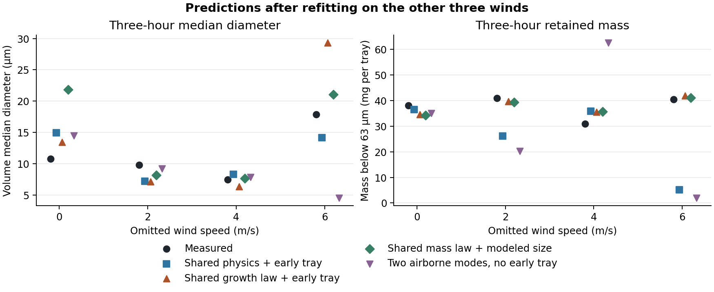

# How well does a shared model transfer between dust-tray experiments?

The 30-minute spectrum helped forecast which sizes remained on the tray. A shared physical model reduced the average three-hour median error across omitted winds from 4.48 to 2.84 µm compared with carrying the early spectrum forward. That improvement was concentrated at 6 m/s and came at a cost in mass. The model predicted only 5.10 mg per tray at 6 m/s, against 40.38 mg measured. At 2 m/s it could reproduce much of the coarsening when that wind entered the fit, but it predicted almost no coarsening when the wind was omitted. A subsequent model that assigned total mass its own shared growth law predicted 39.33 mg and 8.19 µm at 2 m/s, compared with the observed 40.96 mg and 9.80 µm. Its still-air median then missed by 11.06 µm. [Four-wind comparisons (`global-comparisons.csv`)](study-results.zip)

## Which measurements did the prediction use?

The public workbook releases full tray spectra at 30 minutes and three hours. Their six cumulative mass thresholds also provide measurements at 1, 1.5 and 2 hours. We tested a single parameter vector shared by all wind speeds and times. The primary mass target uses the available replicate gram measurements at both endpoints and the reported mean masses at intermediate times. We compare channel volume fractions to modeled mass fractions under a common particle density and use log-diameter interpolation for medians and cutoffs. The 10–20 µm mass is the difference between the cumulative masses below 20 and 10 µm. [Experiment](https://acp.copernicus.org/articles/26/14245/2026/) · [Archived observations](https://zenodo.org/records/22962214) · [Study specification](global-fit-spec.md)

In each omitted-wind test the physical parameters were refitted on the other three winds. The early-conditioned model receives the omitted wind’s 30-minute laser spectrum and its observed mass below 63 µm. The release model receives no tray measurement from the omitted wind, and estimates a common airborne size distribution from the training winds. Both use the recorded centreline concentration through the target time, so their scores apply when that forcing is available. A separate forward test trained only through 1.5 hours in all four winds before scoring 2 and 3 hours. Withholding just one retrieval time generally allows measurements from later retrievals into the fit. These are retrospective tests within one inspected experiment.

The early-conditioned model estimates airborne size fractions from the early tray fractions after division by a power of the settling speed plus 0.001 m/s. The release model uses one lognormal mass mode. An exploratory alternative allows two shared lognormal modes with a wind-dependent coarse fraction, using a quadratic on standardized wind speed followed by a logistic transform. It has 15 shared parameters and only three training winds per wind holdout. We also tested persistence, the two-metre gravity model, and a two-parameter power law that multiplies every early channel by the same factor, 1 + g[(t − 0.5 h)/2.5 h]ᵖ.

For the physical models, incident normal speed has mean equal to the Particula settling speed and standard deviation proportional to friction velocity. Sticking probability for downward speed w is exp[−w²/(2vᶜ²)]. The capture velocity varies with diameter as D⁻¹ᐟ² and can increase progressively after 30 minutes. Size sorting attenuates airborne mass fractions by exp(−a vₛ t/H) before renormalization. A first-order lag filters the monitor concentration. The local concentration, size fraction, speed-weighted capture probability and tray area then give the arrival flux into each channel. The retained mass loses grains at an effective rate proportional to (U/6 m/s)⁶ × D/(10 µm). The reference surface law treats adhesion as an effective sticking threshold. The archive has no per-size charge or humidity series with which to infer those contributions separately. In the early-conditioned model, size channels absent from the early tray have negligible modeled supply. These are effective transport and retention parameters for the collector. [Model, equations and bounds](global_fit.py) · [Fitted parameters for every split (`global-parameters.csv`)](study-results.zip)

The fitting objective adds a mean squared standardized mass error and a mean squared Hellinger distance between spectra scaled by 0.10. The mass scale uses the measured standard error with a floor of 0.75 mg. Cumulative cutoffs share many of the same particles, size fractions sum to one and replicate channel spectra are unavailable. The objective therefore has no likelihood interpretation. A fitted parameter at a bound or a small residual cannot establish a unique concentration history or surface property. We report errors in mg per tray, µm of volume median diameter and percentage points of total variation (half the sum of absolute channel-fraction differences).

## Predicting shape and total mass together

After seeing the tradeoff in the separate fits, we tested a joint model. A common empirical growth law supplies total mass, and the physical calculation supplies the normalized size distribution. We fitted all coefficients together. The impact calculation in this model determines relative composition. It cannot establish an absolute incident flux once the total has been rescaled. A reduced version fixes adhesion, removes the monitor lag and suppresses airborne size sorting. These two models were developed after inspecting earlier holdout behavior. Their scores are exploratory. [Joint-fit specification](global-fit-spec.md) · [All fits for the combined models (`global-combined.json`)](study-results.zip)

Each cell is the predicted or measured three-hour value. For each model the same set of fitted parameters produced both its size and mass prediction for that row.

| Omitted wind (m/s) | Measured D50 / mass (µm / mg) | Early tray + shared physics | Early tray + common growth law | Joint mass and shape model | No early tray, one mode | No early tray, two modes |
|---:|---:|---:|---:|---:|---:|---:|
| 0 | 10.77 / 38.02 | 14.91 / 36.46 | 13.43 / 34.60 | 21.83 / 34.23 | 9.84 / 254.35 | 14.51 / 35.11 |
| 2 | 9.80 / 40.96 | 7.15 / 26.12 | 7.11 / 39.71 | 8.19 / 39.33 | 19.81 / 26.81 | 9.18 / 20.33 |
| 4 | 7.46 / 30.90 | 8.32 / 35.91 | 6.32 / 35.45 | 7.62 / 35.66 | 9.02 / 55.42 | 7.86 / 62.56 |
| 6 | 17.89 / 40.38 | 14.18 / 5.10 | 29.33 / 41.93 | 21.06 / 41.08 | 2.38 / 3.67 | 4.54 / 2.03 |

In still air the early median was 13.43 µm. It declined in the experiment, while the shared physical model predicted coarsening. At 2 m/s the early median was 7.11 µm and the 10–20 µm mass reached 12.48 mg at three hours. Including that wind in calibration gave 9.62 µm and 10.98 mg. Omitting it gave 7.15 µm and 6.27 mg. The power law came within 1.25 mg of the **total** at this wind while leaving the median at its early value. The two-mode release model came within 0.62 µm of the observed median here but delivered only half the observed mass. A median close to the measured value therefore provides a weak test of size-selective accumulation by itself. [Predictions by wind, time and size (`global-comparisons.csv`)](study-results.zip) · [All six cutoffs (`global-thresholds.csv`)](study-results.zip)

| Mean absolute error in omitted winds | Six cumulative masses (mg) | Total mass (mg) | 10–20 µm mass (mg) | Three-hour D50 (µm) | Three-hour spectrum (TV, pp) |
|---|---:|---:|---:|---:|---:|
| Early mass and shape persist | 4.28 | 7.13 | 2.05 | 4.48 | 17.07 |
| Early tray + power law | 2.70 | 3.02 | 1.40 | 4.48 | 17.07 |
| Early tray + settling column | 3.93 | 4.27 | 2.05 | 4.92 | 23.29 |
| Early tray + shared physics | 5.21 | 9.95 | 2.15 | 2.84 | 14.61 |
| Joint mass and shape model | 3.95 | 2.77 | 1.96 | 4.00 | 15.63 |
| Joint model with fixed adhesion, no lag or sorting | 3.54 | 2.79 | 1.59 | 4.89 | 17.28 |
| No early tray, one mode | 42.55 | 55.81 | 26.00 | 7.00 | 48.07 |
| No early tray, two modes | 9.92 | 17.19 | 3.54 | 4.53 | 26.13 |

Mass errors cover all four post-30-minute retrievals per wind. The spectral errors compare the four three-hour measurements, one per wind. TV is the percentage of volume that would have to be reassigned among channels to match the measured shape. Allowing two common airborne modes lowered the errors in total mass and TV over the one-mode release model, and lowered median error to 4.53 µm. Three wind speeds give weak constraints on the mixture weight at a fourth, particularly when an extreme wind is omitted. [Scores and observation counts (`global-scores.csv`)](study-results.zip)

## Later retrievals pose a different forecast

Training through 1.5 hours and predicting the last two retrievals gave total-mass errors of 9.44 mg for the shared early-conditioned physics, 13.39 mg for the power law and 5.71 mg for the settling column. For the 10–20 µm band the corresponding errors were 1.81, 2.82 and 2.70 mg. Their three-hour median errors were 6.39, 4.48 and 4.92 µm. The two-mode release model had the lowest forward median error among the models, 1.39 µm, alongside a 13.53 mg total-mass error. Thus a new wind speed and a later time in an already sampled wind pose different selection problems. [Temporal scores (`global-scores.csv`)](study-results.zip)

When each retrieval was omitted separately at all four winds, the early-conditioned physical model's total-mass errors were 1.04, 3.00, 5.44 and 8.95 mg at 1, 1.5, 2 and 3 hours. In the forward test, its three-hour predictions at 2 m/s reached 9.34 µm and 31.94 mg. At 6 m/s they reached 28.92 µm and 15.02 mg. The smaller early-time errors use later retrievals during training. [All time splits (`global-comparisons.csv`)](study-results.zip)

The full joint model gave forward errors of 5.19 mg for total mass and 6.61 µm for the final median. Suppressing lag, sorting and changing adhesion improved total-mass error to 2.53 mg while increasing median error to 7.56 µm. We also omitted one entire wind from parameter fitting **and** excluded all observations after 1.5 hours at the remaining three winds. The held-out wind still supplied its 30-minute tray as a starting condition. The table averages four such tests, scoring mass at 2 and 3 hours and the spectrum at 3 hours. Three-hour laser spectra were absent from training. The small median error of the physical model accompanied large errors in mass and appreciable errors across the full spectrum. [Individual joint wind-and-time holdouts (`global-scores.csv`)](study-results.zip)

| Joint wind-and-time holdout | Total mass MAE (mg) | 10–20 µm MAE (mg) | D50 MAE (µm) | TV (pp) |
|---|---:|---:|---:|---:|
| Persist | 10.57 | 2.70 | 4.48 | 17.07 |
| Power law | 12.34 | 3.23 | 4.48 | 17.07 |
| Early tray + shared physics | 12.24 | 3.60 | 1.31 | 18.90 |
| Joint mass and shape model | 6.64 | 3.22 | 7.14 | 21.78 |
| Reduced joint model | 5.01 | 2.66 | 8.34 | 24.74 |

## Which physical assumptions transfer?

Refitting each alteration on the same wind splits isolates its effect on performance. Removing the lag improved both the median and total-mass errors on omitted winds, from 2.84 to 2.48 µm and from 9.95 to 6.96 mg. Removing airborne size sorting barely changed either error. Suppressing post-impact removal lowered the total-mass error to 4.33 mg and raised median error to 3.11 µm. Restricting removal to exactly 6 m/s gave 4.06 mg and 3.55 µm. That test fixes removal to zero when 6 m/s is omitted because all three training winds are then insensitive to the rate. Constant adhesion gave 9.02 mg and 4.42 µm. Excluding spectra from calibration gave 10.69 mg and 5.93 µm. These comparisons favor retaining an early observation of shape and caution against inferring a removal or adhesion rate solely from a normalized median. [Model changes and scores (`global-scores.csv`)](study-results.zip)

We also replaced the tunnel-specific shear mapping with the measured free-stream and friction-velocity pairs from Goossens. On its own this gave 2.81 µm median and 10.54 mg total-mass error. Next we used Zhang et al.’s Table B2 wood-plane velocities for 7.5–40 µm dust at friction velocities of 0.12 and 0.40 m/s, measured at a reference height of 15 mm. We interpolated their ratios to spherical settling speed and applied the ratios within the measured size interval, retaining Jia-specific fall speeds and the modeled capture fraction. For example, the tabulated 12.5 µm deposition speed increased from 13.86 to 33.24 mm/s across those two friction velocities on the oiled collector. The central external curve gave 2.63 µm and 11.30 mg. Simultaneously shifting the tabulated velocities down or up by one reported spread gave 2.89 or 2.41 µm and 10.99 or 11.49 mg. These are sensitivity tests to a different surface, reference height and tunnel flow. They give no independent measurement of arrivals onto Jia’s acrylic trays. [Goossens, wind and friction velocities](https://doi.org/10.1029/2007JF000775) · [Zhang et al., Appendix B](https://doi.org/10.5194/acp-14-8869-2014) · [External-data refits (`global-scores.csv`)](study-results.zip)

We also let the optimizer choose a common frictional charge-transfer scale from 0 to 10 µC/m². With the dielectric and restitution assumptions of the earlier rebound study, the charged-dust model adds the electrical image-attraction energy to the squared capture-speed scale. We used each wind’s early tray to infer the contacting grain population or, separately, prescribed a 10 µm soil-bed population. Both all-wind fits selected zero extra electrical attraction. Allowing charge in the inferred grain population gave essentially the same omitted-wind errors as the reference, 9.96 mg and 2.84 µm. Forcing the upper charge scale gave 8.70 mg and 4.88 µm. These results constrain the added image-force term conditional on mechanical capture. The experiments did not measure particle charge, and frictional charging can also influence airborne collisions or drift. [Charge refits (`global-charge.json`)](study-results.zip) · [Grain-contact model](tribocharging.md)

## Two 6 m/s measurements constrain how closely a single spectrum can fit

At three hours the laser spectrum places 56.21% of the volume below 20 µm. The archived threshold means put 8.00 of 40.38 mg there, or 19.82% of mass. Under the uniform-density comparison, matching the measured total and laser fraction would place 22.70 mg below 20 µm. A single retained spectrum cannot reproduce both point estimates. Jia et al. sampled separate trays, and the archive does not link individual spectra to threshold masses. Differences in sampling or mass-to-volume conversion remain possible.

We refitted the physical model after removing each of those endpoint measurement families in turn. Holding out the three-hour laser spectrum at 6 m/s gave 35.79% below 20 µm and 28.87 mg total. Holding out the six corresponding cumulative masses gave 50.36% and 19.71 mg total. Either fit also had to explain the other winds and retrieval times. The shifts show how strongly the inferred size distribution depends on which endpoint measurement enters the fit. [Instrument-by-instrument refits (`global-measurement.json`)](study-results.zip) · [Archive consistency (`consistency.csv`)](study-results.zip)

## The fitted timescales are weakly constrained

The early-conditioned fit using all winds estimated a local-to-monitor concentration ratio of 0.0434, a normal-velocity spread of 0.050 times friction velocity, an initial capture speed of 0.0111 m/s at 10 µm, and a twelvefold threshold increase over a 122-minute adhesion timescale. It returned a 180-minute delivery lag, a depletion coefficient of 0.00104, a 6 m/s removal rate of 0.0888 per hour at 10 µm and zero exponent for the early airborne size adjustment. The velocity spread, threshold increase, delivery lag and size exponent reached their search limits. The ratio of largest to smallest local residual-Jacobian singular values was 753 in normalized parameter coordinates. The weakest direction traded the initial capture speed against the threshold increase and its timescale. The two-mode release fit returned a ratio of about 2.6 × 10¹⁸. The later threshold multiplier was unity, so its time constant could vary without changing capture. The upper airborne median reached its 60 µm bound. In the joint model the ratio was about 45,000. Its fitted empirical gain coefficient was 0.532 and its time exponent 1.66. [All-wind parameter sets with units and bounds (`global-shared-sets.csv`)](study-results.zip) · [Every refit (`global-parameters.csv`)](study-results.zip) · [Residual-Jacobian diagnostics (`global-core.json`)](study-results.zip)

Holding the lag at 360 minutes gave a training objective of 5.42 versus 5.47 at the fitted 180-minute limit. Fixing the threshold increase at 30-fold gave 5.38. Conversely, fixing the lag at 30 minutes worsened the training objective to 6.24 while improving omitted-wind total-mass error from 9.95 to 9.27 mg and increasing median error to 4.34 µm. Using kinetic-sheet endpoint means gave omitted-wind errors of 10.13 mg and 2.54 µm. The workbook sources differ materially at 6 m/s, where the 30-minute kinetic-sheet mass below 63 µm is 22.725 mg against 26.725 mg averaged from the replicates. A unique physical lag or adhesion timescale cannot be recovered from these fits. [Fixed-parameter and input-convention refits (`global-extra.json`)](study-results.zip) · [Scores (`global-scores.csv`)](study-results.zip)

## Reproducibility

The archived optimization includes 185 optimized fits and 24 fixed-model evaluations, with 1,528 local optimizer starts and 17,664 sampled parameter vectors used to screen starting points. Replaying each of the four main fitted physical models reproduced the three-hour comparisons, with a maximum channel-mass deviation across all retrievals below 2 × 10⁻¹⁵ mg. Refining the monitor forcing grid from five minutes to one changed modeled total mass by at most 0.040 mg and three-hour median by at most 0.0038 µm. Finite-difference checks of automatic directional derivatives agreed within 4.1 × 10⁻⁸ relative error. Altering the held-out target values at 2 m/s left its training residuals and frozen predictions unchanged in all four physical models. The fits are numerical candidates within the tested parameter ranges. Repeated samples on these four winds do not establish predictive skill on independent dust types or collectors. [Replay instructions](README.md) · [Numerical checks (`global-checks.json`)](study-results.zip) · [Optimization](global_fit.py) · [Score and plotting script](global_summary.py)
