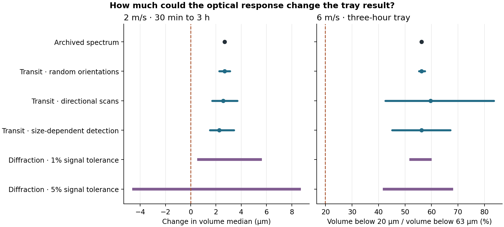

# How much of the dust-size change could come from optical sizing?

At 2 m/s the reported volume median rose from 7.11 to 9.80 µm between 30 minutes and three hours. Every paired reconstruction that used the same tested grain geometry, detection efficiency, or scattering inversion at both endpoints retained a positive shift. Yet a different mathematical question gives a less certain answer. If the only evidence were synthetic signals from a wide-angle scattering instrument, redistributing grain volume could erase the shift with a maximum weighted signal discrepancy of just 1.22%. At 6 m/s an underlying distribution with the fraction implied by the threshold masses required a 33.34% discrepancy from the synthetic signal generated with the archived size spectrum. Those percentages describe a hypothetical detector. The archive contains processed size fractions and masses, with neither recorded detector signals nor replicate size spectra to establish the instrument’s actual uncertainty. [Archived observations](https://zenodo.org/records/22962214) · [Inverse limits (`optical-tipping.csv`)](study-results.zip)

Blue lines span the tested transit responses and dots mark their medians. Purple lines span every nonnegative distribution compatible with the nominal wide-angle signal at the indicated tolerance. The dashed references mark zero coarsening at 2 m/s and the threshold-mass ratio at 6 m/s.

## The paper and the instrument documentation describe different ways to size a grain

Jia et al. report laser diffraction with an Eye Tech analyzer, triplicate readings per tray, and volume-equivalent diameters. They required 100 nm and 20 µm calibration spheres to agree with their nominal diameters within 1%. They recalibrated when a standard suspension’s median drifted by more than 2%. Those checks inform instrument calibration. Neither supplies a per-channel error distribution for irregular soil particles. The published spectrum is an average, and the archive contains no accepted or rejected pulses, angular intensities, instrument configuration, or tray-by-tray channel distributions. [Jia et al., §§2.4–2.5](https://acp.copernicus.org/articles/26/14245/2026/) · [Workbook](https://zenodo.org/records/22962214)

Ankersmid describes the EyeTech laser channel as timing the interruption of a scanning beam by one particle. The system rejects some off-centre or out-of-focus crossings and has a separate imaging channel. A scan across an elongated grain can measure very different chords depending on orientation. An angular-scattering inversion, in contrast, estimates a distribution from how scattered intensity varies with angle and needs an optical model. We tested these two interpretations separately. The make and description in the paper are insufficient to assign our synthetic optical settings to the experiment. [Ankersmid instrument description, pp. 10–16](https://www.ankersmid.com/AutoFiles/doc/922_eyetech%20technologies.pdf) · [Moes and Flash, pulse selection and imaging](https://www.rktech.hu/dokumentaciok/AmbiValue/Poster/EyeTech_Poster.pdf)

## How we reconstructed candidate spectra

**Scan transit.** We treated the 41 archived fractions as *apparent* volumes. A forward matrix projected constant-volume spheroids onto scan chords, weighted accepted apparent diameters by their cubes, and assigned them to the measurement channels. We inverted that matrix to ask what underlying volume distribution could produce the archived values. We tested aspect ratios 1, 1.5 and 2, random orientation and scans along the long or short axis. Additional cases accepted off-centre chords out to 35% of the projected half-width. A separate sensitivity halved the limiting detection efficiency on one side of a smooth transition at 5, 10 or 20 µm; we divided the archived fractions by the assumed efficiency. The manufacturer’s event-rejection algorithm, sampling probability and grain orientation are unknown. [Transit response and inversion](optical_test.py)

**Angular scattering.** In this test the archive gives the *starting true distribution*. We first generated synthetic annular signals for spheres in water at 520 nm with dust refractive index 1.52 + 0.002i. We then inverted those signals for nonnegative size distributions, allowing their overall amplitude to vary. We varied real index over 1.48, 1.52 and 1.55, imaginary index over 0.0006, 0.002 and 0.0048, and the strength of a second-difference penalty over 0, 0.1 and 1. The index ranges come from a multi-source dust study. They are external scenarios for this soil. The full detector has 48 annuli from 0.08° to 130°. The limited detector retains only annuli wholly inside 1°–65°. Synthetic signal strength is scattering cross section per particle volume, integrated over each annulus. [Di Biagio et al.](https://acp.copernicus.org/articles/19/15503/2019/) · [Synthetic annular signals (`optical-signals.csv`)](study-results.zip)

For every angular comparison a ring's weight is the larger of its nominal signal and 1% of the maximum selected-ring signal. A 1% signal discrepancy means 1% of this weight in a given ring. Weak rings therefore have a finite absolute error allowance. In the noise experiment, 1% is the assumed Gaussian standard deviation, not a hard bound on individual draws. In the optimization bounds below, the tolerance is a hard maximum across all selected rings. No detector variance or angular coverage was measured for this study. [Implementation](optical_test.py) · [Signal limits](optical_limits.py)

## Stable responses preserve the 2 m/s coarsening in the selected fits

Each interval spans the tested settings within a family, using the same assumed response at 30 minutes and three hours. The last column uses the three-hour volume below 63 µm as denominator to match the mass-sheet comparison. Entries describe fitted candidates. Across the random-orientation transit cases, the largest discrepancy in an apparent-size channel reached 12.94% at 2 m/s and 22.12% at 6 m/s, expressed as a percentage of the largest archived channel share. Angular fit residuals instead measure discrepancies in synthetic detector rings.

| Response shared across endpoints | 2 m/s change in D50 (µm) | 6 m/s change in D50 (µm) | 6 m/s final volume below 20 / below 63 µm (%) |
|---|---:|---:|---:|
| Archived values | +2.69 | −11.45 | 56.21 |
| Scan chords, random orientation | +2.26 to +3.12 | −12.48 to −8.02 | 55.33–57.53 |
| Scan chords, along long or short axis | +1.70 to +3.69 | −14.21 to −7.24 | 42.58–83.54 |
| Size-selective detection | +1.53 to +3.43 | −12.45 to −9.61 | 45.15–67.13 |
| Scattering, full angles | +0.75 to +3.99 | −12.53 to −8.71 | 47.02–58.46 |
| Scattering, limited angles | +0.24 to +9.79 | −15.79 to +10.44 | 31.68–100.00 |

Across the other winds the random-orientation transit cases gave median changes of −2.74 to −2.33 µm in still air, +0.66 to +1.14 µm at 4 m/s, and −12.48 to −8.02 µm at 6 m/s. Restricting angular coverage admitted fitted changes of either sign at all three of those winds. [Results for all four winds (`optical-transfer.csv`)](study-results.zip)

At 2 m/s the archived 10–20 µm share gained 5.86 percentage points when the cumulative curve was interpolated to the two exact cutoffs. Summing the whole channels labeled (10, 20] µm gave the 6.57-point gain in the main review. Applying these endpoint volume fractions to the measured below-63 µm totals under a uniform-density assumption implies a 6.00 mg gain in that band, close to the 6.13 mg gain obtained by differencing the workbook's two threshold means. Both quantities originate in the tray weighing and optical size classifications. They cannot serve as independent instrument validation. The implied gains in the five scenario families range from 3.03 to 7.55 mg. Across the full-angle scattering cases, some attempted fits missed the reference signal in a ring by 53% at 2 m/s or 90% at 6 m/s. Their fitted endpoints should carry correspondingly less weight if tight detector tolerances are assumed. [All endpoint fits and residuals (`optical-cases.csv`)](study-results.zip) · [Paired results (`optical-transfer.csv`)](study-results.zip)

Holding the response constant within a pair matters. If the assumed directional scan alignment can differ between the two 2 m/s samples, the candidate median changes span −2.76 to +8.15 µm. Allowing a different size-dependent detection efficiency at each endpoint gives −4.00 to +8.31 µm. With random orientation at both endpoints, independently varying the tested shapes and offsets still gives +1.93 to +3.81 µm. These extrema combine alternative endpoint reconstructions and imply a change in sample orientation, detection, or particle properties. They do not establish that a change occurred. [Endpoint distributions (`optical-cases.csv`)](study-results.zip)

## Which alternative spectra could give nearly the same signal?

The fitted alternatives above sample some plausible reconstructions. A separate linear optimization asks about *all* nonnegative channel distributions consistent with a specified synthetic angular signal, up to an unknown gain. At 2 m/s, using nominal optics, full angular coverage and 1% maximum weighted discrepancy, the allowable median is 5.95–8.36 µm at 30 minutes and 8.88–11.59 µm at three hours. Every admissible pair then coarsens. At 5% the ranges widen to 5.05–11.49 and 6.85–13.76 µm. The smallest discrepancy allowing the later median to equal or fall below the early one is 1.22%, with a crossover near 8.44 µm. Requiring bounded curvature and restricting size support to the occupied channels plus one adjacent channel, capped at 63 µm, raises the threshold to 1.50%. With limited angular coverage the optimization admits loss of coarsening even at zero discrepancy within solver precision. [Feasible median and fraction ranges (`optical-feasible.csv`)](study-results.zip) · [Minimum discrepancies (`optical-tipping.csv`)](study-results.zip)

The same optimization can ask whether the 2 m/s deposit gained any *absolute* 10–20 µm mass. We held the measured total mass below 63 µm fixed at each endpoint and allowed its allocation among sizes to vary. With full angular coverage, 1.18% weighted discrepancy permitted equal band masses of 8.20 mg at the two endpoints. The support and curvature constraints raised that threshold to 2.46%. This tests the optical allocation of measured total mass. It does not alter the separately tabulated threshold means. [Absolute-band tipping points (`optical-tipping.csv`)](study-results.zip)

A correlated redistribution among channels can therefore matter more than the particular random errors sampled here. For 64 independent pairs with nominal optics, full angular coverage, a 0.1 smoothing weight and independent 1% Gaussian ring errors, the central 90% of simulated median changes at 2 m/s was +2.57 to +3.02 µm. At 6 m/s the corresponding interval was −10.79 to −10.17 µm. These are percentiles of a stipulated noise process. They cannot be read as confidence intervals for the measured median shifts. [Noise experiment (`optical-noise-summary.csv`)](study-results.zip)

At 6 m/s the three-hour spectrum puts 56.21% below 20 µm relative to below 63 µm. From the threshold means, 8.00 of 40.38 mg is below 20 µm, or 19.82%. Uniform density and the laser fractions imply 22.70 mg. The replicates lack tray identities across cutoffs. Across all 120 possible assignments at 6 m/s, the mean of individual below-20/below-63 ratios ranges only from 19.64% to 20.73%. A choice between averaging ratios and taking a ratio of means therefore cannot recover 56.21%. At 2 m/s the three-hour laser value of 80.40% lies within the 79.72–80.43% range over feasible assignments. [Tray assignments and ratios (`optical-tray-pairing.csv`)](study-results.zip)

At nominal optics the full synthetic signal requires at least 33.34% maximum weighted discrepancy to admit the lower ratio, or 38.34% with the extra support and curvature constraints. With limited angular coverage those thresholds drop to approximately 0.049% and 0.051% with the finest integration. This disparity identifies the decisive missing information for a diffraction interpretation: near-forward and wider-angle signals could discriminate sharply between the two distributions. For a transit instrument, the corresponding evidence would be the original accepted and rejected pulse widths, any linked images and the per-tray mass and processing records. Neither channel can now be reconstructed from the published percentages. [Six-metre-per-second comparison](global-fit.md) · [Optical tipping points (`optical-tipping.csv`)](study-results.zip)

## Does the optical interpretation change the forecast?

We passed each reconstructed 30-minute spectrum to the early-conditioned physical model with the parameter vector previously fitted on the other three winds. The measured early total mass and concentration forcing stayed fixed. We then scored the resulting three-hour median against the three-hour spectrum reconstructed under the same optical assumption. No physical parameters were refitted. With matched nominal optics and zero smoothing the calculation recovers the archived medians. At 2 m/s the predictor then gives 7.15 µm against 9.80 µm. Random-orientation transit alternatives leave the reconstructed endpoint 2.23–3.01 µm above the prediction. The full-angle scattering alternatives leave gaps of 0.74–3.98 µm. At 6 m/s alignment alone can change the sign of the forecast residual, from −2.43 to +9.19 µm across the directional transit cases. [Frozen-model replay (`optical-transfer.csv`)](study-results.zip) · [Underlying model](global-fit.md)

The threshold of 1.22% admits *some* noncoarsening pair of spectra. A model supplies one particular spectrum with a specified shape in every channel, a stronger constraint. At 2 m/s, converting the frozen physical model’s three-hour spectrum into detector space misses the full nominal synthetic signal by at least 17.18% in the worst weighted ring, even after optimizing the overall gain. Carrying the early shape forward gives 17.42%. Limited coverage reduces the physical model’s discrepancy to 5.41%. Small changes that remove a difference in median need not remove the full size-resolved discrepancy. [Specified models in signal space (`optical-model-signals.csv`)](study-results.zip)

The 552 endpoint fits yield 276 matched early-to-late comparisons. Five sphere sizes gave integrated angular energies within 8.2 × 10⁻¹⁰ relative of the independent scattering-efficiency calculation. Doubling angular integration from 36 to 72 nodes per ring changed the wide-angle 2 m/s median threshold by less than 0.001 percentage point. With 3, 12 and 24 diameter nodes per channel it was 1.223%, 1.217% and 1.221%. The 6 m/s limited-angle threshold varied more, from 0.114% to 0.042% to 0.049% without the support and curvature assumptions. We quote the 24-node tipping points above. The plotted endpoint ranges and fitted reconstructions use the base three-node representation. Doubling scan-geometry quadrature changed a transit-matrix entry by at most 0.0018. These checks address numerical approximation. The main empirical limits are the unknown response, missing raw signals and absent replicate spectra. [Numerical checks (`optical-checks.json`)](study-results.zip) · [Replay instructions](README.md) · [Source and inputs](optical-spec.md)
