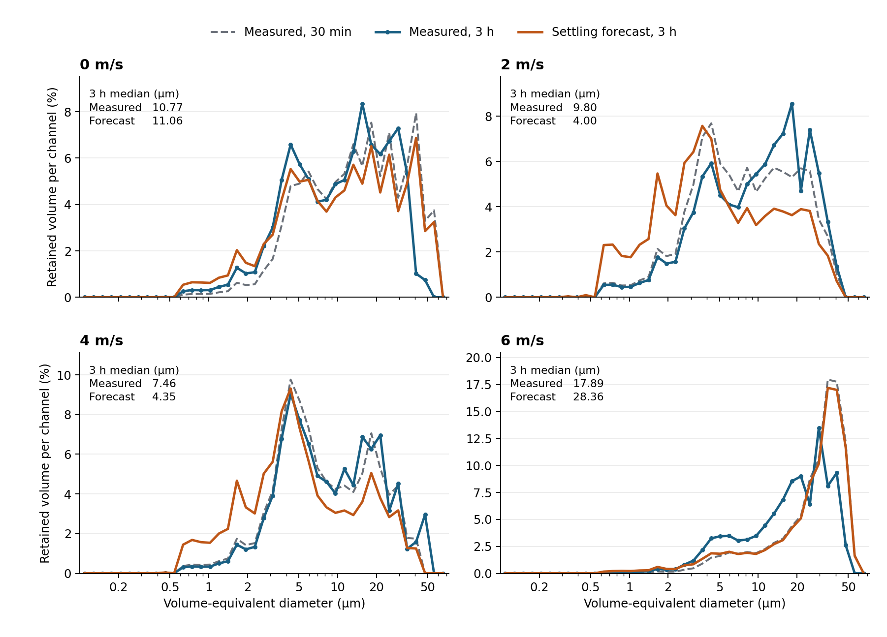
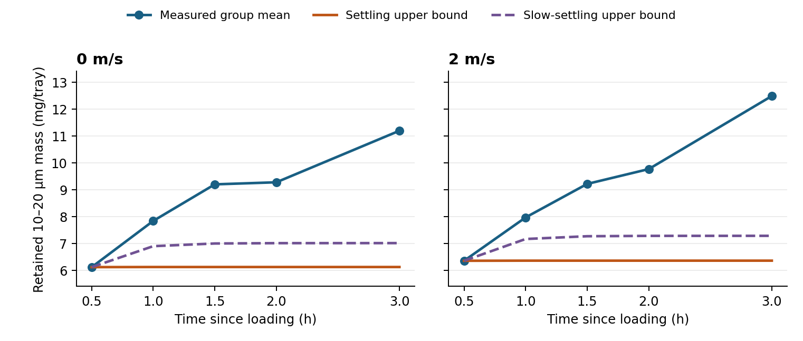
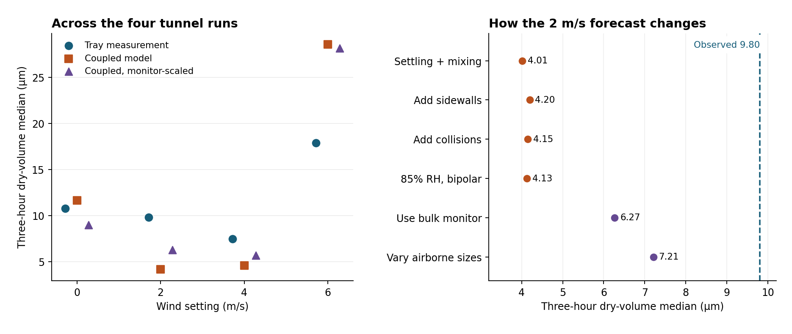
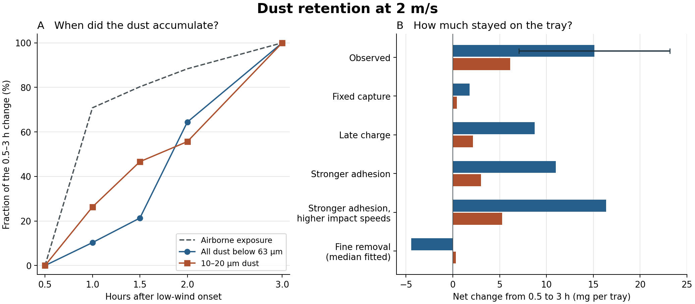
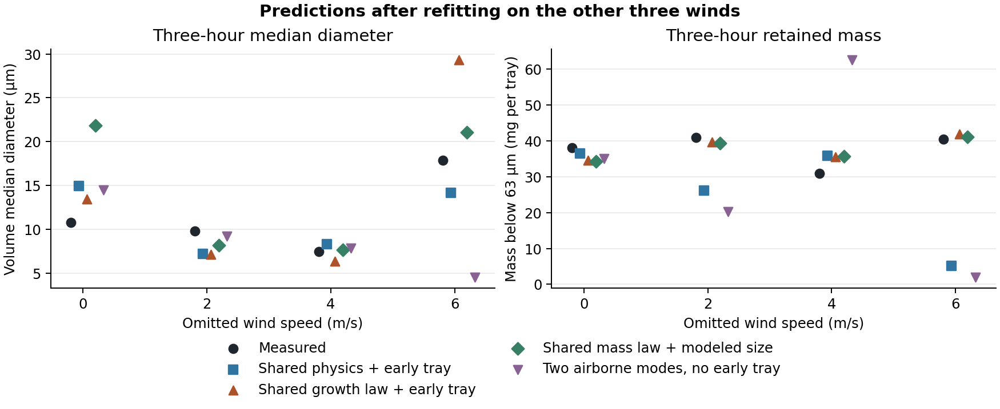

# Settling predicts the still-air dust median but misses the 10–20 µm enrichment at 2 m/s

[Read the integrated paper and its two synthesis figures.](../../docs/studies/literature/dust-tray-retention/index.md)

Jia and colleagues measured the size distribution of dust remaining on collection trays after 30 minutes and three hours in a wind tunnel. We used each early spectrum to forecast the later one using gravitational settling. In still air the predicted volume median was 11.06 µm, close to the measured 10.77 µm, yet the model kept the peak at 40.67 µm while the measured peak moved to 15.56 µm. At 2 m/s the median grew from 7.11 to 9.80 µm and the 10–20 µm channels gained 6.57 percentage points of retained volume. Settling predicted a median of 4.00 µm and a loss of 6.90 points in that band. The 10–20 µm mass nearly doubled, from 6.35 to 12.48 mg per tray. A model with size-dependent rebound reached a still-air median of 10.49 µm. When fitted across winds it could reproduce much of the 2 m/s shift, reaching 9.62 µm with those data included. Training on the other three winds gave 7.15 µm. A shared empirical growth law recovered much of the additional mass, while the size of the grains arriving late remained uncertain.

## What accumulated on the trays

Jia et al. loaded a recirculating tunnel with dry cropland dust, covered the source, and exposed floor trays at four wind speeds. Each tray collected continuously until retrieval. Separate groups supplied the 30-minute and three-hour samples. A deposited grain could subsequently leave a tray, so the laser measurement describes the material present at collection. The authors fitted cumulative mass for six diameter thresholds. Their Figure 4 supplies eight measured spectra, each with 41 reported diameter channels, and no fitted spectral forecast. We recovered all eight reported volume medians within 0.05 µm by normalizing the channels and interpolating cumulative volume on log diameter. The 2 m/s peak shifted from 4.32 to 18.26 µm. At 4 m/s it remained at 4.32 µm, even as the median increased. [Jia et al., methods and Figure 4](https://acp.copernicus.org/articles/26/14245/2026/) · [Archived workbook, version 2](https://zenodo.org/records/22962214)

## The still-air median hides a missed coarse tail

For a well-mixed column of height H with an absorbing floor, the deposited fraction of a channel by time t is F(t) = 1 − exp(−vₛt/H). We multiplied each early tray volume share by F(3 h)/F(0.5 h) and renormalized. This conditions on particles already retained at 30 minutes. Coarse channels that have already settled out then contribute little new material. We used Particula terminal speeds for mineral spheres at 2650 kg/m³ in a 2 m column, the tunnel test-section height. The comparison case simply copied the early shares. We selected no parameters from the late spectra and applied the same operator to all four early spectra.

| Wind (m/s) | 30 min D50 (µm) | Measured 3 h D50 (µm) | Settling 3 h D50 (µm) | Settling error (µm) | Whole-spectrum distance, copy → settling (percentage points) |
|---:|---:|---:|---:|---:|---:|
| 0 | 13.43 | 10.77 | 11.06 | +0.29 | 16.47 → 14.86 |
| 2 | 7.11 | 9.80 | 4.00 | −5.80 | 12.17 → 27.25 |
| 4 | 6.32 | 7.46 | 4.35 | −3.11 | 7.75 → 20.75 |
| 6 | 29.33 | 17.89 | 28.36 | +10.48 | 31.88 → 30.29 |

Distance is half the sum of the absolute channel-share differences. It gives the percentage of total volume that would have to move among channels to reproduce the endpoint. Signed median error is forecast minus measured. D50 divides retained volume into two equal parts. The peak is the single channel with the largest share. [All scores (`scores.csv`)](study-results.zip)

*Each panel uses its own 30-minute input. Lines connect the archived diameter channels. Vertical scales vary by panel.*

In still air, channels labeled 10 µm or smaller gained 8.84 percentage points, close to the predicted 8.39. Yet channels above 30 µm lost 13.58 points, against a predicted loss of only 2.78. Intermediate sizes gained the volume that the median alone cannot locate. At 6 m/s the >30 µm share fell from 49.57% to 20.02%, while the model left 47.45% there. It captured only 0.97 µm of the observed 11.45 µm median decline. [Size-band changes (`bands.csv`)](study-results.zip)

## At 2 m/s no preferential weighting toward smaller sizes improves on the early spectrum

For the two sampling times in this experiment, the multiplier for each channel is 1 + exp(−x) + … + exp(−5x), with x = vₛ × 1800 s / H. The multiplier decreases with settling speed. For spheres of common density, settling speed increases with diameter, so every median forecast from this model must be at or below the early median. Varying density from 1500 to 3000 kg/m³ and effective height from 0.5 to 4 m gave 2 m/s forecasts from 3.63 to 5.95 µm. A second calculation with an initially uniform still column and no vertical remixing gave 3.23–6.16 µm. Both miss the measured 9.80 µm. At 4 m/s the median also moved in the opposite direction to both models, although the nominal model recovered the modal channel. [Height, density and mixing tests (`sensitivity.csv`)](study-results.zip)

To test whether a different size dependence could rescue the forecast, we gave a diagnostic fit access to the three-hour spectrum. It could choose *any* nonnegative size multipliers that stayed constant or decreased with diameter. At 2 m/s the smallest whole-spectrum distance was 12.17 points, exactly the distance for the unchanged early spectrum to the displayed precision. At 4 m/s this freedom improved the distance by just 0.08 points. At 6 m/s the same diagnostic could lower the distance from 31.88 to 4.41 points. Thus the 6 m/s laser record allows much stronger preferential enrichment of fine sizes than the nominal physics produces. This retrospective fit establishes a lower bound on error and has no independent predictive score. [Monotone-weight limits (`monotone-limit.csv`)](study-results.zip)

## The 2 m/s middle-size gain also appears in retained mass

At 2 m/s the archived mass below 20 µm minus the mass below 10 µm rose from **6.35 to 12.48 mg per tray**, a gain of 6.13 mg. This is a difference of group means at two retrieval times. It supports an absolute increase in this band alongside the change in relative volume. The two summaries share the authors’ laser measurements. Different trays at each endpoint, unavailable individual channel spectra and unmeasured size-dependent delivery limit attribution to aggregation, transport or selective retention. [Threshold masses (`threshold-masses.csv`)](study-results.zip)

The mass record also tests the settling time directly. We initialized the band with its own early measured mass and assigned every particle the slowest speed in the 10–20 µm band. Even a 10 µm sphere settles at 8.09 mm/s under the reference assumptions, giving a depletion time H/vₛ of 4.12 minutes. By 30 minutes the column has supplied over 99.9% of its available 10–20 µm material. At 2 m/s the resulting upper bound on three-hour mass was 6.36 mg/tray. Giving particles the lowest density and largest mixing height tested raises the upper bound to 7.28 mg/tray. The archived means had already reached 7.97 mg/tray at one hour and rose to 12.48 mg/tray by three hours. Even in still air the three-hour mean was 11.19 mg/tray, against upper bounds of 6.12 and 7.01 mg/tray. These deterministic bounds condition on the measured early mean. The workbook gives no identifiers linking trays across the two size thresholds. The uncertainty analysis below accounts for the possible pairings, assuming independent groups at the two endpoints. [Five collection times and both bounds (`middle-band-growth.csv`)](study-results.zip)

At 6 m/s and three hours, the interpolated laser spectrum places **56.21%** of retained volume below 20 µm. The archived <20 and <63 µm mean masses yield **19.82%** under the authors’ volume-to-mass convention. Even dividing the largest <20 measurement by the smallest <63 measurement gives only 29.23%. The laser median is already below 18 µm, so shifting the 20 µm channel boundary cannot explain the gap. A comparable 2 m/s check gives 80.40% versus 79.35%. The two archive summaries at 6 m/s support different accounts of the middle sizes. Report its median as a result for Figure 4 and use the threshold mass records separately. [Cross-check by wind, time and cutoff (`consistency.csv`)](study-results.zip)

For the <63 µm total, scaling the early mass by the model's volume growth gives 28.42, 37.80, 31.94 and 27.92 mg per tray at 0, 2, 4 and 6 m/s. Measured endpoint means were 38.02, 40.96, 30.90 and 40.38 mg. The 4 m/s total is close although the median shift goes the wrong way. These conditional total-mass predictions assume common mineral density and that the early spectrum represents the mass samples. Seven endpoint gram cells are blank, including one of five 4 m/s trays at three hours for all six thresholds. We used available gram measurements. The 6 m/s three-hour <40 µm group also has four trays. Subtracting its mean from the five-tray <63 µm mean gives −0.11 mg for 40–63 µm. That difference between incomplete groups has no physical interpretation as retained mass. The paper gives a tray radius of 10 cm, while the workbook converts area using a 25.4 cm diameter. Using mg per tray avoids that discrepancy. [Total masses, sample counts and standard errors (`total-mass.csv`)](study-results.zip)

## The airborne dust supply mattered more than the collision kernel at 2 m/s

The coupled model divided the 2 m tunnel height into 12 equal-volume air parcels. Each parcel carried its own size distribution, exchanged dust with adjacent layers and lost particles to the floor and sidewalls. Measured wind profiles supplied the shear at 2, 4 and 6 m/s. The 102 simulations included still air, sustained changes in shear and sequences with stronger wind either early or late in the forecast. [Transport assumptions and case definitions](transport.md)

At 2 m/s, the early tray and initial loading implied that 84.95 mg/m³ remained airborne after 30 minutes. The centreline monitor measured 16.35 mg/m³. Treating this single-height reading as the section mean raised the three-hour median forecast by 2.11 µm. The monitor measured total airborne mass. At the same loading, assigning suspended dust the size distribution of the early tray raised the forecast further to 7.21 µm. Both estimates fell below the measured 9.80 µm. Scaling to the monitor also improved the forecast at 4 m/s but worsened it in still air. [Four-wind comparison (`transport-results.csv`)](study-results.zip)

The following paired comparisons use the 2 m/s monitor reading and the reconstructed airborne size distribution. Each row varies one part of the reference calculation. The extra decimal places show differences between simulations.

| Process varied | Three-hour volume median (µm) |
|---|---|
| Wind shear | Decreasing or increasing friction velocity by 25% gave 6.24–6.29. |
| Size-dependent sidewall loss | Including sidewall capture raised the median from 6.151 to 6.268. Modeled loss rates were 0.294 per hour for 0.5 µm particles and 0.040 per hour for 20 µm particles. |
| Collisions | Enabling Brownian, turbulent-shear and differential-settling collisions together moved the median from 6.275 to 6.268. Each kernel was also tested separately at the reconstructed loading. |
| Relative humidity | At 0%, 50% and 85% RH the medians were 6.268, 6.267 and 6.260, respectively, assuming dust hygroscopicity κ = 0.05. |
| Particle charge | Giving all particles +5 elementary charges yielded 6.271. An equal mixture of +5 and −5 yielded 6.267. Mergers reduced total particle number by 1.08% and 3.86%, respectively. |

The archive supplies no tunnel humidity, dust charge distribution or size-resolved wall loading for these cases. The humidity and charge comparisons therefore quantify sensitivity to prescribed values. The wall calculation treats the floor as absorbing, so actual tray losses through rebound or re-entrainment remain a possible contribution. [Size-dependent wall rates (`sidewall-rates.csv`)](study-results.zip) · [Airborne and deposited volume by size (`transport-channels.csv`)](study-results.zip)

## Frictional charging can alter collisions and collection at the tray

The dry grains could exchange charge as they struck each other, the soil bed or the tunnel surfaces during the 14 m/s loading phase. In low-humidity laboratory experiments, smaller grains of a single material tended to acquire negative charge and larger grains positive charge. The polarity and magnitude for Jia et al.’s soil are unknown. We tested that size dependence in 35 additional cases, allowing equal and opposite charge transfer during loading and charge inheritance when particles merged. [Laboratory contact-charging experiment](https://doi.org/10.1021/acs.iecr.7b02328) · [Tunnel methods](https://acp.copernicus.org/articles/26/14245/2026/)

At 2 m/s, using the 30-minute monitor constraint, the strongest persistent charge tested for contacts within the inferred source increased the particle-number loss from mergers from 2.9% to 25.2%. The predicted three-hour tray median moved from 6.27 to 6.12 µm, still below the measured 9.80 µm. In a separate test of electrical drift, an assumed upward field of 1 kV/m raised the median from 6.28 to 6.41 µm for the same contact population. Assigning charge through contacts with a coarser bed population reversed the response, lowering it to 5.84 µm. The data do not identify which grains carried each sign or what field they experienced. Size-resolved measurements of both polarities and the field above the tray would test that distinction. [Contact model, charge decay and field tests](tribocharging.md)

## Rebound can explain a median while missing the mass retained

We tested whether grains bouncing on first impact, returning to the tray, or being lifted after landing could explain the 2 m/s result. We first applied one fixed rebound law in still air, then transferred it to each wind speed. Each run started with the measured 30-minute tray and used the archived airborne concentration history. We inferred each wind’s airborne size mix by asking what mixture, under gravity alone, would deliver the early tray proportions. In still air, including rebound moved the three-hour median from 13.43 to 10.49 µm (measured 10.77) and the subsequent mass gain from 25.70 to 16.12 mg/tray (measured 13.42). The error across the full spectrum increased from 16.47 to 19.25 percentage points in total variation distance. Under the same rebound law, predicted medians at 2, 4 and 6 m/s were 5.13, 1.34 and 3.19 µm. The trays measured 9.80, 7.46 and 17.89 µm. [Settling and rebound study with all four wind speeds](rebound.md)

The 2 m/s mass history helps distinguish two ways to move the median. In a separate test that set the airborne size mix equal to the early tray spectrum and allowed preferential loss of particles up to 10 µm, we fitted the removal rate to recover the three-hour median of 9.80 µm. The tray then **lost 4.45 mg**, whereas the observed group mean **gained 15.12 mg**. An alternative allowed particles to stick at higher impact speeds after 30 minutes. With the early deposit used to infer the incoming size mix, increasing the 10 µm sticking threshold from 0.05 to 0.20 m/s gave a median of 10.20 µm and gains of 10.98 mg overall and 3.00 mg at 10–20 µm. Doubling the assumed fluctuations in normal impact speed brought the gains to 16.37 and 5.26 mg, near the measured 15.12 and 6.13 mg. The median was then 9.14 µm. These two scenarios needed near-tray concentrations of 1.28 and 1.94 times the centreline reading, respectively, to reproduce the early mass. Neither local concentration nor impact speed was measured. Keeping the mechanical threshold fixed and switching on strong charge-assisted adhesion instead gave 9.64 µm, +8.73 mg overall and +2.16 mg at 10–20 µm at the lower fluctuation level. [Surface-change results (`rebound-changing-surface.csv`)](study-results.zip) · [Charge and rebound assumptions](rebound.md)

By one hour, the centreline monitor had recorded 70.8% of its integrated exposure between 30 minutes and three hours. Separate trays retrieved at one hour showed only 10.3% of the eventual total gain and 26.3% of the 10–20 µm gain. Even granting an exact fit to both endpoints, a constant collection law after 30 minutes with incoming size-resolved flux proportional to that monitor would give 36.55 mg/tray by one hour. The retrieved mean was 27.40 mg/tray. The 9.15 mg discrepancy had an approximate 95% interval of 3.21–15.09 mg/tray, holding the exposure fixed and treating the three groups of five trays as independent. Shared flow conditions and the fixed positions assigned to each retrieval time add uncertainty. Letting adhesion strengthen with a 60-minute time constant reduced the early accumulation, but the reference mechanical case then gained only 4.68 mg by three hours. The figure's whisker is an approximate 95% interval for the total mass change, treating endpoint groups as independent. The archive does not resolve sampling intervals for each laser channel. [Retrieval means and exposure (`rebound-timing.csv`)](study-results.zip) · [Timing uncertainty (`rebound-timing-intervals.csv`)](study-results.zip) · [Gradual changes in adhesion (`rebound-gradual.csv`)](study-results.zip) · [Uncertainty](uncertainty.md)

## The measured shift survives calibration and weak-channel tests

Jia et al. averaged three laser readings per sample. Calibration standards had to fall within ±1% of nominal diameter, a shift above 2% in a check suspension triggered recalibration, and blank noise had to stay below 0.5%. To test the sign of the median change, we allowed independent ±2% diameter shifts at the two endpoints, suppressed channels contributing less than 0.5 percentage points and assigned 1% hypothetical undetected volume to either end of the size range. The latter two values are sensitivity assumptions. The archive gives no channel-specific detection limit. [Measurement methods](https://acp.copernicus.org/articles/26/14245/2026/) · [Detection-test definitions](uncertainty.md)

The median shift kept its sign at all four winds. At 2 m/s the measured increase of **2.69 µm** ranged from **2.23 to 3.39 µm** under the combined perturbations. This range describes the tested instrument effects. A sampling confidence interval for the median would require individual tray spectra. The balance resolved 0.1 mg. For the observed **6.13 mg/tray** gain in 10–20 µm material, feasible pairings of the archived threshold masses give standard errors of **0.95–4.35 mg/tray**. [Sensitivity results by wind (`measurement-sensitivity.csv`)](study-results.zip) · [Tray-pairing results (`middle-band-spread.csv`)](study-results.zip)

## How optical sizing affects the 2 m/s forecast and the 6 m/s mass comparison

Jia et al. describe laser diffraction. The manufacturer's EyeTech documentation describes a scanning laser that sizes each accepted grain by the duration of its shadow. The archive provides the eight processed size distributions. The optical channel, raw signals and replicate spectra needed to estimate experimental uncertainty are missing. We tested both measurement principles. [Jia et al., methods](https://acp.copernicus.org/articles/26/14245/2026/) · [EyeTech instrument description](https://www.ankersmid.com/AutoFiles/doc/922_eyetech%20technologies.pdf) · [Optical study and figure](optical-study.md)

At 2 m/s the apparent median increased by 2.69 µm. The selected transit reconstructions for randomly oriented grains with aspect ratios from 1 to 2 gave increases of **2.26–3.12 µm**. The physical model fitted on the other three winds still underpredicted the three-hour median by **2.23–3.01 µm**. Changing the scan alignment between the two samples could reverse the shift. In the alternative diffraction calculation, a pair of distributions with equal medians became compatible with the synthetic wide-angle signals at **1.22% maximum weighted signal discrepancy**. Holding the predicted three-hour size distribution and nominal optics fixed, its best-scaled signal missed the synthetic observation by **17.18%**. The difference matters because matching a median leaves freedom to put the remaining volume into the wrong size channels. Both thresholds depend on assumed detector coverage. [Paired optical reconstructions (`optical-transfer.csv`)](study-results.zip) · [Limits on the median (`optical-tipping.csv`)](study-results.zip) · [Physical model in detector space (`optical-model-signals.csv`)](study-results.zip)

At 6 m/s the three-hour spectrum puts **56.21%** of the below-63 µm volume below 20 µm. The threshold masses, which the authors derived from tray weights and optical fractions, imply **19.82%**. Across all 120 assignments of the five below-20 values to the five below-63 values, averaging the individual tray ratios gave **19.64–20.73%**. Reordering the trays or changing the order of averaging cannot explain the gap if both summaries refer to the same trays and size definition. Linking each tray weight to its original size analysis would resolve whether the two summaries are comparable. [Tray-pairing calculation (`optical-tray-pairing.csv`)](study-results.zip)

## A shared fit transfers total mass more reliably than the 2 m/s size shift

We next fitted one parameter vector across all wind speeds. Automatic differentiation supplied gradients for a joint fit to the six cumulative mass thresholds and the 41-channel laser spectra. The model used Particula fall speeds, size-dependent impact capture, a possible lag between the centreline monitor and the tray, and wind-dependent removal. We refitted from scratch with each wind omitted. For the original transfer question we supplied that wind’s 30-minute tray and recorded airborne concentration. A separate test withheld every tray measurement from the omitted wind and inferred the incoming size distribution from the other three.

At 2 m/s, the early-conditioned physical fit gave a three-hour median of 9.62 µm when that wind entered calibration. With 2 m/s withheld, the median fell to 7.15 µm, close to the initial 7.11 µm. The model then predicted 6.27 mg in the 10–20 µm band, compared with 12.48 mg measured. Across all four omitted winds its median error averaged 2.84 µm, an improvement over 4.48 µm from copying the early spectrum. Its total-mass error averaged 9.95 mg/tray over the later retrievals. A two-parameter common growth law reduced that error to 3.02 mg while keeping the early size proportions. [All held-out predictions (`global-comparisons.csv`)](study-results.zip)

An exploratory model used the common growth law for total mass and the physical model for the size proportions. With 2 m/s omitted, it predicted 39.33 mg/tray and 8.19 µm, compared with 40.96 mg/tray and 9.80 µm measured. The same procedure overpredicted the still-air median by 11.06 µm. When we trained through 1.5 hours across all four winds and withheld the last two times, its total-mass error averaged 5.19 mg and its three-hour median error averaged 6.61 µm. These comparisons identify a useful shared mass-growth curve. They leave the physical delivery and adhesion parameters weakly constrained. Adding a freely fitted image-attraction term for frictionally charged grains gave essentially the same withheld predictions. At 6 m/s, the three-hour laser spectrum assigns 56.21% of volume below 20 µm and the threshold masses assign 19.82% of mass there. A single uniform-density spectrum cannot exactly match both archived means. [Shared fit, external wind-tunnel tests and parameter sensitivity](global-fit.md) · [Numerical checks (`global-checks.json`)](study-results.zip)

## What the early tray can predict

For this dust, still air supports a useful estimate of the three-hour median, with a substantial miss in the peak and coarse tail. At 2 m/s, even a model calibrated successfully on that wind missed the coarsening when trained on the other winds. The 2 m/s result supplies a more discriminating benchmark for a transport model. It must allow the 10–20 µm contribution to rise relative to the fine channels while the total retained mass grows. At 2 m/s, measuring the size and normal velocity of incoming grains just above the tray during 0.5–1 h and 1–3 h would distinguish a late supply of 10–20 µm dust from higher retention of the same incoming population. Paired adhesive and untreated acrylic collectors, with matched positions and retrieval times, would provide an independent check on capture. Replicate spectra linked to the individual threshold masses would also help resolve the 6 m/s discrepancy.

## Reproducibility

- CPU run with Particula 0.3.6 at commit 3435f653ae2606c4eeef23bdf55b617d2ac58586. Dry-air properties used 293.15 K and 101325 Pa. These are modeling assumptions. Predicted settling speeds at 2 and 10 µm were 0.344 and 8.09 mm/s, close to the paper's approximate 0.35 and 8.1 mm/s. The single-column settling model advances time analytically. In the coupled model at 2 m/s, refining from 12 to 24 parcels, 48 to 95 size pivots and 120 to 60 s maximum steps changed the monitor-scaled median by 0.00092 µm. [Environment and inputs (`run.json`)](study-results.zip) · [Specification](specification.md)
- Each input is a channel volume percentage, not a density per log diameter. For band sums we grouped labels at (0,10], (10,20], (20,30] and >30 µm. For comparison to cumulative threshold masses we interpolated the normalized cumulative curve to the exact cutoff. This gives distinct values for the two operations. Treating early volume as uniform in log diameter between adjacent cumulative coordinates changed the nominal forecasts by at most 0.47 µm. Refining that alternative from 16 to 32 subchannels changed any median by less than 0.00004 µm. These are numerical and representation checks. The archive lacks the individual channel spectra needed for a sampling interval on D50 or band shares. [Within-channel sensitivity (`refinement.csv`)](study-results.zip)
- The workbook is distributed under CC BY 4.0 by Jia et al. The replay verifies its MD5 before reading. Figure 4 is the observational reference. The paper's threshold kinetic fits address a different quantity and were not rerun. The original settling forecast used an untuned transfer law. The subsequent optimization refitted shared parameters within the same previously inspected experiment. [Original data](https://zenodo.org/records/22962214) · [Replay instructions](README.md) · [Numerical channel data (`channels.csv`)](study-results.zip)
