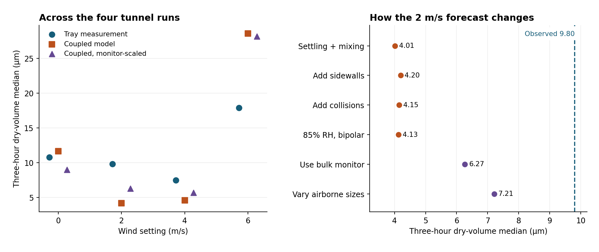

# Adding wind-driven mixing, wall loss and collisions leaves the 2 m/s dust deposit too fine

The 30-minute tray records what remained on its surface at retrieval. Predicting the next 150 minutes also requires the amount and size distribution of dust still in the air. At 2 m/s our reconstruction from the early deposit and initial loading left **84.95 mg/m³** airborne at 30 minutes. The monitor on the tunnel centreline read **16.35 mg/m³**. The coupled model forecast a three-hour volume median of 4.15 µm. Scaling the remaining dust to the monitor reading moved the forecast to **6.27 µm**, against **9.80 µm measured**. With that same bulk constraint, changing humidity, charge or collisional sticking had much smaller effects. The size distribution of suspended dust at 30 minutes remains unmeasured. This limits what a collision-kernel comparison can establish about this experiment.

| Wind (m/s) | Early tray (µm) | Measured 3 h (µm) | Coupled model (µm) | Coupled, scaled to 30 min monitor (µm) | Reconstructed / measured bulk at 30 min (mg/m³) |
|---:|---:|---:|---:|---:|---:|
| 0 | 13.43 | 10.77 | 11.66 | 8.97 | 30.41 / 74.94 |
| 2 | 7.11 | 9.80 | 4.15 | 6.27 | 84.95 / 16.35 |
| 4 | 6.32 | 7.46 | 4.55 | 5.66 | 77.37 / 20.46 |
| 6 | 29.33 | 17.89 | 28.58 | 28.15 | 12.95 / 20.41 |

The monitor measured total concentration at one height. Treating it as the section mean is a sensitivity test. It improves the median at 2 and 4 m/s and worsens the still-air median. As a separate test at the same observed 2 m/s loading, we assigned the suspended particles the size composition of the early deposit. The predicted median then rose to 7.21 µm. This alternative gives slightly coarser dust than the early tray but still falls 2.59 µm short. Its assumed airborne sizes have no independent observational support. [All cases (`transport-results.csv`)](study-results.zip) · [Air, floor and sidewall inventory by size (`transport-channels.csv`)](study-results.zip) · [Measured inputs](https://zenodo.org/records/22962214)

## Wind varied between runs, across height and within a run

Our first reconstruction used one column and changed only the measured early spectrum at each wind. Here twelve equal-volume air parcels occupy fixed height intervals across the 2 m section. The model exchanges dust between adjacent parcels through turbulent diffusion and downward settling. Each parcel has its own particle size distribution and collision rates. These fixed layers resolve vertical transport. The model averages over the horizontal direction and does not track individual paths around the tunnel circuit.

We recovered friction velocities of 0.0627, 0.0887 and 0.1543 m/s at 2, 4 and 6 m/s by fitting the measured 0.05–0.40 m velocity profiles. The simulation uses these values for turbulent exchange and shear. At 2 m/s, decreasing or increasing friction velocity by 25% after 30 minutes gave 4.11–4.20 µm. Switching from low to high shear halfway through the remaining time gave 4.12 µm. Reversing the sequence gave 4.18 µm. These are imposed wind histories. The archive supplies mean profiles, and the brief gusts and tray-rim wakes remain unresolved. [Jia et al., Figure 1 and methods](https://acp.copernicus.org/articles/26/14245/2026/) · [Case definitions](transport.py)

## Sidewalls remove fine particles, but the measured middle-size gain remains

Without collisions at 2 m/s, adding competing sidewall loss moved the median from 4.01 to 4.20 µm. The baseline sidewall sink increases with wind shear and Brownian diffusivity, preferentially removing fine dust. With collisions active, varying the wall eddy coefficient from 0.1 to 10 times nominal gave 4.02–4.52 µm. For dry 0.5, 2, 10 and 20 µm particles at 2 m/s, the modeled sidewall loss coefficients were 0.294, 0.132, 0.057 and 0.040 per hour. [Sidewall rates by size and wind (`sidewall-rates.csv`)](study-results.zip) The nominal model assigned 12.54% of the dry inventory at 30 minutes to subsequent sidewall capture. No measurements of wall loading were available to calibrate this coefficient. Other surfaces, including the bends and fan, could capture coarse particles through impaction. The model treats the floor as absorbing and uses its dry-volume spectrum as the tray proxy. The authors’ separate edge-capture experiment found a marked increase in mobilization near 6 m/s, so the highest-wind observation also includes a surface-loss pathway absent here. [Wall-loss formulation](https://doi.org/10.1016/0021-8502%2881%2990036-7) · [Jia et al., supplement Figure S1](https://acp.copernicus.org/articles/26/14245/2026/acp-26-14245-2026-supplement.pdf)

## Which collisions, humidity and charge changed the forecast?

All three encounter kernels feed an evolving sectional particle population in each layer. In the 2 m/s case using the reconstructed loading, the sidewall-only median was 4.197 µm. Activating Brownian collisions alone gave 4.162 µm, turbulent shear alone 4.196 µm and differential settling alone 4.187 µm. Combining them gave 4.154 µm. Although mergers grow individual particles, earlier capture of the resulting fine-particle aggregates can lower the median of the cumulative deposit. The combined model placed 15.46% of retained volume in the channels labeled 10–20 µm, below both the early 21.82% and the measured late 28.39%. Starting all three kernels and sidewall loss at release gave 7.21 µm at 30 minutes and 4.31 µm at three hours.

At 2 m/s with the 30-minute airborne mass scaled to the monitor, collisions moved the median from 6.275 to 6.268 µm. Omitting sidewall loss while retaining collisions gave 6.151 µm. The 0%, 50% and 85% RH scenarios gave 6.268, 6.267 and 6.260 µm. At dry conditions, +5 elementary charges per particle gave 6.271 µm and an equal mixture of +5 and −5 gave 6.267 µm. The like-sign and bipolar closures reduced total particle number by 1.08% and 3.86% through mergers, respectively, counting the airborne and captured inventories together. The change in collision frequency is easier to see in number than in the volume median. The 30-minute size and mass assumptions matter more to this forecast than choosing among these specific RH and charge cases. Larger charges, humidity-dependent sticking, and electrostatic wall capture remain open. [Numerical results (`transport-results.csv`)](study-results.zip)

## How the calculation can be checked

- **Wind and air supply.** The source was closed after loading. Using the four initial bulk concentrations from supplementary Table S1, we identified deposition time zero at workbook minute 4, 4, 7 and 4, respectively. The early spectrum supplies relative floor composition. For each size, a unit tracer initially uniform over height gives its floor fraction by 30 minutes. Dividing the early share by that fraction and scaling the resulting air inventory to measured initial mass supplies the starting distribution. The reference spins up for 30 minutes using gravity and vertical exchange. The default forecast adds the requested processes thereafter. In the full-duration challenge those processes run from the common initial state and both early and late spectra are scored. In the monitor cases the analysis resets only the airborne inventory at 30 minutes and then conserves the revised budget. [Air monitor and initial loading](https://acp.copernicus.org/articles/26/14245/2026/acp-26-14245-2026-supplement.pdf)
- **Transport and boundaries.** Interlayer diffusion uses K(z) = 0.4 u★ z (1−z/H). Settling transfers particles downward at their Particula slip- and drag-corrected speeds. The two lateral walls of the continuously recirculating test section use the lateral term of the rectangular chamber closure, 4√(kₑDᴮ)/(πW), where Dᴮ is Particula Brownian diffusivity, W = 2 m and kₑ = u★²/ν is an assumed wall-turbulence scale. This sidewall sink vanishes at zero imposed shear. Floor flux is counted once. There are no absorbing end caps. Pure diffusion to distant walls in still air, electrostatic wall deposition and losses back off the floor are omitted.
- **Kernels.** Brownian collisions use the Particula transition-regime kernel. The Saffman–Turner shear kernel uses assumed local dissipation ε = u★³/(0.4z). Differential settling uses geometric cross-section times the absolute difference in fall speeds. The reference uses unit collision/sticking efficiency and compact merged spheres. A separate case reduces combined sticking to 0.1. For charge we multiply the Brownian term by a continuum Coulomb factor, averaging like- and unlike-sign factors for the bipolar case. The charge mixture is prescribed at every size and time. This approximation excludes the evolution of aggregate charge, charge-dependent adhesion and electric fields. [Saffman and Turner](https://doi.org/10.1017/S0022112056000020) · [Coulomb collision theory](https://doi.org/10.1103/PhysRevE.85.026410)
- **Humidity and observation.** The test assumes κ = 0.05 and subsaturated equilibrium, using wet/dry volume ratio 1 + κ RH/(1−RH) with RH expressed as a fraction. We neglect curvature, adjust wet density with water at 1000 kg/m³, and use wet size for motion and collision cross-sections. We compare retained **dry** material by volume-equivalent size with the laser data. Sample dispersion, aggregate breakup and changes in adhesion are unresolved. Tunnel RH, the actual dust water uptake and dust charge were unavailable as forcing. [Petters and Kreidenweis](https://acp.copernicus.org/articles/7/1961/2007/)
- **Numerics and uncertainty.** Transport uses an exact matrix exponential over each substep, split around a positivity-checked collision integration. Births distribute to adjacent dry-mass pivots to conserve mass. The grid extends beyond the instrument channels. All 102 scenarios closed the dry budget across air, floor and sidewalls to better than 3 × 10⁻¹³ relative. At 2 m/s the monitor-scaled median changed by 0.00092 µm on refining together from 12 to 24 parcels, 48 to 95 pivots and 120 to 60 s maximum step. The measured shift remains positive under the specified calibration and detection stresses. The lack of individual laser spectra prevents a sampling interval on the measured median. [Detection and tray uncertainty](uncertainty.md) · [Replay](README.md)
