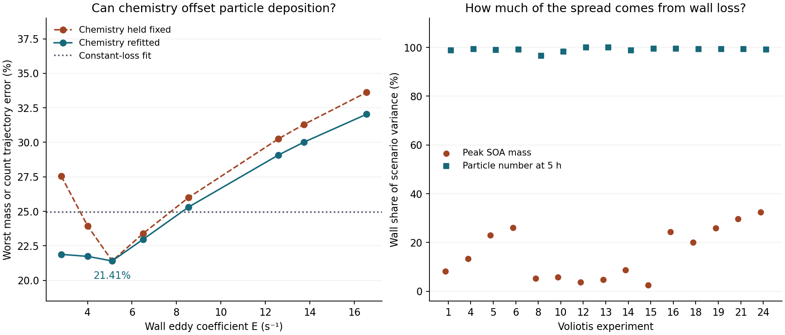

# Chemistry controls most of the modeled peak SOA spread, while particle counts constrain wall loss

One shared reduced mechanism reproduced parts of the Manchester SOA campaign, but the best joint fit left a **21.41% worst trajectory error** across the 15 experiments with measured precursor decay, suspended organic mass and particle counts. The worst mass trajectory alone had 21.41% error, exceeding the original 10% mass target. A matched fit with constant particle loss gave 24.93%. Size-dependent deposition improves agreement, and chemistry can compensate for part of the change in wall loss. Neither effect resolved the ternary mass excess or the rising particle count in a binary run. These are same-experiment reproduction results conditional on measured precursor decay. The paper reports 24 experiments in total. [Voliotis et al.](https://acp.copernicus.org/articles/22/14147/2022/) · [Coverage and archive reconciliation](joint/data/CAMPAIGN_SERIES.md) · [Run-by-run results](joint/results/uncertainty/best_by_run.csv)



## What the earlier chemistry analysis established

In four α-pinene experiments, adding a second volatility class or an aging pathway gave little improvement at nominal dose and fixed branching. Allowing the reported ±15% injection uncertainty let the simple mechanism reach 7.5% worst mass trajectory error. At nominal dose, allowing the product branch to depend on initial NOₓ gave 8.23% in native replay. With bounded doses, NOₓ slopes from 0.396 to 1.481 produced identical product-source histories. The mass curves therefore admit multiple chemical explanations even before fitting particle deposition. In the wider campaign we tested additive yields, mixture-dependent yields, distinct precursor delays and dose uncertainty. Those comparisons assessed mechanism structure and parameter trade-offs. [Four-run mechanisms and dose equivalence](joint/REPORT.md) · [Earlier campaign comparisons](joint/results/campaign_dose_scores.csv)

## How chemistry and wall loss were varied together

The campaign model gives α-pinene, o-cresol and isoprene one formation delay each and two effective yields per parent. The two channels weight each parent's disappearance by its own and the other precursors' shares of total disappearance. Particula's rectangular-chamber deposition law uses the evolving representative particle size, Brownian diffusivity and settling speed. Brownian coagulation also removes particle number. The effective wall eddy coefficient E has units of s⁻¹ in the near-wall diffusivity relation Dₑ(z) = Ez². E is shared across runs. It is distinct from the size-dependent particle deposition rate. [Campaign equations and implementation](joint/wall_campaign.py) · [Wall evidence, geometry and independent seed checks](joint/WALL_LOSS.md)

- **Forward sensitivity at nominal injections.** Two separately scrambled Sobol designs with 256 chemistry vectors each were fully crossed with eight wall coefficients from 2.82 to 16.55 s⁻¹, giving 4,096 joint scenarios. For each chemical coordinate, the bounds span six earlier campaign solutions obtained by fitting mass alone, mass and counts jointly, or mass and counts at the fixed dark-seed wall setting. Delays were sampled on a log scale and yields on a linear scale. Crossing the coordinates deliberately breaks their fitted correlations to test sensitivity. The eight wall levels include single-run count minima, the formation optimum, dark-seed fits and two intermediate values. The high E from fitting mass alone was excluded because it badly missed the count histories. [Chemistry vectors and origins](joint/results/uncertainty/chemistry_design.csv) · [Wall-level construction](joint/uncertainty_profile.py) · [Shao et al., dark seed loss](https://amt.copernicus.org/articles/15/539/2022/#section3)
- **Shared-fit assessment.** At each wall level we evaluated chemistry fits spanning the original search bounds of 5 min to 4 h for each delay and 0 to 2 for each mass yield. Six levels received two new evolutionary searches. The formation optimum and the dark reference reused prior search vectors, rescored at the exact level. We also crossed the six historical and 16 profile vectors with every wall setting. Each run could choose one multiplier on all its injections from 0.85 to 1.15 in increments of 0.005. The score is the largest run-level mass or number RMSE. Mass is normalized by the observed peak with a 1 µg m⁻³ floor, and counts by initial number. The 1,258 mass and 682 count readings were scored at their measurement times. [Profile fits](joint/results/uncertainty/wall_profile.csv) · [Scores for every scenario](joint/results/uncertainty/scenario_scores.csv)
- **Scope of uncertainty.** For each run and response, we partitioned the variance of the nominal-dose forward design into chemistry, wall coefficient and their interaction, weighting each chemistry vector and wall level equally. Peak SOA is the maximum prediction at that run's mass measurement times. The number response is the modeled fraction remaining at five hours. The reported shares and extrema describe these chosen scenarios. No probability law for the real chamber, measurement-error model, or confidence interval was inferred. [Per-run variance fractions and envelopes](joint/results/uncertainty/sensitivity_by_run.csv)

## What the observations distinguish

**Chemical yields and delays explained 86.3% of peak SOA variance in the median run**, ranging from 67.1% to 97.2% across experiments. **Particle wall mixing explained 99.3% of five-hour number variance in the median run**, ranging from 96.6% to essentially 100%. Interactions accounted for at most 1.9% of peak mass variance. Estimates from the two independent designs differed by at most 0.17 percentage point for any reported campaign variance share. The number result is conditional on the modeled sinks, representative particle size, and known initial count. Processes that add particles were outside this analysis. The two isoprene-only controls have zero observed mass, so a high fractional chemistry contribution there describes very little absolute variation. [All 15 experiments in physical units](joint/results/uncertainty/sensitivity_by_run.csv)

The detailed four-run α-pinene model gave the same ordering. We crossed 256 vectors for product branching, saturation concentration, accommodation, formation delay, vapor wall loss and NOₓ response with the same eight wall levels at nominal dose. Their bounds span nine earlier detailed fits. The combined chemistry, vapor-loss and uptake parameters accounted for 74–86% of peak mass variance, while the particle wall coefficient accounted for 99.2–99.4% of five-hour number variance. Here peak mass uses the six-minute model output grid. These four runs overlap the campaign and provide a check using a different mechanism. The earlier free-wall detailed fit achieved 12.42% worst joint error at E = 4.76 s⁻¹. [Detailed chemistry design](joint/results/uncertainty/alpha_design.csv) · [Detailed response shares](joint/results/uncertainty/alpha_sensitivity.csv) · [Detailed fixed-wall scores](joint/results/uncertainty/alpha_profile.csv)

| Shared E (s⁻¹) | Worst error with chemistry fixed | Worst error after chemistry refit |
|---:|---:|---:|
| 2.82 | 27.55% | 21.88% |
| 4.00 | 23.95% | 21.73% |
| 5.11 | 21.41% | 21.41% |
| 6.50 | 23.39% | 22.97% |
| 8.54 | 26.00% | 25.31% |
| 12.59 | 30.26% | 29.08% |
| 13.74 | 31.30% | 30.02% |
| 16.55 | 33.62% | 32.03% |

Both columns reselect the bounded dose in each experiment. Several relatively low E values give similar errors once chemistry can adjust. Fixing E to the independent dark-seed log-rate fit of 13.74 s⁻¹ leaves 30.02% error after refitting chemistry. That mismatch limits transfer of the effective dark coefficient to these illuminated runs. Halving the integration step from 30 to 15 s changed any per-run fitted trajectory error at the eight selected solutions by less than 0.012 percentage point. [Full profile and numerical check](joint/results/uncertainty/wall_profile.csv)

**Two experiments show where the common model falls short.** Using the constant-loss fit's 24.93% score as a comparison threshold, the tested scenarios that matched or improved it were confined to the four sampled wall levels from 2.82 through 6.50 s⁻¹. Six of the 4,096 forward-design scenarios met this screen after dose adjustment, alongside 26 rows from the fitted vectors, which include repeats. Across every compatible run-24 dose on the 61-point grid for these scenarios, the predicted peak in ternary run 24 was 72.35–85.95 µg m⁻³ against an archived peak of **59.05 µg m⁻³**. Binary run 16 reached **123% of its initial particle count**. With deposition and coagulation as its only number-changing processes, the model's count can only fall. At the overall optimum, run 24 reached a modeled 79.19 µg m⁻³ even at its minimum allowed dose. It had the largest mass error (21.41%), while run 16 had the largest count error (21.39%). Their residuals point to different limitations. Time-resolved product composition would help distinguish yields from partitioning in run 24. Size-resolved number and a synchronized second counter could distinguish a real particle source from a counting or timing issue in run 16. A unique chemical mechanism or an out-of-sample prediction has yet to be established. [Screened ranges](joint/results/uncertainty/sensitivity_by_run.csv) · [Per-run fitted values](joint/results/uncertainty/best_by_run.csv) · [Count records and instrument choices](joint/WALL_LOSS.md)

## Reproduce the uncertainty analysis

From the study worktree root with the Particula environment and a CUDA device, run the following commands. The first reconstructs the conditional fit vectors from the archived starting fits. The ensemble scripts include the criteria used for the tables. The figure uses the saved results.

```bash
export PYTHONPATH="$PWD"
export MPLBACKEND=Agg
PY=/home/kyle/Code/particula/.venv/bin/python
J=studies/voliotis-2022/joint
"$PY" "$J/uncertainty_profile.py"
"$PY" "$J/uncertainty.py"
"$PY" "$J/uncertainty_alpha.py"
"$PY" "$J/uncertainty_figure.py"
```
