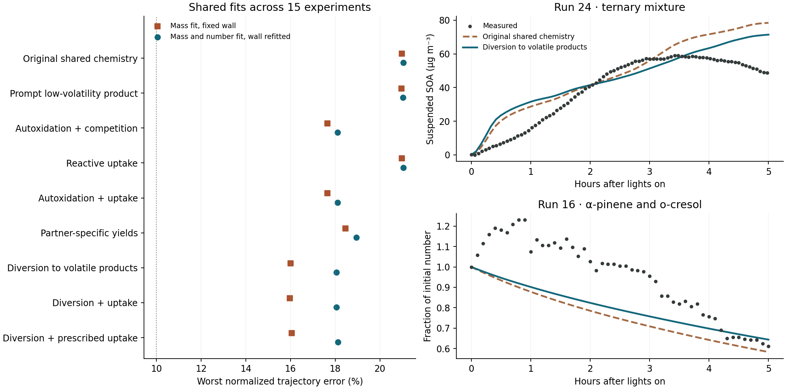

# Isoprene-dependent product formation improves the Manchester SOA fit

The reference model already allowed yields to differ between pure precursors and mixtures. The largest improvement came from letting isoprene disappearance change how much α-pinene and o-cresol oxidation product remained available to condense. Across 15 experiments by Voliotis and colleagues, fits to organic mass at a common wall coefficient gave about 21% worst-run trajectory error with the refitted reference chemistry. An extra α-pinene product that condensed immediately left that error almost unchanged. A gas-phase pathway with competition from isoprene oxidation improved it, and diverting part of the original α-pinene and o-cresol product supply toward volatile material lowered it to about 16%. Every model retained size-dependent particle deposition. These fits use each experiment's measured parent-VOC decay, seed loading and initial particle number. They assess which shared mechanisms can reproduce the chamber observations. Among the tested formulations, the fits favor an additional dependence on measured isoprene disappearance. The identities and reaction locations of the products remain unresolved. [Chamber experiments](https://acp.copernicus.org/articles/22/14147/2022/) · [Mechanism fits](joint/results/pathways/comparison.csv)

## The chamber measured both product amount and particle volatility

In the earlier Particula fit, ternary run 24 reached a modeled 79.19 µg m⁻³ of suspended organics against an observed peak of 59.05 µg m⁻³. The excess motivates two distinct questions. Does a faster or more strongly retained oxidation product change the timing of aerosol growth? Does the mixture shift a portion of the product supply away from the aerosol altogether? The Manchester companion paper found directionally different volatility changes in isoprene mixtures with α-pinene and o-cresol. The ternary particles were less volatile than an additive prediction. A smaller mass of particles can still be enriched in low-volatility material. The material that remains in the gas is absent from the measured particle volatility distribution. These fits predict total suspended mass and number. They do not predict the measured distribution of product volatilities. [Earlier wall-constrained assessment](ASSESSMENT.md) · [Manchester volatility measurements](https://acp.copernicus.org/articles/22/13677/2022/)

## Prompt condensation, gas-phase branching and uptake make different predictions

α-Pinene oxidation can produce highly oxygenated molecules on a seconds timescale. Separate chamber measurements show that isoprene-derived radicals can intercept low-volatility product formation, while uptake measurements show that some oxidation products react after reaching particles. These observations motivated the competing routes. The autoxidation calculation uses an effective gas intermediate and a competing volatile branch proportional to measured isoprene disappearance. The reactive-uptake calculation generates a vapor from α-pinene and o-cresol that competes between loss to the gas-chamber system and irreversible uptake on the evolving particle area. Neither a fitted radical concentration nor a measured uptake probability was available for these Manchester runs. [Rapid α-pinene autoxidation](https://www.nature.com/articles/s41467-021-21172-w) · [Isoprene and product scavenging](https://www.nature.com/articles/s41586-018-0871-y) · [Particle uptake of α-pinene oxidation products](https://doi.org/10.1029/2021JD036414)

| Shared chemistry | Worst mass error, fixed E | Worst mass or count error, fixed E | Worst mass or count error, fitted E |
|---|---:|---:|---:|
| Original shared chemistry | 20.98% | 21.25% | 21.05% |
| Prompt low-volatility product | 20.97% | 21.23% | 21.04% |
| Autoxidation + competition | 17.65% | 20.88% | 18.11% |
| Reactive uptake | 20.98% | 21.25% | 21.05% |
| Autoxidation + uptake | 17.65% | 20.88% | 18.11% |
| Partner-specific yields | 18.46% | 20.95% | 18.94% |
| Diversion to volatile products | 16.00% | 20.90% | 18.06% |
| Diversion + uptake | 15.97% | 20.90% | 18.06% |
| Diversion + prescribed uptake | 16.05% | 20.98% | 18.11% |

The first two score columns hold the wall eddy coefficient at 5.11 s⁻¹. Fitting mass alone allows the chemistry to improve while run 16 still carries about 21.5% count error. Fitting both observables at that same wall setting leaves all joint scores above 20%. Allowing the shared wall coefficient to change lowers the reference joint score to 21.05% at E = 4.84 s⁻¹ and the diversion score to 18.06% at E = 3.18 s⁻¹. The autoxidation–competition route reaches almost the same joint score (18.11%). This comparison refits the reference, which improves slightly on the earlier 21.41% result. The lower worst-run mass error also hides a trade-off. For the fixed-wall mass fits, the median run error moves only from 16.10% to 15.98% with diversion, and the number meeting 10% falls from four runs to one. [Scores and run identities](joint/results/pathways/comparison.csv)

**The observations permit substantial reactive uptake.** When we prescribed positive uptake alongside diversion, uptake delivered 22.7% of cumulative gross SOA production in run 24 in the fixed-wall mass fit. The worst mass error was 16.05%, compared with 16.00% with uptake disabled. This is a modeled fraction before particle deposition. Its value comes from the imposed uptake assumptions. Mass alone cannot determine how much of that production actually occurred in the particle phase. The effective autoxidation case also reached both its lifetime and competition upper bounds (300 s and 10 (ppb min⁻¹)⁻¹) in the fixed-wall mass fit. Its improvement supports exploring competitive formation chemistry but supplies little basis for assigning a molecular rate. [Per-run source contributions](joint/results/pathways/by_run.csv) · [Fitted vectors](joint/results/pathways/comparison.csv)

The simple diversion model retains 1/(1+bI) of its potential α-pinene and o-cresol product supply, with I the isoprene disappearance rate. Both parents contribute to the fitted result. With shared chemistry fixed and doses reselected, switching off the diversion raised the worst mass error from 16.00% to 39.50%. Retaining diversion for α-pinene alone gave 32.42% and for o-cresol alone 34.25%. These are channel-removal sensitivities. The reference and partner-specific rows of the table show what happens when the other chemistry can readjust. [Channel-removal experiments](joint/results/pathways/ablations.csv)

The diversion strength reached its original upper bound of 10. Increasing the upper bound to 30 and then 100 put the fixed-wall mass fit near b = 14, lowering its worst mass error only to 15.88%. In the free-wall joint fits, strengths around 10–34 gave 18.06–18.04% worst error, too small a score change to discriminate among them. Processing the measured precursor histories on 10-, 20- and 40-minute knots gave fixed-wall mass errors of 16.83%, 16.00% and 21.68% for the original bounded diversion fit. Corresponding reference scores were 21.82%, 20.98% and 28.81%. The ordering held at all three spacings, but the absolute error depends on how the gas observations are processed. These perturbations hold chemistry and E fixed while reselecting doses. [Bounds and forcing sensitivity](joint/results/pathways/forcing_and_bounds.csv)

## A chemical explanation for the mass discrepancy has a separate test from the count discrepancy

In the joint fits, the modeled run-24 peak fell from 78.40 µg m⁻³ in the reference to 71.36 µg m⁻³ with diversion. The observed peak was 59.05 µg m⁻³ at 3.42 h, falling to 48.82 µg m⁻³ by 4.98 h. The modeled diversion trajectory was still rising near five hours. This late decline is a stronger discriminator for a future mechanism than another increase in the amount of prompt product. It could constrain time-dependent production or reversible partitioning if paired with measurements of the late gas-phase products. In run 16 the counter rose to 123% of its initial value. All these models allow only deposition and coagulation to change number, so their count predictions decrease even when the chemistry improves. A synchronized size distribution and second counter would help distinguish growth into the instrument's detectable size range, new-particle formation and an instrument discrepancy. None of the tested shared models reproduced all mass trajectories within 10%. [Run-level fits](joint/results/pathways/by_run.csv) · [Observations and source coverage](joint/data/CAMPAIGN_SERIES.md)

At matched precursor consumption, a gas-phase diversion predicts that a decrease in condensable supply accompanies increased formation of more volatile products. Time-resolved gas-phase product speciation alongside particle composition would test that mass redistribution. A labeled oxidation-product pulse at controlled seed area and acidity, followed by dilution and recovery of the gas, particle and wall fractions, would test chemical retention after uptake. Distinct labeled products appearing in particles would discriminate reactive uptake from simple slow evaporation. The existing mass record admits both substantial uptake and a fit with that channel disabled. [Same-campaign composition](https://acp.copernicus.org/articles/21/14251/2021/) · [Acidic and neutral sulfate uptake comparison](https://doi.org/10.1039/B904025K)

## Study resources

The methods give the model equations, parameter ranges, exact commands, independent reservoir check and numerical comparisons. The archive includes the selected vectors from each search and refinement, per-experiment scores and five-minute trajectory samples. [Methods and reproduction commands](joint/PATHWAY_METHODS.md) · [Individual experiment fits and product budgets](joint/results/pathways/by_run.csv) · [Five-minute trajectory samples](joint/results/pathways/trajectories.csv.gz) · [Channel-removal experiments](joint/results/pathways/ablations.csv)
