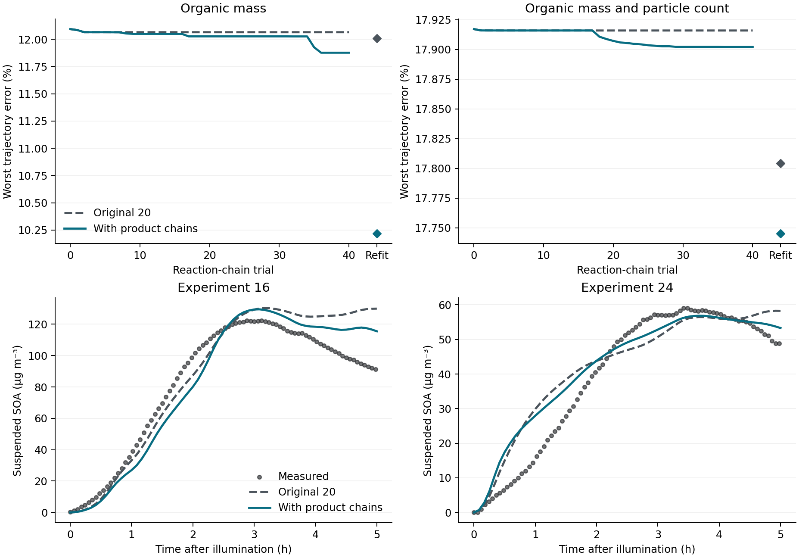
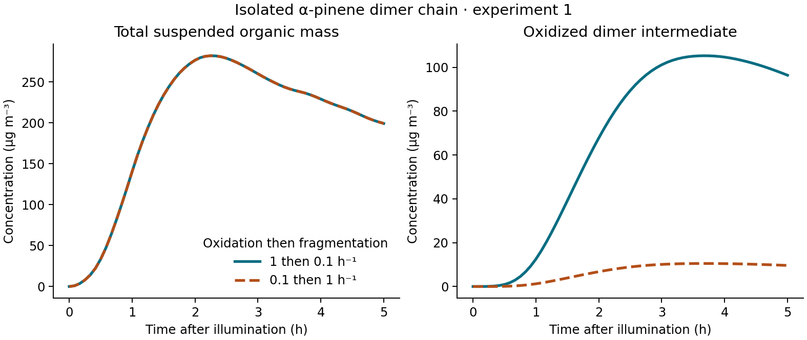

# Aging α-pinene dimers lowers the worst SOA mass error across 15 Manchester chamber runs

Letting an α-pinene dimer oxidize, fragment and release material to the gas improved reproduction of the measured aerosol. The refitted original 20-reaction network gave **12.01% worst-run error in suspended organic mass**. Giving only the α-pinene dimer further chemical fates lowered it to **11.32%**. Across five product families, the network restricted to pathways with a published reaction-family analogue reached **11.31%**. The full set of 40 proposals reached **10.22%**, a 1.79 percentage point gain over the refitted original. With particle counts included, the apparent 0.06 percentage point advantage of the full network at a 15 s step reversed at finer resolution. A lower mass error favors a mechanism that can lose or regain suspended material over time. It leaves open which molecule reacted and which reaction controlled its lifetime. Two isolated dimer chains with their slow and fast steps exchanged illustrate that ambiguity. [Previous 20-reaction study](REACTION_DISCOVERY.md) · [Final numerical comparisons](joint/results/chains/sensitivity.csv)

## What the Manchester measurements can distinguish

Voliotis and colleagues photo-oxidized α-pinene, o-cresol and isoprene, alone and in mixtures, in a seeded 18 m³ chamber. From their 24 experiments we used the 15 with overlapping precursor, aerosol mass and particle number records. Measured fractional decay of each parent supplies the timing of the gas source. The five-hour fits use 1,258 observations of suspended organic mass and 682 particle-count observations. In the ternary run 24, for example, the measured organic mass peaked at 59.05 µg m⁻³ and fell to 48.82 µg m⁻³ at the final sample. The earlier mass fit reached 58.18 and finished at 58.17 µg m⁻³, giving a specific test of whether a later generation removes particle material after the peak. [Chamber paper](https://acp.copernicus.org/articles/22/14147/2022/) · [Archive coverage](joint/data/CAMPAIGN_SERIES.md) · [Previous per-run fits](joint/results/discovery/per_run.csv)

The campaign's companion composition study provides a second reason to consider longer chains. In the ternary experiments, 23% of the measured particle-phase ion signal came from compounds detected only in that mixture, and another 22% came from compounds also detected in one of the binary mixtures and absent from the single-precursor experiments. These signal fractions depend on instrument response. Mixing can change single-precursor pathways as well as enable direct cross-reactions, so a mixture-specific formula alone cannot identify its formation route. Bulk mass and number can reveal the timing of retention or release. A structure-specific concentration measurement would be needed to identify the dimer and its daughters. [Volatility and molecular composition, Figs. 3–5](https://acp.copernicus.org/articles/22/13677/2022/)

## What counts as a reaction-chain test

The search separates five kinds of previously formed material. These include α-pinene dimers, mixed α-pinene/o-cresol accretion products, material formed by uptake of α-pinene-derived vapor, o-cresol dimers and isoprene dimers. For each family the model follows the initial particle product, an oxidized particle product, a smaller retained residue and a released vapor. Within each same-precursor dimer family, gas-phase accretion and particle-phase coupling feed the same dimer pool. For example, α-pinene products can form a dimer, the dimer can oxidize while suspended, and the oxidized material can fragment. Partial fragmentation assumes half the effective organic mass remains on the particle and half enters the gas. All transfers conserve modeled organic mass equivalents. Oxidant uptake and the molecular oxygen or carbon stoichiometry of individual products remain unresolved. [Candidate equations](joint/chains/bank.py) · [Experimental analogues by family](joint/chains/EVIDENCE.md)

A chain that moves mass from one suspended pool to another can change the modeled composition without changing either bulk observable. The retained intermediate becomes visible in the mass curve if a subsequent step releases material to the gas or returns it to the particle on a different time scale. Forty trials cover eight candidate pathways for each of the five starting families. Several proposals share a step. Together they add 50 distinct reaction channels to the original 20.

We fitted the two objectives separately. For each, the score is the largest normalized root-mean-square error across the 15 time series, using each run's measured peak to scale mass (with a 1 µg m⁻³ floor) and initial count to scale number. The joint objective takes the larger of the two errors for every run. Each proposal competes with a fresh fit of the preceding network. A second control repeatedly refits the same original 20 channels, with new reaction rates fixed at zero. This matters when changes are small enough that extra optimization alone can yield a comparable gain. [Method of fitting and controls](joint/chains/search.py)

## The largest change during selection also occurred without that round’s new reaction

After the 40th addition, the best mass error was 11.877%, compared with 12.065% after 40 further fits of the original 20 reactions. Joint error reached 17.902%, compared with 17.916% for the repeated original-network fits. The final comparison gives each completed network a stronger optimization.

The immediate controls tell a different story about which *individual* channels helped. Round 35 proposed fragmentation of released isoprene-derived vapor and lowered worst mass error by 0.099 percentage points relative to round 34. The previous network reached exactly the same score when refitted in round 35. The largest immediate gain beyond its same-round control was 0.0106 percentage points in mass error at round 8, for oxidation followed by fragmentation of material formed by α-pinene vapor uptake. For the requested α-pinene dimer oxidation–fragmentation sequence, the corresponding round-6 gain was 0.00049 percentage points. These small conditional differences depend on search order and fit effort. [Scores and controls for all 40 rounds](joint/results/chains/rounds.csv)

Fifteen of the 40 pathways have an experimental analogue for the reaction family. The other 25 specify a substrate, daughter, phase change or sequence that extends beyond the evidence retrieved. For example, experiments observed OH depletion of specific α-pinene dimer esters, while aqueous treatment also increased several ring-opened acids. They support dimer aging and leave the amount of resulting vapor in the Manchester chamber unresolved. The search therefore also fits a network restricted to the 15 family-supported proposals and another restricted to the eight α-pinene-dimer proposals. [Heterogeneous dimer oxidation](https://doi.org/10.1016/j.jes.2023.08.021) · [Aqueous dimer oxidation](https://doi.org/10.1021/acs.est.2c07630) · [Evidence grades for each trial](joint/chains/evidence.csv)

## How much the additional pathways improve the fit

| Reactions allowed in final optimization | Worst mass error | Worst joint mass or count error |
|---|---:|---:|
| Original 20, refitted | 12.009% | 17.804% |
| Original 20 plus all α-pinene dimer pathways | 11.316% | 17.749% |
| Original 20 plus steps in the 15 family-supported proposals | 11.314% | 17.751% |
| Original 20 plus all 40 proposals | 10.219% | 17.745% |

The α-pinene-dimer and family-supported networks reach nearly identical mass scores with different allowed pathways. A further 1.095 percentage points of mass improvement comes from allowing the full set of pathways and refitting every shared rate. Assigning that increment to a single newly proposed reaction would require another constraint. The fits were optimized and scored at 15 s. Several searches reached their iteration limit, so each number is the best found within the search. [Paired calibrations](joint/results/chains/continued.json) · [Numerical replays](joint/results/chains/sensitivity.csv)

At the finest replay (1.875 s), applying reactions in the original and reversed order gave **10.244% and 10.251% mass error** for the full fit, compared with 12.085% for the original 20 in either order. The corresponding joint errors were 18.036% and 18.148% for the full fit, against 17.847% and 17.861% for the original 20. The family-supported joint fit gave 17.751% in both orders at that resolution. Thus the mass gain survives the numerical check. For the joint objective, the advantage of this full-network calibration reverses. The resolution-checked mechanism therefore pairs the full-network mass parameters with the family-supported joint parameters, setting the remaining joint rates to zero. For each objective this selects the smallest worst error across the two 1.875 s order replays of the four calibrations. Binary run 16 remains the largest count error. Its measured count rose above the initial value, while deposition and coagulation only remove particles here. [Resolution and reaction-order checks](joint/results/chains/sensitivity.csv) · [Run 16 count history](joint/WALL_LOSS.md)

The size of the mass gain depends on the assumed phase split. Holding the fitted rates fixed, changing the retained fraction from one-half to one-quarter raised the full-model mass error to 12.74%. Retaining three-quarters gave 11.90%. These sensitivity runs reselected each chamber's dose. Measuring the released and retained products would constrain a choice that can change whether the full network improves on the original fit. [Fragment branching sensitivity](joint/results/chains/sensitivity.csv)

## The dimer can carry material through multiple steps

In the full mass fit for the high-loading α-pinene experiment (run 1), the modeled gas-phase accretion route formed 466.1 µg m⁻³ of dimer material cumulatively. Dimer oxidation transferred 16.6 µg m⁻³ to oxidized particle material. Subsequent fragmentation processed 29.9 µg m⁻³ of the oxidized pool over five hours. Oxidized material can also enter this pool when released vapor or retained residue reacts again. These gross transfers measure throughput and can count the same organic material at successive stages. [Per-reaction gross transfer](joint/results/chains/flux.csv) · [Product histories](joint/results/chains/trajectories.csv.gz)

The change appeared in the declining limb of the curves. In binary run 16, the original and expanded mass fits lost 0.32 and 13.72 µg m⁻³, respectively, between their sampled peak and last observation. The measured decline was 30.89 µg m⁻³. In ternary run 24, the corresponding modeled declines were 0.01 and 3.43 µg m⁻³, against 10.23 µg m⁻³ measured. Adding secondary loss helped both experiments, while substantial suspended mass still persisted late in each simulation. [Per-run peaks and last observations](joint/results/chains/per_run.csv)

## A measured dimer and its daughter could distinguish which step is slow

We isolated the sequence dimer → oxidized particle product → partial release. We assigned the two steps rates of 0.1 and 1 h⁻¹ and then exchanged them, leaving every other setting the same. The slower step delays release by the same amount regardless of its position in this isolated sequence. In the mass calibration the two versions differed by as much as 94.75 µg m⁻³ in their predicted unaged dimer inventory. Their largest difference in total suspended organic mass was below 10⁻¹² µg m⁻³, and the particle-count histories were identical. A concentration time series for the unaged dimer, particularly before peak SOA, would distinguish the two mechanisms directly. Pairing it with a time series for the oxidized daughter and a gas-phase fragment would test the direction of the transfers as well. [Rate-swap experiment](joint/results/chains/rate_swap.csv)

## Reproduction and study records

Each run began with its own seed and initial count, and allowed one common multiplier for its injected precursors within ±15%. The wall eddy coefficient was fixed at 5.1079 s⁻¹ for mass fits and fitted across runs for the joint objective. The numerical checks include the zero-addition replay, an organic-mass budget including deposition, and changes to integration step and reaction order. [Run commands and model equations](joint/chains/METHODS.md) · [Resolution-checked rate sets](joint/results/chains/resolution_checked_mechanism.json) · [Original full-network fits](joint/results/chains/mechanism.json) · [All 40 paired fits](joint/results/chains/rounds.csv) · [Sensitivity and numerical checks](joint/results/chains/sensitivity.csv)
