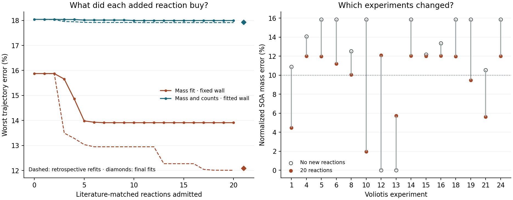

# Twenty added reactions improve the SOA mass fit, while particle counts still limit joint reproduction

For the 15 Manchester chamber experiments with paired precursor, organic aerosol and particle-number records, adding 20 literature-matched reaction channels lowered the **worst mass trajectory error from 15.87% to 12.09%**. That is a 3.78 percentage point reduction, or 24% of the previous worst error. The **joint mass-and-number error moved from 18.04% to 17.93%**, reaching **17.92%** in a further refit with one reaction turned off. The two objectives have separate calibrations. Every experiment within a calibration shares the same chemistry and size-dependent wall-loss coefficient. Each run supplies its own measured precursor decay, seed conditions and bounded dose. These numbers measure reproduction of the fitted experiments. [Voliotis et al. chamber measurements](https://acp.copernicus.org/articles/22/14147/2022/) · [Data coverage](joint/data/CAMPAIGN_SERIES.md) · [Final scores](joint/results/discovery/final_scores.csv)

## Where the search gained ground

In each round we proposed a reaction from a precursor-specific set, fitted its rate, then looked for a published experimental analogue before admitting it. **Twelve matches have direct process evidence and eight have a reaction-family analogue.** The reaction ledger records all 20 equations, fitted rates for both objectives, publications, substrate or chamber differences and unverified product identities. A reaction with a good analogue could enter the set at zero rate. [All 20 reactions and primary sources](joint/results/discovery/REACTION_EVIDENCE.md) · [Each fit and its no-addition control](joint/results/discovery/rounds.csv)

| Reactions admitted | Most recent addition or stage | Mass error during selection | Mass error after stronger refit | Joint error after stronger refit |
|---:|---|---:|---:|---:|
| 0 | Previous shared chemistry | 15.88% | 15.87% | 18.04% |
| 2 | Gas accretion and particle dimer formation | 15.88% | 15.87% | 18.04% |
| 3 | α-Pinene particle photofragmentation | 15.65% | 13.49% | 17.96% |
| 4 | Isoprene particle photofragmentation | 14.86% | 13.28% | 17.95% |
| 5 | Uptake of α-pinene-derived vapor | 13.98% | 13.04% | 17.92% |
| 13 | Gas-phase α-pinene product accretion | 13.91% | 12.27% | 17.91% |
| 17 | Fragmentation of α-pinene-derived vapor | 13.91% | 12.04% | 17.91% |
| 20 | Final reaction set | 13.91% | 12.01% | 17.91% |

The table gives the 30-second search scores for each successive set. Independent 15-second replays of the selected full network give the headline 12.09% and 17.93%. Adding the round-3, -4 and -5 channels beat an extra local refit of the preceding network by 0.22, 0.25 and 0.22 percentage points in the online mass search. The later gains for rounds 13 and 17 appeared under the stronger retrospective optimization. Their timing identifies promising chemistry to investigate, while the isolated contribution of each depends on the competing channels and optimization effort. Twelve of the 20 final mass-fit rates are below 10⁻⁶ in their respective units. [Per-round scores](joint/results/discovery/rounds.csv) · [Published α-pinene accretion experiment](https://doi.org/10.1021/jacs.2c10398) · [Pinonaldehyde chamber photolysis](https://acp.copernicus.org/articles/20/13701/2020/)

## What the fitted equations can identify

**A pathway out of suspended organic mass improves the fit.** At round 3, substituting evaporation for α-pinene particle photofragmentation at its fitted rate produced identical modeled mass and number errors, peaks and final sampled masses in all 15 runs. The same equivalence held for isoprene in round 4 and persisted for isoprene in the full network. The nominal destinations differ chemically. Evaporation populates a vapor reservoir that can return to particles, while the fragmentation channel generates terminal volatile material. In the full mass fit the α-pinene vapor has active return pathways. Substituting evaporation there raised the score from 12.09% to 32.13% when we held rates and doses fixed. An independently refitted evaporative mechanism could behave differently. [Matched physical alternatives](joint/results/discovery/physical_alternatives.csv) · [Irradiation of isoprene-derived SOA](https://doi.org/10.1021/acs.est.6b02313)

For the α-pinene particle channel, the final fitted effective rates were **1.01 h⁻¹** for mass and **0.137 h⁻¹** for the joint objective. Epstein and colleagues observed near-UV loss from α-pinene ozonolysis SOA. Their solar-scaled diameter loss of 0.56% per day corresponds to roughly 0.00070 h⁻¹ bulk mass loss at constant density and number. Substituting that scale while freezing the remaining fit raised the mass error to 107%. The labile fraction, lamp exposure and peroxide abundance differ. The paper establishes a plausible process and leaves the fitted Manchester coefficient unresolved. [Epstein et al.](https://doi.org/10.1021/es502350u) · [Rate substitution](joint/results/discovery/physical_alternatives.csv)

**Reactive uptake is a candidate explanation for material returning to particles.** The α-pinene uptake rate in the mass fit was 0.731 h⁻¹ at the reference particle surface area. Removing it and locally refitting the final network raised worst mass error by 14.99 percentage points. That measures dependence of this parameter set on uptake. Indeed, the earlier network with no new reactions already achieves 15.87%, well below this local omission fit. Pinonaldehyde uptake produced oligomeric material on acidic seed in the published experiment, while its neutral sulfate control showed no detectable uptake. Manchester used nominally neutral ammonium sulfate. An uptake interpretation would benefit from direct measurement of acidity and gas-phase pinonaldehyde loss. [Liggio and Li](https://doi.org/10.1029/2005JD006978) · [Each reaction removed in turn](joint/results/discovery/ablations.csv)

Other reactions can be chemically real yet invisible to the instruments used here. In a numerical control, particle-phase dimerization transferred as much as 283 µg m⁻³ cumulatively between model pools while changing predicted peak suspended mass by less than 3 × 10⁻¹³ µg m⁻³. A molecular measurement could distinguish the products. [Numerical control](joint/results/discovery/numerical_checks.json) · [Experimental α-pinene particle dimer chemistry](https://doi.org/10.1126/science.adi0857)

## What remains unexplained

- **The ternary peak improved more than its decline.** In run 24 the mass-only fit moved the modeled peak from 63.92 to 58.18 µg m⁻³, close to the observed 59.05. It still had 58.17 µg m⁻³ at the last observation, when the instrument measured 48.82. Five of 15 runs achieved mass error at or below 10%, up from two. The new worst mass error is in isoprene-only run 12. Its archived AMS series is all zeros, so the 1 µg m⁻³ normalization floor makes its 12.09% error an absolute RMSE of only 0.121 µg m⁻³. [Per-run comparison](joint/results/discovery/per_run.csv) · [Archive notes](joint/data/CAMPAIGN_SERIES.md)
- **Particle counts still constrain the common fit.** In the full joint fit, run 14 had the largest mass error (17.93%) and run 16 the largest count error (17.91%). Run 16's observed count rose above its initial value. The modeled size-dependent deposition and coagulation can remove particles, while the added chemistry changes their mass and size. The joint fit selected a wall eddy coefficient of 3.22 s⁻¹ against 3.18 s⁻¹ before expansion. [Per-run errors](joint/results/discovery/per_run.csv) · [Particle-count and wall-loss assessment](ASSESSMENT.md)
- **Vapor availability and injected dose matter.** Halving or doubling the assumed secondary vapor supply, holding chemistry fixed and reselecting doses, moved worst mass error to 13.08% or 12.95%, respectively. Joint error rose to 20.81% or 19.64%. Fixing every dose at its nominal value yielded 26.51% mass and 27.09% joint error with the same fitted parameters. These are sensitivities to assumptions. The bounded search provides no guarantee of a global optimum. [Sensitivity runs](joint/results/discovery/sensitivities.csv) · [Methods and reproduction](joint/discovery/METHODS.md)

The most informative follow-up would pair time-resolved gas products with suspended mass during the post-peak decline, ideally across matched light and dark periods with measured seed surface area and acidity. Evaporated isoprene oxidation products and volatile fragments can give identical bulk curves here, but they predict different gas compositions. Size-resolved number measurements during the rise in run 16 would independently test the missing number source or a counting artefact.

[Replayable 20-reaction mechanism](joint/results/discovery/mechanism.json) · [Best fit including zero-rate controls](joint/results/discovery/best_seen_mechanism.json) · [Rate profiles](joint/results/discovery/final_rate_profiles.csv) · [Per-reaction material budgets](joint/results/discovery/reaction_flux.csv)
