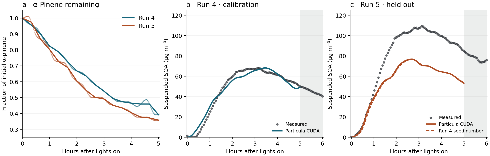
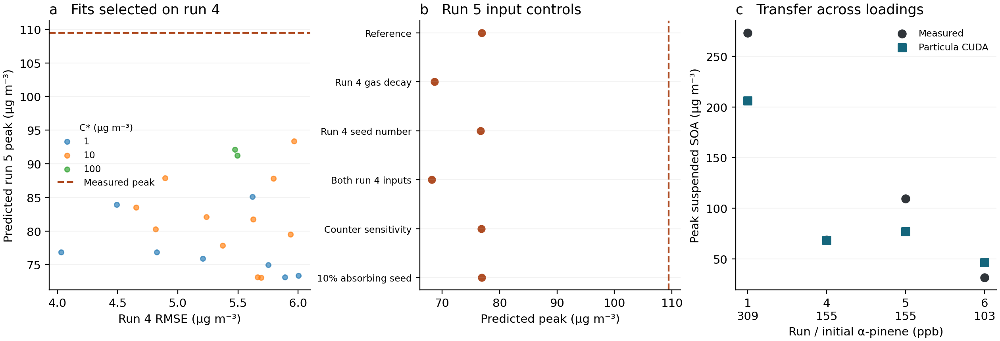
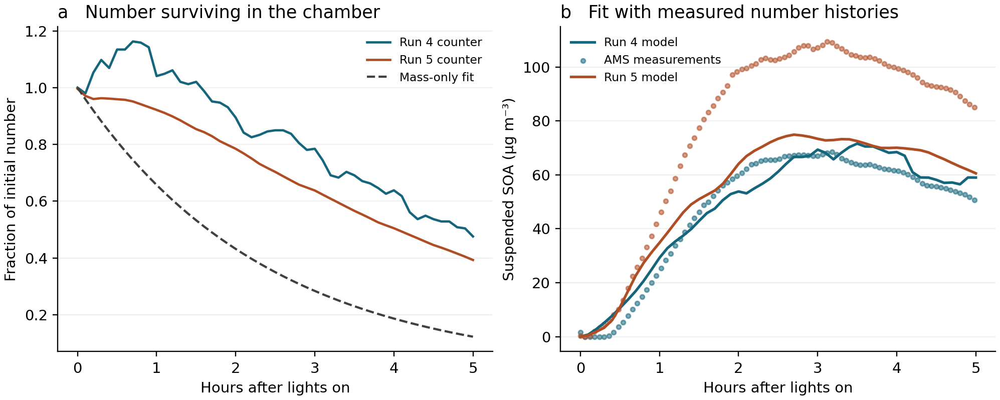

# An α-pinene chamber fit predicts 77 µg m⁻³ of suspended organic aerosol in a second run that reached 109

The 20-reaction follow-up compares each fitted equation with published chemistry and tests whether evaporation gives the same observed response. [Sequential reaction study](REACTION_DISCOVERY.md)

The final campaign assessment quantifies chemistry and wall-loss uncertainty across the 15 paired experiments. [Read the wall and chemistry assessment](ASSESSMENT.md) · [Explore the additional chemical pathways](CHEMICAL_PATHWAYS.md)

Two Manchester chamber experiments began with the same nominal α-pinene loading. One reached 68.47 µg m⁻³ of suspended organic aerosol and the other reached 109.46 µg m⁻³. We fitted Particula's gas chemistry and reversible condensation to the first run and supplied the second run's own measured α-pinene decay, initial particle number and seed mass. With the product and loss parameters fixed, the predicted second peak was 76.88 µg m⁻³, 30% below the measurement. All 21 parameter sets that fit the first trajectory within 2 µg m⁻³ of its lowest root-mean-square error underpredicted the second peak. Yet uncertainty in the relative precursor injections could account for much of the difference. An independent particle-number record also challenges the removal rate inferred from the first mass curve. Together, these comparisons identify what the gas and aerosol records constrain and where experimental uncertainty still admits different explanations. [Chamber paper](https://acp.copernicus.org/articles/22/14147/2022/) · [Archived observations](data/README.md)

## Two chamber runs began at 155 ppb and produced different organic mass

Voliotis and colleagues illuminated α-pinene, NOₓ and ammonium sulfate seed in the 18 m³ Manchester Aerosol Chamber. Their wider campaign compared individual precursors and mixtures. We selected the α-pinene-only runs so that a measured precursor fraction could drive production of condensable material without assigning that material to competing organic precursors. Runs 4 and 5 began with nominally 155 ppb α-pinene and 45.7 and 47.8 µg m⁻³ seed. The initial particle counts used here differed nearly sevenfold and came from different instruments. Reported initial NOₓ also differed, and some archive descriptions disagree with the article. [Experimental design and Table 1](https://acp.copernicus.org/articles/22/14147/2022/#section2) · [Run metadata and instrument comparisons](data/README.md)

The target is **suspended organic mass**, excluding sulfate. The archived AMS peaks match Table 1 within 0.15 µg m⁻³ across the four runs, and the late declines agree with the raw panel of Figure 3. The authors separately estimated particle deposition from size-resolved seed decay. Applying their correction typically increased campaign peaks by 30–40%. Their published yields incorporate this treatment, while the archived organic-mass series compared here retains particle loss. [Figure 3, Tables 1 and 3](https://acp.copernicus.org/articles/22/14147/2022/#section3)

## Matching run 4 leaves a 33 µg m⁻³ peak deficit in run 5

Gas chromatography constrains when α-pinene disappears. In the model a fitted fraction of the consumed precursor forms an oxygenated intermediate, which matures into one semivolatile product. That vapor can condense or evaporate. Particle removal carries suspended organic material to the chamber wall. This construction distinguishes production, reversible partitioning and loss while keeping the carbon inventory explicit. It leaves the identities of the products and the changes in their chemistry unresolved. [Mechanism and observation treatment](METHODS.md)

Run 4 selected a condensable precursor branch of 0.25 by mole, a five-minute product formation time, an effective saturation concentration of 1 µg m⁻³, vapor accommodation of 0.03 and particle removal of 0.42 h⁻¹. These values jointly minimized error among 1,404 grid points. The best fit placed the run 4 peak at 3.50 h, compared with the measured 3.18 h. In run 5, it reached its peak early at 2.70 h versus 3.12 h and underestimated the five-hour trajectory by 23.94 µg m⁻³ on average. Varying the fitted parameters jointly across the 21 near-best run 4 fits gave run 5 peaks of 73.08–93.35 µg m⁻³. That range describes sensitivity within the tested grid. [Frozen fit](results/frozen_run4_fit.json) · [Run 5 parameter ensemble](results/run5_fit_envelope.csv)

Dots show the archived measurements. Lines use the gas record through hour five. Shading marks the final hour with AMS data beyond that forcing window.

The measured gas history explains most of the difference *between the two model peaks*. Replacing run 5's precursor decay with run 4's lowered its predicted peak from 76.88 to 68.70 µg m⁻³. Replacing only its initial particle number lowered the peak to 76.68 µg m⁻³. Although more particles offer more surface at fixed seed mass, increasing that surface had little effect under the selected volatility and accommodation assumptions. Across the wider loading range, the same fit underestimated the high-loading peak by 24% and overestimated the low-loading peak by 47%. A single upward adjustment to product formation would worsen the latter comparison. [Controlled substitutions and transfer scores](results/comparisons.csv)

The observations show where the discrepancy arises. By the time of each measured organic peak, the reconstructed α-pinene consumption had risen only 8% between runs, from 416 to 449 µg m⁻³, while suspended organic mass rose 60%. The corresponding ratios of suspended organics to apparently consumed precursor are 0.165 and 0.244. They depend on the nominal injections and retain particle loss. A constant-yield fit to run 4 predicted 82.55 µg m⁻³ in run 5. Its peak came at 4.98 h and its trajectory RMSE was 30.70 µg m⁻³, compared with 2.70 h and 27.39 µg m⁻³ for the process model. [Empirical comparison](results/empirical_yield.csv)

| Run | Nominal α-pinene (ppb) | Measured peak (µg m⁻³) | Predicted peak (µg m⁻³) | Five-hour RMSE (µg m⁻³) |
|---|---:|---:|---:|---:|
| 4 · calibration | 155 | 68.47 | 68.17 | 4.03 |
| 5 · held out | 155 | 109.46 | 76.88 | 27.39 |
| 1 · higher loading | 309 | 273.06 | 206.19 | 86.25 |
| 6 · lower loading | 103 | 31.44 | 46.35 | 9.05 |

## Particle counts expose a trade-off between vapor and particle loss

The original fit attributed the post-peak decline to a particle removal rate of 0.42 h⁻¹ and selected zero vapor wall loss. After five hours, this removes 88% of the initial particle count. The archived counter retained 48% of run 4's initial count and 39% of run 5's. The trajectory of particle number therefore challenges the physical interpretation of the mass-only calibration even in the run used for fitting. [Archived and simulated number fractions](results/number_check.csv)

We repeated the calibration across 1,008 cases with each run's measured number decline prescribed. The cases differed in how much organic material left suspension with disappearing particles, ranging from complete mass retention as the mean remaining particle grows to removal of particles with their organic coating. Run 4 selected the latter case, a 0.20 condensable branch and a vapor wall-loss rate of **4.5 h⁻¹**, the highest tested. Its RMSE was 4.97 µg m⁻³. Run 5's predicted peak remained low at 74.90 µg m⁻³. The two searches used different grids. On their shared condensable-branch grid with vapor wall loss capped at 1.8 h⁻¹, the mass-only and number-constrained fits selected 1.8 and 0.6 h⁻¹, respectively. Even the direction of the difference depends on the allowed parameter values. Across the three separately calibrated treatments of disappearing particles, run 5 peaks ranged from 74.90 to 82.89 µg m⁻³. A fit at the edge of this grid cannot supply a chamber vapor-loss coefficient. Size-resolved particle deposition and a direct vapor-loss measurement would help separate these pathways. [Number-constrained calibration](results/number_calibration.csv) · [Transfer results](results/number_transfer.csv)

## Precursor injection uncertainty can move the second peak close to the measurement

The nominal α-pinene dose has ±15% uncertainty. Because each run supplies a *fraction* of precursor remaining, run 4 constrains the product of the injected amount and the branch entering the condensable pathway. Decreasing run 4's dose by 15% and increasing its fitted branch in inverse proportion reproduces its mass trajectory. If run 5 also received 15% more precursor than nominal, its predicted peak rises to **104.23 µg m⁻³**. Reversing the relative dose assumptions gives **56.66 µg m⁻³**. The extremes require opposing injection errors between the two experiments. They show why an absolute precursor measurement at lights-on would narrow the inference substantially. They do not assign a probability to either dose. [Injection and wall-loss tests](results/injection_and_walls.csv)

Adding vapor loss in run 5 while keeping the original run 4 fit lowered the peak to 74.22 and 69.20 µg m⁻³ at 0.6 and 1.8 h⁻¹, respectively. This one-way removal worsens the deficit. The six-hour mass records add a second check, though the gas observations end near five hours. Stopping oxidation at hour five or continuing its final inferred rate gives 36.25 or 43.27 µg m⁻³ at hour six in run 5. Both fall below the measured 75.98. These are two extrapolations of unobserved precursor behavior. [Final-hour sensitivity](results/unmeasured_gas_tail.csv)

## Oxidant exposure and material volatility constrain different parts of the explanation

The same Manchester campaign found a shift in particle composition toward the 10 µg m⁻³ volatility class at the lower initial α-pinene loading, with a larger contribution from the 100 µg m⁻³ class at higher loading. FIGAERO-CIMS resolved this shift in ion signal, while thermal-denuder mass retrievals had overlapping uncertainties. A single effective product can capture a mass trajectory without reproducing this change in composition. Joint measurements of gas- and particle-phase products would help distinguish a change in volatility from a change in the fraction of precursor that forms condensable material. [Volatility study, Fig. 1](https://acp.copernicus.org/articles/22/13677/2022/#section3)

Using the paper's ozone rate coefficient and each available ozone record, integrated ozone attack accounts for 53.5%, 99.5% and 66.2% of the measured five-hour α-pinene decrease in runs 1, 5 and 6. For run 5, the reported rate-coefficient uncertainty alone expands the estimate to 70–140%. The high end exceeds the measured precursor depletion. Run 4's gas monitor lacks an unambiguous lights-on clock. These limits preclude apportioning the difference in organic mass between OH, O₃ and NOₓ-dependent chemistry from this pair. [Ozone integration and uncertainties](data/README.md#ozone-reaction-budget) · [Rate evaluation](https://acp.copernicus.org/articles/20/13497/2020/)

## Absolute precursor loading and size-resolved loss would discriminate between explanations

At the nominal injections, run 5 produced more suspended organic mass per unit of disappearing α-pinene than the model transferred from run 4. That conclusion survives a fitted range of product volatilities and an independent constraint on particle number. Opposite injection errors within the authors' stated bounds, however, bring the predicted peak within 5.23 µg m⁻³ of the observation. A paired absolute precursor measurement could test that explanation directly. If the relative doses were confirmed close to unity, the next discriminating comparison would be run-specific gas- and particle-phase oxidation products alongside size-resolved particle deposition. Those measurements would constrain whether run 5 generated more condensable material or retained more of it in suspension.

## Reproducing the comparison

Particula 0.3.3 ran gas chemistry and condensation on an NVIDIA GeForce RTX 5060. For the two reference runs the largest CPU–CUDA difference in suspended organics was 0.088 µg m⁻³. Halving the 12 s integration step and the 360 s forcing and removal interval together changed the trajectory by at most 0.288 µg m⁻³. Halving the integration step again to 3 s changed it by 0.039 µg m⁻³. Refinement shifted the two extremes of the run 5 peak ensemble by at most 0.13 µg m⁻³. The reference carbon and total reactive mass inventories, including the recorded wall transfers, closed to better than one part in 10¹². These numerical differences are small beside the 32.58 µg m⁻³ transfer deficit. [Methods and reproduction commands](METHODS.md) · [Source DOI and file checksums](data/source_manifest.csv) · [Numerical checks](results/numerical_checks.json) · [Saved trajectories](results/trajectories.csv)

A follow-up jointly fits the four observed α-pinene trajectories and compares all 15 paired single- and mixed-precursor experiments. [Shared mechanisms across the Manchester campaign](joint/REPORT.md)
