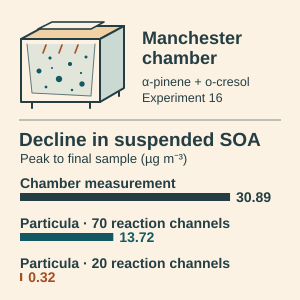

# Tracking product aging improves the fit to organic aerosol decay in the Manchester chamber

## Abstract

We used an agentic search to fit shared chemistry to secondary organic aerosol (SOA) formation and decay in 15 Manchester chamber experiments. Particula simulated candidate reactions on CUDA using measured precursor decay and size-dependent particle wall loss. The search fitted 20 precursor-compatible reactions and checked their literature analogues, then tested 40 product-aging sequences against refits of the preceding network. Assuming half the fragment mass remained suspended, expanding the model from 20 to 70 reaction channels lowered the worst normalized mass error from 12.1% to 10.25% in fine-step replays. A network restricted to literature-supported classes of product aging gave a 17.75% worst error for mass and particle number together. In an isolated α-pinene dimer chain, exchanging oxidation and fragmentation rates changed predicted dimer concentrations by up to 95 µg m⁻³ while leaving bulk mass and number effectively identical. Measuring the dimer and its daughter through the aerosol peak could distinguish which step controls the subsequent loss.

**TOC caption.** In the α-pinene/o-cresol experiment, the 70-channel Particula model captured 13.72 µg m⁻³ of the observed 30.89 µg m⁻³ decline in suspended SOA. The refitted 20-channel model captured 0.32 µg m⁻³. The labels count candidate reaction channels, including those whose rates could fit to zero. Each decline is measured from the respective sampled peak to the final sample of the five-hour fit. [Run-level data](joint/results/chains/per_run.csv)

[Full study and research process](../../docs/studies/literature/evaporation-and-uptake/manchester-soa/index.md) · [Chamber experiments](https://acp.copernicus.org/articles/22/14147/2022/) · [Wall-loss assessment](ASSESSMENT.md) · [Mixture chemistry](CHEMICAL_PATHWAYS.md) · [Agent-guided reaction search](REACTION_DISCOVERY.md) · [Product-chain study](PRODUCT_CHAINS.md) · [Print-ready PNG](results/figures/manchester-soa-toc.png)
