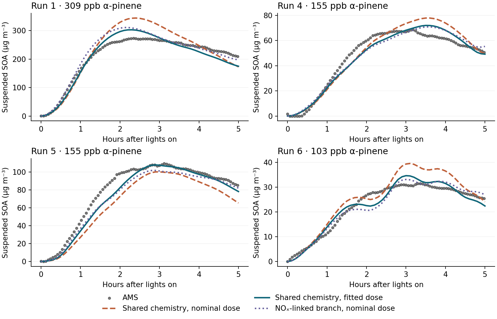
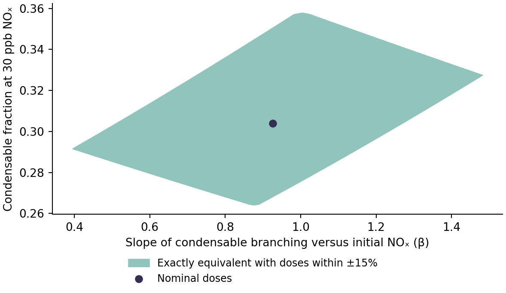
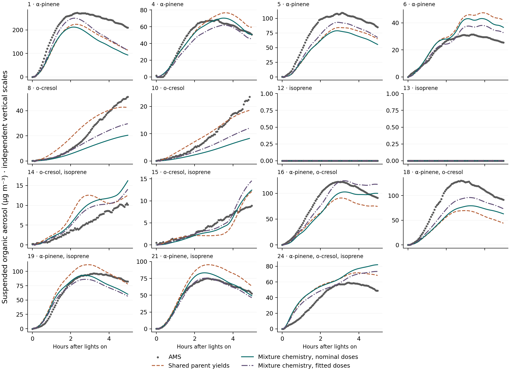

# One product reproduces four α-pinene curves. The best 15-run campaign fit still misses by 20%.

The final campaign assessment quantifies chemistry and wall-loss uncertainty across the 15 paired experiments. [Read the study assessment](../ASSESSMENT.md)

At the same nominal 155 ppb α-pinene dose, the Manchester chamber produced peak suspended organic aerosol concentrations of 68.47 and 109.46 µg m⁻³. Could a single set of chemical parameters reproduce both curves and the experiments at other doses? We fitted every available paired α-pinene run together, then asked the broader question across all 15 campaign runs with both measured precursor decay and aerosol mass. In native Particula, one condensable product reproduced all four α-pinene curves when the injections could vary within their reported uncertainty. Its worst trajectory error was 7.5% of the measured peak, and its largest peak error was 11.1%. A shared dependence on initial NOₓ also worked with nominal injections. Adding a second volatility class alone gave little improvement. Across three precursors and their mixtures, a separate reduced mechanism left substantially larger discrepancies. All scores describe joint reproduction of the same data used to choose the parameters. [Chamber experiment](https://acp.copernicus.org/articles/22/14147/2022/) · [Earlier held-out comparison](../REPORT.md)

A follow-up fits size-dependent wall deposition and Brownian number loss directly to the particle counts and organic mass across the same campaign. [Joint wall-loss analysis](WALL_LOSS.md)

## Four gas histories constrain four organic mass trajectories

Runs 1, 4, 5 and 6 began at nominal α-pinene loadings of 309, 155, 155 and 103 ppb. Their archived aerosol mass spectrometer peaks were 273.06, 68.47, 109.46 and 31.44 µg m⁻³. Each target is organic mass still suspended in the chamber. It excludes inorganic seed and retains the effect of particle deposition. The chamber paper separately reports yields corrected for particle loss. The model receives each run's fractional precursor decay and uses 84 mass observations over the first five hours to score its predicted organic trajectory. [Archive and observation definitions](../data/README.md) · [Paper, Figure 3](https://acp.copernicus.org/articles/22/14147/2022/#section3)

We minimized the worst run's root-mean-square error divided by its observed peak. A separate search tested both study criteria simultaneously for every fitted run: normalized trajectory error at most 10% **and** absolute peak error at most 15%. The two criteria matter because a curve can agree near its peak yet form aerosol too early or lose it too slowly. [Fit design and parameter bounds](METHODS.md) · [Per-run errors and peak times](results/scores.csv)

## Does a second volatility class improve the fit at the reported doses?

All candidate mechanisms turn measured α-pinene disappearance into production of an oxygenated intermediate. The simplest gives that intermediate one condensable product after a fitted delay. More detailed alternatives let two products of different volatility form, let the more volatile product age into the less volatile one, or allow two intermediates to react in a concentration-dependent pathway. Gas chemistry, condensation and removal operate simultaneously over the experiment. The nonlinear pathway represents a possible dependence on intermediate concentration. The records contain no species-specific evidence identifying that pathway. Same-campaign composition measurements independently show a shift toward lower-volatility particle material at lower initial loading. [Mechanisms and chamber assumptions](METHODS.md) · [Companion volatility measurements, Figure 1](https://acp.copernicus.org/articles/22/13677/2022/#section3)

At nominal doses and a condition-independent branch, the best one-product, two-product and nonlinear mechanisms all gave approximately 14.0% worst normalized trajectory error in the search. The native one-product replay overshot run 1's peak by 26.3% and run 6's by 26.2%. The two-product fit assigned essentially the same effective chemistry. Using measured counts reduced the two-product search error to 10.6%, with a native peak overestimate of 20.6% in run 6. Direct searches targeting both error limits also missed the targets in the one-product, two-product and count-constrained two-product cases. [Searches aimed at both limits](results/joint_gate_search.csv) A finite parameter search establishes agreement when it finds a parameter set that meets the criteria. A remaining discrepancy describes the tested bounds and mechanisms.

## Dose and NOₓ change the interpretation of a shared chemical fit

The authors give ±15% uncertainty on each nominal injection. Varying the dose changes the absolute quantity of reacted precursor while retaining its measured fractional decay. In the model, dose and the fraction of precursor entering the condensable pathway multiply. A larger dose can therefore offset a smaller product branch. The native one-product replay gave peaks of 303.41, 72.15, 108.14 and 34.70 µg m⁻³ in runs 1, 4, 5 and 6. The fitted dose multipliers were 1.046, 0.966, 1.150 and 0.850. The run with the larger of the two 155 ppb peaks reached the upper injection bound, and the lowest-dose run approached the lower bound. At the nominal-dose fit the independent solver put run 1's peak at 344.90 µg m⁻³. [Per-run native replay](results/native_checks.csv) These fitted doses identify an admissible explanation of the relative organic masses. Confirming that explanation would require calibrated absolute precursor measurements.

An alternative fits one common relationship between initial NOₓ and the fraction entering the condensable branch. This allows product formation to change across experiments at their nominal doses. The paper gives 26 and 35 ppb initial NOₓ for the two 155 ppb runs, but alternate archive descriptions differ. O₃ also consumed α-pinene, and run 4's gas-monitor clock remains unresolved. With Table 1 inputs the fitted slope was β = 0.926. The 3 s search trajectories had a worst normalized error of 8.08% and a largest peak error of 13.77%. The refined native replay gave 8.23% and 14.06%, respectively. Its peak times in the 155 ppb pair were 3.6 and 2.9 h, compared with measured maxima at 3.18 and 3.12 h. Reproducing peak order and magnitude still leaves timing structure to explain. The separate search that directly targeted both error limits also found acceptable parameters. Changing only run 4's initial NOₓ from 26 to 15 ppb raised its trajectory error from 7.67% to 28.41%. Changing only run 6 from 18 to 7.8 ppb raised its error from 8.08% to 41.02%. These are fixed-law sensitivity tests. [NOₓ metadata sensitivity](results/NOx_metadata_sensitivity.csv) With four experiments, an association with initial NOₓ can absorb differences in exposure, effective dose and wall interactions. The data cannot uniquely attribute a branch change to radical chemistry. [Gas data and metadata conflicts](../data/README.md) · [Controlled α-pinene photooxidation experiments](https://acp.copernicus.org/articles/12/7413/2012/)

Even with Table 1 held fixed, injection uncertainty permits a continuous family of chemically different fits. Slopes from **0.396 to 1.481** yield exactly the same four product-source histories as β = 0.926 by adjusting the shared reference branch and each dose within ±15%. This follows from keeping the product of dose and branch fixed in every run. These endpoints bound exact equivalence for this fitted source. [Equivalent parameter combinations](results/equivalent_sources.csv)

## A fifth mass curve depends on a borrowed precursor history

Run 2 was another 309 ppb experiment. Its AMS measured a peak of 282.93 µg m⁻³, but the VOC instrument failed. The five-run fit uses its own organic record and chamber inputs while borrowing the fractional precursor decay from run 1. Optimizing all five curves together at nominal injections gave a shared one-product NOₓ law with 8.88% worst trajectory error and 13.17% largest peak error in native CUDA. Run 2 peaked at 320.20 µg m⁻³ in that replay. The separate two-product, fitted-dose five-run solution gave 7.44% and 11.77%, respectively, in the refined native replay. Its run 2 peak was 313.05 µg m⁻³. Keeping that chemistry fixed and scaling the borrowed precursor-loss hazard by 0.80, 1.00 or 1.25 moved the search-model peak through 267.51, 312.28 and 357.54 µg m⁻³, with normalized errors of 11.72%, 7.07% and 15.76%. This tests how far one precursor history can stand in for another. A correct peak alone cannot verify how fast the precursor reacted. Run 3 lacks an organic record, and the remaining experiments introduce other organic precursors. [Run 2 measurements](data/README.md) · [Precursor-history sensitivity](results/missing_forcing_sensitivity.csv)

## Can the chemistry cover o-cresol, isoprene and their mixtures?

The full campaign contains 24 experiments. Fifteen have simultaneous aerosol and speciated precursor records, including two recorded zero-aerosol isoprene runs. Five have only aerosol, one has only precursor, and three have neither time series. The paper reports a peak for 21. Even an arbitrarily flexible function of **nominal precursor identity and loading alone** has a 33.02% minimum worst positive-peak error. Two nominal 400 ppb o-cresol runs peaked at 28.2 and 56.0 µg m⁻³. Their best common prediction is 37.51 µg m⁻³. Differences in NOₓ, seed or precursor decay can distinguish these runs in a chamber model. [All 24 experiments and endpoint calculation](data/CAMPAIGN_PEAKS.md) · [Time-series coverage and archive conflicts](data/CAMPAIGN_SERIES.md)

To use the measured time histories across all seven precursor systems, we fitted three reduced box mechanisms to all paired runs. They convert the measured disappearance of each parent into a delayed source of suspended organic material with a shared removal rate. The first assigns one yield to each precursor. The second lets each precursor's yield respond to what fraction of the reacting mass comes from the other precursors. The third also gives each precursor its own maturation time. These are campaign-scale effective kinetics. The detailed native condensation and vapor-wall calculation above covers α-pinene.

Across 1,258 measurements, the worst normalized trajectory errors were 35.46% with additive yields, 30.30% with mixture-dependent yields and 29.44% with distinct precursor delays. Jointly searching the kinetic rates, yields and one dose multiplier per experiment within ±15% lowered the respective errors to **26.58%, 20.86% and 20.29%**. In the last fit, runs 1, 10, 14, 18 and 24 all lay within 0.01 percentage point of that maximum. They include single-precursor, binary and ternary experiments. Both isoprene-only curves were zero and compatible with negligible isoprene yield. The lowest error still exceeds the 10% trajectory target by a factor of two. That residual applies to these tested mechanisms, measured gas histories and common-per-run dose treatment. At the selected rates, a convex calculation bounds the best attainable worst error between 20.2892% and 20.2896% to numerical precision; the search over rates is finite. [Individual run scores](results/campaign_scores.csv) · [Joint dose and chemistry fits](results/campaign_dose_scores.csv)

## What the fits establish, and which measurement would distinguish the explanations

A single effective chemical law can reproduce the measured α-pinene mass histories to the chosen tolerance when it uses measured precursor decay and either a dose adjustment or a condition-dependent branch. The 15-run results give a different answer. Even after jointly fitting all available runs, none of the tested campaign mechanisms reached that tolerance. In the best mixed-precursor fit the o-cresol delay reached its 4 h search bound. The isoprene contribution to the fitted aerosol source was negligible, so its fitted delay carries little information. Identifying the missing physics requires another observable. In particular, separate time histories for semivolatile products and suspended material in o-cresol mixtures would help distinguish a production delay from uptake or wall loss.

The 155 ppb pair offers the most direct follow-up. Absolute precursor mass at lights-on would test the dose explanation. A synchronized O₃ and NO record, combined with gas- and particle-phase product measurements, would test whether the two runs generated different amounts of low-volatility material per unit of reacted precursor. Size-resolved particle loss would independently constrain how much of that material remained in suspension. These measurements would allow the fitted product chemistry to be challenged on observations beyond the four mass curves used to select it.

## Study resources

The global α-pinene search evaluated 674,004 candidate vectors across 13 model configurations and three restarts each. Across the fitted runs, reducing the search time step from 3 to 2 s changed any modeled concentration by at most 0.27 µg m⁻³. Across the native replays the maximum deviation from the 3 s search trajectory was 1.48 µg m⁻³. Halving the native time steps for the one-product NOₓ and fitted-dose five-run cases changed concentrations by at most 0.19 µg m⁻³. Carbon and total mass budgets closed to 1.3 × 10⁻¹⁴ relative error or better. The methods record describes the shared bounds, CUDA search and native replay. It also gives the commands for reproducing the comparisons from the archived measurements. [Methods and commands](METHODS.md) · [Scores by model and experiment](results/scores.csv) · [Numerical replay and per-run scores](results/native_checks.csv) · [Published experiment inventory](https://acp.copernicus.org/articles/22/14147/2022/acp-22-14147-2022-supplement.pdf)
