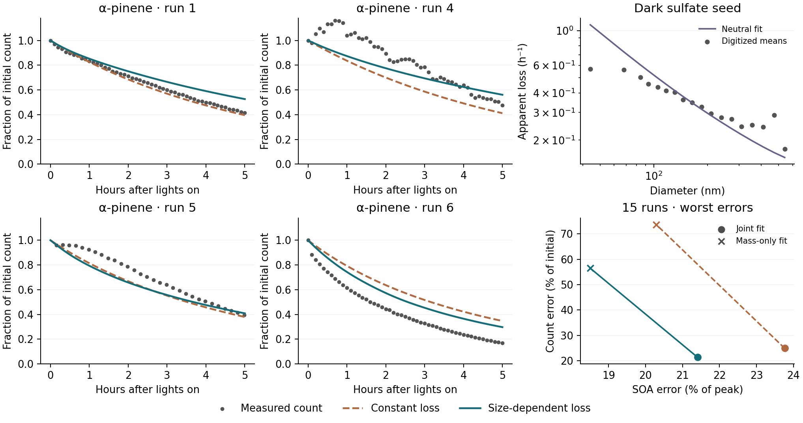

# Particle counts favor a wall-mixing coefficient near 5 s⁻¹ in the Manchester SOA fits

The original four-run Particula optimizer fitted separate first-order loss rates for suspended particles and product vapor. Its count-conditioned variants prescribed a measured count history, and the 15-run reduced model fitted a single effective suspended-product removal rate. We replaced the particle removal rate with size-dependent deposition and fitted its wall eddy coefficient jointly with chemistry. Across 15 paired Voliotis experiments, the best shared coefficient was **5.11 s⁻¹** when both organic aerosol and particle number constrained the fit. The worst trajectory error fell from **24.93% to 21.41%** relative to the matched constant-loss model. Fitting organic mass alone favored **81.45 s⁻¹** and produced a **56.47%** count error. The 15-run data support including particle counts when estimating wall transport. Size-dependent deposition still leaves a substantial discrepancy in the organic mass curves. [Original joint study](REPORT.md) · [Campaign measurements](https://acp.copernicus.org/articles/22/14147/2022/)



## What changed in the optimizer

The neutral rectangular-chamber deposition model combines diffusion to the walls and gravitational settling. We approximate the variable-volume chamber bag as a fixed box 3 m long, 2 m wide and 3 m high. At each deposition update, the model calculates the volume-equivalent radius and particle density from the evolving suspended seed, organic mass and number concentration. Deposition removes whole particles and their share of seed and organic material. Brownian collisions remove number while conserving suspended material. In the detailed four-run model, reversible gas–particle exchange and the separate product-vapor wall sink remain active. In the 15-run reduced model, each precursor supplies delayed aerosol through effective yields. Its new particle deposition law replaces the previous bulk removal term. [Chamber geometry](https://amt.copernicus.org/articles/15/4385/2022/) · [Particle deposition relation](https://doi.org/10.1016/0021-8502(81)90036-7)

Particula calls the input `wall_eddy_diffusivity`. In this formulation the diffusivity near the wall is proportional to distance squared, Dₑ(z) = E z². The fitted coefficient **E has units of s⁻¹**. The deposition rate depends on E, particle size, settling velocity and chamber geometry; it is generally orders of magnitude smaller than E. Some Warp docstrings label the input m²/s. The CPU function, unit-aware builder and dimensional form √(E Dₚ) support s⁻¹. [Particula wall-loss API](https://uncscode.github.io/particula/API/particula/dynamics/properties/wall_loss_coefficient/) · [Wall-layer formulation](https://doi.org/10.1080/02786829308959596)

## What the particle counts add

The joint objective minimizes the largest mass or count trajectory RMSE in any fitted run. Mass errors are divided by the run's observed peak (1 µg m⁻³ floor for the two zero-aerosol controls). Count errors are divided by that counter's initial concentration. The scores below are percentages; the tabulated maxima can occur in different runs. Each row refits the shared chemistry.

| Experiments and objective | Particle loss | Shared fitted wall parameter | Worst mass error | Worst count error |
|---|---|---:|---:|---:|
| Four α-pinene runs, joint | Constant | 0.175 h⁻¹ | 17.73% | 17.81% |
| Four α-pinene runs, joint | Size dependent | 4.76 s⁻¹ | 12.42% | 12.42% |
| Fifteen runs, joint | Constant | 0.142 h⁻¹ | 23.76% | 24.93% |
| Fifteen runs, joint | Size dependent | 5.11 s⁻¹ | 21.41% | 21.39% |
| Fifteen runs, organic mass only | Constant | 0.856 h⁻¹ | 20.29% | 73.68% |
| Fifteen runs, organic mass only | Size dependent | 81.45 s⁻¹ | 18.50% | 56.47% |

All tabled comparisons include neutral Brownian coagulation with unit collision efficiency and a single representative particle size per run. In the four-run model, omitting Brownian collisions increased the shared eddy estimate from 4.76 to 6.14 s⁻¹ and raised the worst joint error from 12.42% to 13.41%. With chemistry held at the shared joint optimum, the individual count trajectories preferred coefficients of approximately 7.94, 3.16, 2.82 and 12.59 s⁻¹ for runs 1, 4, 5 and 6. Those conditional grid minima illustrate inter-run spread. Run 4's early measured count increase cannot be reproduced by either loss-only number model. In the campaign joint eddy fit the largest mass error occurred in ternary run 24 and the largest count error in binary run 16. Run 16 reached 123% of its initial count. Even the best possible nonincreasing number curve starting at one has at least 8.8% count error in that run, compared with 21.4% in the fitted model. [Four-run fits](results/wall/scores.csv) · [Conditional profiles](results/wall/conditional_profiles.csv) · [All 15 fits](results/wall/campaign_scores.csv)

## What independent dark-seed measurements say

Shao et al. measured size-resolved dark ammonium sulfate decay in the same chamber. Fitting the neutral rectangular law to 18 digitized mean rates for 44–541 nm particles at 50% RH with mixing gave **13.74 s⁻¹** using equal log-rate residuals. Equal absolute-rate residuals gave **8.54 s⁻¹**. The neutral curve overpredicted loss at 44 nm by 91% and underpredicted it at 473 nm by 42%. In a separate sensitivity calculation we fixed E at 13.74 s⁻¹, then refitted the chemistry and, for the campaign, the bounded doses. Worst joint error increased to **20.44%** in the four α-pinene runs and **30.02%** across all 15. A universal physical mixing rate cannot be recovered from those comparisons alone. Charge, coagulation in size bins, bag history, changing bag geometry and a real size distribution can all affect the apparent decay. In particular, importing the dark apparent rate while explicitly modeling coagulation can attribute some number loss twice. [Particle-loss measurements, Fig. 5](https://amt.copernicus.org/articles/15/539/2022/#section3) · [Digitization, residuals and calibration](wall_data/README.md) · [Dark-constrained fits](results/wall/dark_constrained.csv)

## Reproduce the comparisons

The four-run fit uses measured precursor decay, the prior one-product NOₓ-dependent mechanism and nominal injections. The campaign fit uses 1,258 AMS readings and 682 count readings across the same 15 experiments as the original reduced model. It shares three precursor delays, six own/mixture yields, and one wall coefficient across all runs, with one injection scale per run between 0.85 and 1.15. Relative to the constant-loss control each size-dependent model exchanges one free parameter for another. The two studies overlap in four experiments and use different chemical parameterizations. Their estimates do not constitute independent replication.

We used each original α-pinene counter and recovered native WCPC or DMPS total number for the additional 11 experiments. Where both were available for a new run we used WCPC. Each observed count retains its source timestamp. WCPC concentrations are interpreted as cm⁻³ where source units are blank. Near-zero-time counts initialize each run; initial DMPS scans in runs 10 and 12 are offset by three minutes. The four WCPC files using absolute seconds since 1904 are aligned to their AMS lights-on clock. Compare only observed samples within five hours. The archive extraction targets a six-minute analysis grid, retaining each physical measurement once. Selective depletion by particle size, electrostatic losses and water uptake remain unresolved. [Count observations](data/wall_counts.csv) · [Source URLs and checksums](data/wall_counter_sources.csv)

The detailed CUDA search used three scrambled Sobol/differential-evolution starts with 18 s gas/condensation steps and fine refinement at 3 s. The campaign search used two starts and explicit candidates consistent with zero isoprene-only aerosol. It profiled bounded doses on increasingly fine grids, ending with 61 values at 0.005 spacing. Both searches bounded E between 0.001 and 1,000 s⁻¹. These are best-found parameters within the searched models. The score is descriptive and the restarts do not give a confidence interval.

Reducing the four-run particle update interval from 360 to 60 s changed any fitted concentration by at most 0.023 µg m⁻³ and any normalized count by at most 0.00017 at the reported joint parameters. With chemistry switched off, the GPU number histories agreed with independent NumPy Particula deposition and Brownian kernels integrated by an adaptive ODE solver within 0.000033 of initial number. In the campaign, halving the time step from 30 to 15 s changed the per-run, dose-profiled errors by at most 0.017 percentage point. The earlier study's verification also passes with the new particle loss mode disabled. [Independent seed checks](results/wall/seed_oracle.csv) · [Update-interval check](results/wall/wall_interval_check.csv)

From the study worktree root, with its existing Python 3.12 environment and CUDA device:

```bash
export PYTHONPATH="$PWD"
PY=/home/kyle/Code/particula/.venv/bin/python
J=studies/voliotis-2022/joint
"$PY" "$J/wall_fit.py"
"$PY" "$J/wall_campaign.py"
"$PY" "$J/wall_dark.py"
"$PY" "$J/wall_checks.py"
MPLBACKEND=Agg "$PY" "$J/wall_figure.py"
```

The archived counter data and dark reference suffice for a rerun. To independently rebuild the counter table, run `data/prepare_wall_counts.py --cache /tmp/voliotis-campaign` with the study interpreter. The [native CUDA study engine](engine.py) accepts a positive scalar or one coefficient per candidate through `eddy_s`. The run-specific number and organic trajectories are evaluated together before scoring. The [four-run optimizer](wall_fit.py) and [campaign optimizer](wall_campaign.py) save restart vectors and scores under `results/wall/`.
