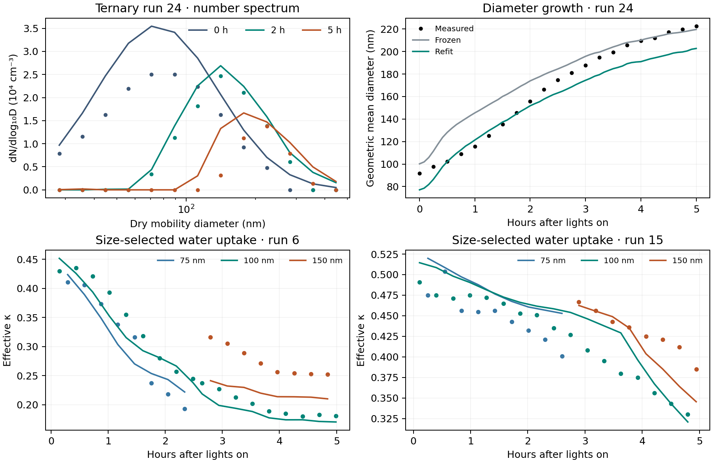
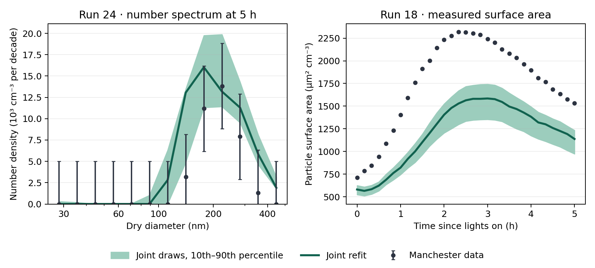

# Fitting individual particles improves the size spectrum and exposes a surface-area discrepancy

The preceding Manchester simulations followed chamber-wide chemical reservoirs, number, and a mass-equivalent radius. We repeated the 15 five-hour experiments with composition-resolved particles in a finite sample of chamber air. Each particle grows from the shared gas, undergoes condensed-phase reactions, deposits at its own size-dependent rate, and can merge with a Brownian collision partner. An optional source forms 3 nm particles from gas-phase intermediates. The 70-channel chemistry and other continuous parameters were reoptimized using automatic differentiation and full stochastic CUDA replays. [Methods and reproduction](METHODS.md)

## Measurements used for calibration

The July 30 ternary spectrum is traceable to run 24 in Manchester’s campaign, through the date on Wang et al. supplement Figure S1(a). We read 273 cells over 25–501 nm, 21 times and five hours. After excluding one mostly masked cell, 272 entered the fit. Seven archived DMPS records supplied 212 modal diameters, and run 18 supplied 31 surface-area points. We also fitted suspended mass, detector-visible particle number, and effective hygroscopicity in runs 6 and 15. We held the run 24 geometric-mean diameter line out of the loss as a check on the fitting tradeoff. That line comes from the same experiment as the spectrum. [Measurements, calibration coordinates and file hashes](size_data/README.md) · [Original figure](https://acp.copernicus.org/articles/22/4149/2022/acp-22-4149-2022-supplement.pdf#page=5)

## What changed after the refit?

Both columns below use the explicit particle model. The frozen column uses the earlier mass-calibrated chemistry, seed GSD 1.50, surface-area-weighted condensation and zero nucleation. The comparison uses 2,048 initial seed particles per run, 15 s chemistry steps and the same new stochastic realization. The search itself used smaller particle populations.

| Measurement or diagnostic | Frozen | Refit |
|---|---:|---:|
| Run 24 number-size spectrum RMSE (particles cm⁻³ per log₁₀ diameter) | 9,682 | 3,899 |
| Mean absolute error in modal diameter across seven runs | 46.2 nm | 19.1 nm |
| Run 24 geometric mean at 5 h (measured 222.5 nm) | 219.6 nm | 202.7 nm |
| Mean normalized organic-mass trajectory error across 15 runs | 9.45% | 9.05% |
| Worst normalized organic-mass trajectory error | 11.93% | 13.49% |
| Run 18 normalized surface-area trajectory error | 19.50% | 29.36% |
| Six-block calibration score, dimensionless | 0.1513 | 0.1055 |

The seed GSD moved to 1.823 and the common wall eddy coefficient to 3.786 s⁻¹ from 5.108 s⁻¹. The selected condensation allocation weights volume by 0.591 and surface area by 0.409. The fitted width changes the predicted mixture of large and small seed particles even at lights-on. Improved average agreement with the distribution coexists with a worse endpoint diameter, worse surface area and a worse worst-run organic-mass error. The best-fit vector is one compatible set; the score does not uniquely determine the elementary chemistry or a seed width for each experiment. [All 106 vector entries](results/parameters.csv) · [Parameter screening and alternative objectives](results/selection.csv) · [Replays and kernel-removal tests](results/checks.csv)

The upper-left points are heatmap readings at lights-on, 2 h and 5 h. Lines join the refit’s predictions in the same diameter intervals. The upper-right points are the separate geometric-mean line. In the bottom panels, points are archived HTDMA κ measurements at the indicated dry mobility diameters and lines are predictions from the corresponding simulated particle windows. [Pointwise spectrum](results/psd.csv.gz) · [Modal sizes](results/modes.csv.gz) · [Surface areas](results/surface.csv.gz) · [Water predictions](results/water.csv.gz)

## Which kernels and particle properties matter here?

At 1,024 seeds and a 30 s step, disabling wall deposition with all other fitted parameters held fixed raised the six-block score from 0.1077 to 0.2025. Disabling Brownian coagulation gave 0.1090, and disabling nucleation gave 0.1086. The numerical replays with altered particle count or time step gave refit scores of 0.1055–0.1115, covering both smaller changes. The selected experimental nucleation parameter was Jmax = 0.126 cm⁻³ s⁻¹, the upper scale of a concentration-dependent source. The actual rate varies with gas concentrations. These runs show sensitivity to wall deposition and do not resolve nucleation as an observed process. Manchester reported that the sulfate seed suppressed observable new-particle formation. [Original seeded experiment](https://acp.copernicus.org/articles/22/14147/2022/#section2) · [Particle births, deposits and mergers by run](results/runs.csv.gz)

We also used the same simulated particles to compare water uptake calculated from their size-selected composition with uptake calculated from bulk composition, holding the fitted organic κ fixed. Over two new realizations, selecting 100 nm particles reduced κ RMSE from 0.052 to 0.023. At 150 nm the error rose from 0.019 to 0.044. For CCN, conditioning on measured activation diameter reduced κ RMSE from 0.123 to 0.068. Size selection changes the diagnosis, while the 150 nm discrepancy remains. These are reproduction results on fitted experiments. [Matched water controls](results/water_control_scores.csv) · [Individual final particle compositions for three runs](results/particle_examples.npz)

The direct finite-time aging AD reduced its conditional objective from 0.01160 to 0.01063. In complete particle simulations, a half step toward those rates scored 0.1094, compared with 0.1098 before that update and 0.1111 for the full step. The full model selected the half step. The comparison illustrates why every chemical gradient proposal was tested against the particle calculations. [AD fit](results/aging_ad.json) · [Frozen, proposed and selected candidates](results/selection.csv)

## Which results survive joint perturbations?

We varied all 101 active parameters together around the particle-resolved refit, including the 70 chemical rates, precursor yields and doses, seed width, condensation, wall loss, nucleation and water uptake. Each of the 48 parameter sets was replayed across all 15 experiments with two particle random seeds. Compared with the earlier frozen parameters, all 48 improved the run 24 number spectrum, the seven-run modal diameter and the water-uptake score, using errors averaged across the two seeds. Mean absolute modal-diameter error had a median of 22 nm and a 10th–90th percentile range of 18–30 nm, against 46 nm for the frozen parameters. These three improvements persisted in all 12 finer-resolution replays with a new random seed. [Per-observable comparisons and ranges](results/perturbations/paired_seed_summary.csv) · [Finer replays](results/perturbations/summary.csv)

The combined score improved in 47 of 48 draws. Yet every draw had a larger average organic-mass error than the frozen case. The central refit gave 9.2% mass error, the frozen case 9.5%, and the perturbations a median of 18.2%. Restoring precursor conversion or the first 20 reaction rates to their fitted values changed mass error by a median absolute 4.7 or 4.0 percentage points, respectively. Restoring the wall eddy coefficient changed it by 0.54 points. Seed width had the largest median effect on modal-diameter error (2.3 nm). These comparisons use 12 matched parameter sets and describe sensitivity within the chosen ranges. [Parameter-group comparisons](results/perturbations/group_effects.csv) · [Sensitivity design](METHODS.md)

The shaded band shows sensitivity to the chosen parameter ranges. It spans the pointwise 10th–90th percentiles across 48 draws at one random seed. Run 24 spectrum bars show the digitization allowance. All 31 run 18 surface-area readings exceed the upper edge of the band, including the reading at lights-on. At the measured peak, Manchester recorded 2,317 µm² cm⁻³ and the ensemble spanned 1,298–1,671 µm² cm⁻³ between those percentiles. Recovering the full run 18 dry-size scans would let us check the reconstructed seed distribution and integrate number and surface area over the same instrument window before attributing this discrepancy to chemistry. [Run 18 measured and simulated surface area](results/perturbations/surface_envelope_nm2_cm3.csv)
